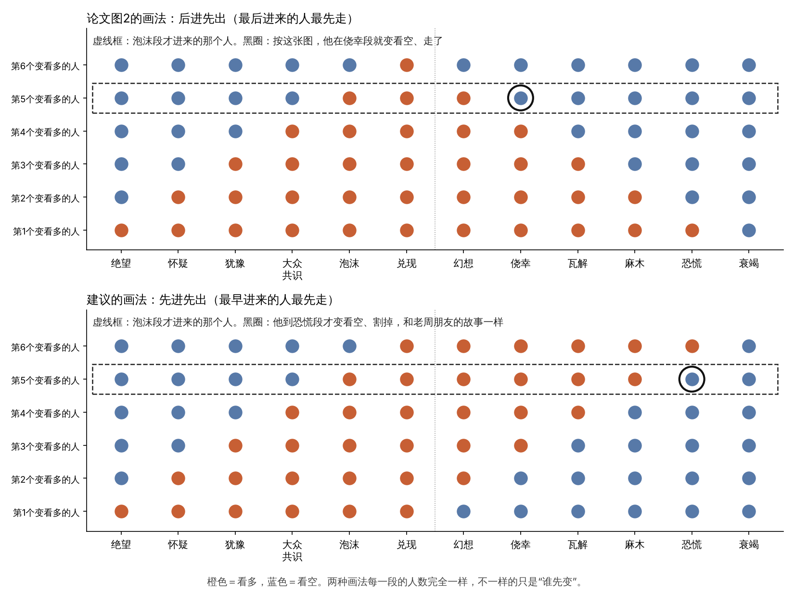

# 研究笔记三：读第二版，推理方式从哪里改

2026年11月7日

读的是《冬至理论——一个关于市场冷热循环的十二阶段模型》（洛辰justin，2026年10月），原文在 `paper/冬至理论_v2.md`。

## 第二版和第一版最大的不同

| | 第一版 | 第二版 |
| --- | --- | --- |
| 为什么会转 | 六层从里往外翻：供需、价格、利润、扩产、资金、人气 | 屋里六个人，看多的越来越多，“后来的人”用完了就转 |
| 管什么 | 一把认位置的尺子，不给买卖建议 | 每段都有“该怎么做”，外加一整套止损和纪律 |
| 怎么判断 | 看六样：价格、成交、消息反应、人气、资金、谁在卖 | 看三样：听声音、看价格、看反应；最看重“看反应” |
| 案例 | 2014–2016年真实的A股 | 虚构的药材商老周 |

我的看法：第二版的方向更对。笔记一里，数据最不支持的正是第一版的六层顺序；第二版“后来的人”这套说法，和数据对得上：新开户先见顶，融资余额后见顶。

## 发现一：图2画成了“后进先出”，正文讲的却是“先进先出”

图2里，绝望段第一个变看多的人（最下面那个点），要到衰竭段才最后一个变看空；兑现段最后一个进来的人（最上面那个点），在幻想段第一个走。这是**后进先出**。

正文讲的是另一回事：

- 兑现段：“真正在动的，是那些早早进场的人，他们在悄悄把纸面上的钱换成真金白银。”这是最早进的人先走。
- 老周：绝望段进，泡沫、兑现段出。
- 老周的朋友：泡沫段追进去，恐慌段割在低处。

这是**先进先出**。按图2的画法，泡沫段进来的人在侥幸段就该变看空走掉了，和朋友的故事对不上；按先进先出，他正好在恐慌段才割。

两种画法每一段的人数一模一样，所以表1不用改。改的是“谁先变”，而这一点很要紧。

**同样的人数，屋里是谁不一样：**

- 犹豫段（三比三）：看空的三个，是**还没进来**的人，是后面的柴。
- 瓦解段（三比三）：看空的三个，是**早就走了**的内行；还看多的三个，是后来进来、被套住的人，每次反弹都想“回本就卖”，是压在上面的砖。

这比第五节第（四）部分“光数人头不够，还得看人心往哪边走”说得更具体，也直接解释了犹豫段好消息能涨、瓦解段好消息不涨。

**第一版的六层，换个样子回来了。** 六个人不是一样的人，而是按进场早晚排出的六类人，比如：内行（产业里的人、大股东）→ 老练的投资者 → 机构 → 老股民 → 跟风的、借钱的 → 外行。最早进的最懂行，最先走；最晚进的最不懂，最后割。

**数据也是这个样子：** 大股东减持在顶部之前就出现过高峰（2021年比全市场顶早16个月，2026年早6个月）；融资余额（借钱的、偏后进场的人）7次大顶大底全都晚于价格转。

**推理上的用处：看谁在看空、谁在卖，就知道在上半圈还是下半圈。** 上半圈，看空的是还没进来的外行；下半圈，看空、在卖的是先走的内行。

## 发现二：口诀里其实是三件事，图3把两件画成了一件

引言讲得很清楚：冬至（太阳回头）和三九（最冷）是两天，太阳先回头，冷后到。可图3把“冬至·最冷”画在同一个点上，图4也把“最冷的那天”放在价格最低点、“最热的那天”放在价格最高点。

一次转折里其实有三件事，先后是：

1. **太阳回头**：后来的人进场的速度见顶（顶部），或者想卖的人卖完了（底部）；
2. **价格掉头**；
3. **感觉到头**：嘴上最一致，看多（或看空）的声音最响。

数据给的先后也是这样：新开户比价格早约4个月转；融资余额比价格晚，7次全中。

放到十二段里，我的初步对应（待讨论）：

| | ① 太阳回头 | ② 价格掉头 | ③ 感觉到头 |
| --- | --- | --- | --- |
| 顶部 | 泡沫段（门口新人最多） | 兑现段末 | 兑现到幻想 |
| 底部 | 恐慌到衰竭（卖的人卖完） | 衰竭末到绝望 | 绝望（原文：“这是最冷的那几天”） |

建议图3、图4把这三个点分开标，至少让“太阳回头”和“最热、最冷”不是同一个点。口诀和图才是一回事。

这里又牵出图2的一个小问题：正文写幻想段“群里很多人晒加仓的单子，卖掉的人被笑话”，嘴上比兑现段还热，可图2里幻想段看多的人已经从六个掉到了五个。根子在“看多”这个词同时指了两件事：**嘴上说**和**手上拿着**。兑现段嘴上全看多、手上已经有人在卖；绝望段嘴上全看空、手上已经有人在买。把这两件事分开，图2会更准。

## 发现三：“三样对得上才算”和理论自己的核心有冲突

第六节第（一）部分说：三样对得上，才算判断清楚；对不上，就是看不清，少做或不做。

可整套理论最值钱的两段，兑现和绝望，恰恰是三样各说各的：

- 兑现：声音最热，价格不听话，好消息不涨。
- 绝望：声音最冷，坏消息不跌。

在这两段，声音不是帮你认出它的信号，而是“还没转过来”的那一方。要求三样一致，就会总在下一段（幻想、怀疑）才认出来。那时候三样又对上了，可最好的时机已经过了。

建议给三样分工，不要求它们一致：

| 信号 | 它告诉你什么 |
| --- | --- |
| 听声音 | 屋里大概几成人看多（冷热程度） |
| 看价格（高低点往哪走） | 人心往哪边走（方向） |
| 看反应 | 后面还剩多少柴：还有没有后来的人、想卖的人 |

声音和反应分开的时候，不是“看不清”，恰恰是转折段的标志。

## 推理方式的一个改进版（草稿）

第六节第（二）部分已经说了，决定其实只要分五个区：

- 买：绝望、怀疑
- 拿：犹豫、大众共识
- 卖：泡沫、兑现
- 走：幻想、侥幸
- 等：瓦解、麻木、恐慌、衰竭

所以推理不用一上来就对十二段，按顺序问四个问题：

1. **方向**：高低点往上还是往下？好消息管用，还是坏消息管用？→ 上半圈还是下半圈。
2. **程度**：听声音，屋里大概几成看多？→ 偏冷还是偏热。
3. **柴**：上半圈问好消息还推不推得动，门口还有没有新人；下半圈问坏消息还砸不砸得下去，被套的人走完没有。→ 离转折远不远。
4. **顺序**：上次判断是哪一段？这次只能停在原地，或者往前一两段。往回跳、跳很远，先怀疑自己。尤其是：**没见过恐慌和衰竭，就先别认绝望。** 第七节第六条你说自己犯过的错，把下跌途中的反弹当成绝望段，这一条能挡掉大半。

然后定区，按区做事，止损兜底。

## 第二版里最强的地方

- **止损和“错了能出来”。** 判断不准也不致命，整套办法对推理出错有容错。这是第一版没有的，也是最实用的部分。
- **把“看反应”放在最重要的位置。** 它直接量的是“后来的人还剩多少”，也就是理论的核心变量。
- 每段配场景，好懂，好记。

## 值得补的

- 案例全是虚构的，是照着理论写的，所以一定对得上，说服力有限。建议把第一版的2014–2016年真实行情留一个，放在附录也行，连同对不上的地方（2015年四季度的反弹）一起写。
- 数据上最该测的是“看反应”，下一步可以用PMI公布日来测。

## 要作者回答的

1. 图2：你心里想的是先进先出，还是后进先出？
2. “看多”指嘴上说，还是手上拿着？
3. 冬至（太阳回头）和三九（最冷）在十二段里各落在哪？
4. 如果六个人按进场早晚排成六类人，你会怎么排？

图的代码：`research/six_people.py`
