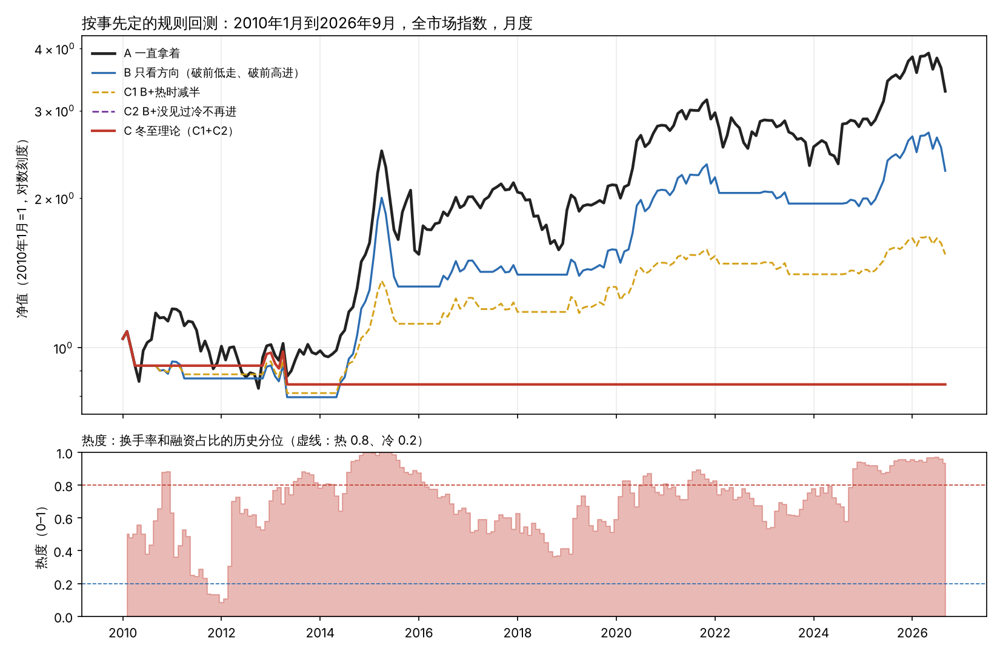

# 研究笔记四：冬至理论有没有效果

2026年11月7日

## 一、论证计划（先写下来，再跑数据）

“有没有效果”拆成四句能被数据推翻的话。每一句先写清楚理论预测什么、什么结果算推翻，再去跑。这样结论不会是看了结果再凑的。

| 编号 | 理论的说法 | 预测 | 什么结果算推翻 |
| --- | --- | --- | --- |
| H1 | 看法越一致，后来的人越少，转折越近（核心命题） | 市场最热的时候，之后6到12个月涨得少、回撤大；最冷的时候相反 | 最热和最冷之后的涨跌没有差别，或者方向反了 |
| H2 | 太阳先回头，价格再到头，感觉最后到头（口诀） | 顶部：天量早于价格顶，融资余额晚于价格顶。底部：地量早于价格底，融资余额晚于价格底 | 多数转折上先后反过来 |
| H3 | 看消息，不如看价格对消息的反应 | 同样是降准（好消息），在上半圈涨，在下半圈不涨；同样是升准（坏消息），在上半圈跌不动，在下半圈大跌 | 两个半圈的反应没有差别 |
| H4 | 照规矩做，错的时候亏得少，对的时候拿得住 | 按理论的规矩买卖，比一直拿着回撤小；而且比单纯“破前低就走”的止损更好 | 回撤不比一直拿着小，或者加上冷热判断以后不比单纯止损好 |

H4 里最要紧的是最后半句。理论里的止损（破前低就走）本身就是一种老办法，叫跟势。要证明十二段有用，得证明“看冷热、看顺序”能在单纯止损的基础上再加分，不然有效果的只是止损，不是冬至理论。

### 数据

- 全市场指数（两市总市值扣掉新股和增发），月数据，2008-01 到 2026-10
- 换手率（两市成交额 ÷ 总市值），月数据，2008 起
- 融资余额 ÷ 流通市值，2010 起
- 存款准备金率调整：58 次，2007 到 2025 年，带公布次日上证涨跌
- 沪深300、融资余额日数据，2010 起

### 规则（事先定死）

- **热度**：换手率和融资余额占比，各自在过去的历史里排第几（只用当时以前的数据），两个取平均。前20%算“热”，后20%算“冷”。
- **上半圈/下半圈**：月末价格跌破过去6个月的最低收盘价，转下半圈；突破过去6个月的最高收盘价，转上半圈。这就是论文里“破前低就走”。
- **回测的四种做法**：
  - A 一直拿着
  - B 只看方向：上半圈满仓，下半圈空仓
  - C1 B 加上“热的时候减半仓”（泡沫、兑现分批卖）
  - C2 B 加上“没见过冷，先别再进”（没见过恐慌和衰竭，先别认绝望）
  - C C1 和 C2 都加
- 每个月末看信号，下个月执行；空仓时现金不计利息；不算手续费。
- 参数（回看几个月、冷热的分界）换一圈，看结论稳不稳。

### 已知的局限

- 理论是作者经历过这些行情后写的，A股这十几年对它来说不算“没见过的数据”，检验天然偏乐观。
- 2008 到 2026 年大的顶底只有五六次，统计上能证明的东西有限。
- 月数据，指数不含分红。

---

## 二、结果：按事先定的规则

一句话：**按现在能写成规则的部分，在A股全市场2010–2026年的月数据上，看不出冬至理论有效果。** 它能让回撤变小，但丢掉的收益比省下的多。

| 编号 | 说法 | 结果 |
| --- | --- | --- |
| H1 | 最热之后涨得少，最冷之后涨得多 | **不成立**，方向还是反的 |
| H2 | 天量、地量先于价格；融资余额后于价格 | **一半**：融资余额晚于价格（日数据7次全中）；天量、地量的先后各占一半 |
| H3 | 好消息在上半圈涨、下半圈不涨 | **不成立**，方向反的，次数也少 |
| H4 | 照规矩做亏得少、拿得住，且比单纯止损好 | **亏得少成立，拿得住不成立**；理论加的两条没有在单纯止损上加分 |

### H1 热度和之后的涨跌

| 热度 | 月数 | 之后6个月 | 之后12个月 | 之后12个月最深跌幅 |
| --- | --- | --- | --- | --- |
| 冷（后20%） | 5 | −2.8% | −3.1% | −13.7% |
| 中间 | 131 | +4.0% | +9.2% | −7.6% |
| 热（前20%） | 65 | +8.9% | +16.4% | −6.2% |

热的时候，之后一年平均反而涨得最多。热度和之后12个月涨跌的相关是 +0.18，理论预测的是负的。

原因看得很清楚：2014年3月、2014年8月热度就过了80%，之后一年分别涨了97%和59%。热可以热很久。这正是论文里说的“泡沫可能比你想的长得多”，可这也意味着，**光凭“热”去卖，会卖得太早**。

### H2 拐点上的先后

用全市场月数据，按“涨跌超过25%才算一次拐点”自动找出12个顶底（2008–2024）：

| | 符合预测 | 相反 | 同月 |
| --- | --- | --- | --- |
| 顶部：天量早于价格顶 | 3 | 2 | 0 |
| 顶部：融资余额晚于价格顶 | 1 | 1 | 2 |
| 底部：地量早于价格底 | 3 | 3 | 0 |
| 底部：融资余额晚于价格底 | 3 | 1 | 1 |

月数据分辨率太粗，很多挤在同一个月。笔记一用的日数据（沪深300和融资余额，2015年以后7次顶底）是 7 比 0：融资余额全部晚于价格转。那一条是在定计划之前就看到的，不能算独立的证明，但它和这里的月数据不矛盾。

结论：**“感觉到头在价格之后”有支持；“地量在价格见底之前”没有**，2016年和2024年地量都晚了7个月。

### H3 降准、升准的次日反应

| 消息 | 半圈 | 次数 | 次日上证平均 |
| --- | --- | --- | --- |
| 降准（好消息） | 上半圈 | 9 | −0.16% |
| 降准（好消息） | 下半圈 | 17 | +0.36% |
| 升准（坏消息） | 上半圈 | 11 | −0.15% |
| 升准（坏消息） | 下半圈 | 1 | −0.90% |

好消息在下半圈反而涨得多，和预测相反（p=0.69，算不上任何结论）。升准几乎都发生在上半圈，没法比。

### H4 照规矩做的回测（2010-01 到 2026-09）

| 做法 | 年化 | 最大回撤 | 年化÷回撤 | 在场时间 |
| --- | --- | --- | --- | --- |
| A 一直拿着 | 7.4% | −38.1% | 0.19 | 100% |
| B 只看方向（破前低走、破前高进） | 5.0% | −33.7% | 0.15 | 58% |
| C1 B+热时减半 | 2.6% | −24.9% | 0.11 | 42% |
| C2 B+没见过冷不再进 | −1.0% | −21.8% | −0.05 | 5% |
| C 冬至理论（C1+C2） | −1.0% | −21.8% | −0.05 | 5% |

参数换了72组（回看3/6/9/12个月，热的分界70/80/90%，冷的分界10/20/30%，排位用全部历史或过去60个月）：

- C 的回撤比 B 小：72组里100%。
- C 的“年化÷回撤”比 B 好：只有17%。
- 没有一组做法的“年化÷回撤”比一直拿着好。

C2 和 C 几乎一直空仓，是因为按事先定的热度量法，2012年以后市场再也没“冷”过（见下图下半部分）。规则要求“见过冷才再进”，于是一直等。

## 三、事后探索（不是事先定的，结论要打折扣）

**热度量法的毛病。** 融资融券2010年才开始，2010–2015年融资余额一路增长，它的历史分位一直是1.0，永远到不了“冷”。换手率用全部历史排位，也被2019年以后成交整体变大带偏。这是事先没想到的，属于我量法的问题。

**只用换手率、在过去36或60个月里排位，重跑一遍：**

- H1 还是不成立：热之后12个月 +18.6%（36个月排位）、+10.5%（60个月），冷之后 +2.1%、+9.9%。相关 +0.23 和 0.00。
- H4：C2 能正常进出了，“年化÷回撤”在一半左右的参数下和 B 打平或略好；但仍然没有一组比一直拿着好。

**看反应能不能预测后市（降准次日的涨跌 vs 之后12个月）：**

- 上半圈里，好消息没涨的4次（2015年2月、4月、8月，2023年3月）之后12个月平均 −7.4%；涨了的5次平均 +15.7%。方向和“兑现段好消息不涨”一致，但只有9次。
- 下半圈里正好反过来：好消息没涨的8次，之后反而平均 +29%（2008年10月、12月，2018年10月，都在大底附近）。

## 四、怎么看这个结果

1. **没通过检验的，是“我能写成规则的那部分冬至理论”，不一定是你的判断。** 你实际判断时听的声音、看的消息反应，这里大多没量到。但这恰恰说明：如果它的效果只存在于人的判断里，那就得用人的判断来检验，而不是用规则。
2. **两处和数据对得上：** 融资余额晚于价格转（感觉到头在价格之后）；按规矩做回撤确实小（错的时候亏得少）。
3. **核心命题在“热”这个层面不成立。** 热不等于“后来的人用完了”。热可以持续很久，而且常常是行情刚走到一半。真正的“用完了”，按笔记三的说法，应该是**热 + 价格不听话**（声音和反应对不上），不是光热。这一条这次没测，应该作为下一个事先写定的检验。
4. **“没见过恐慌和衰竭，先别认绝望”这条规矩，代价很大。** 2012年以后A股全市场再没出现过足够冷的时候，按这条规矩会错过2014–2015年和2019–2021年的两轮大涨。这条规矩要改成“见过冷，或者等价格自己证明”，不能一直等。

## 五、更公平的检验办法

- **从现在开始记录（唯一真正没见过的数据）。** 每个月月底，你写下判断在哪一段、为什么、准备怎么做，写完就不改。一两年后拿结果来对。同时让规则版也跑着，比一比人和规则谁准。
- **换到理论的老本行。** 生猪、药材有清楚的供给周期，冬至理论本来就是从这里来的。要找到生猪价格的长期数据，需要再开一个数据网址。
- **测“背离”版本（H5，先写定再跑）。** 热度在前20%，同时价格三个月不创新高，或者好消息不涨，看之后12个月是不是明显更差。
