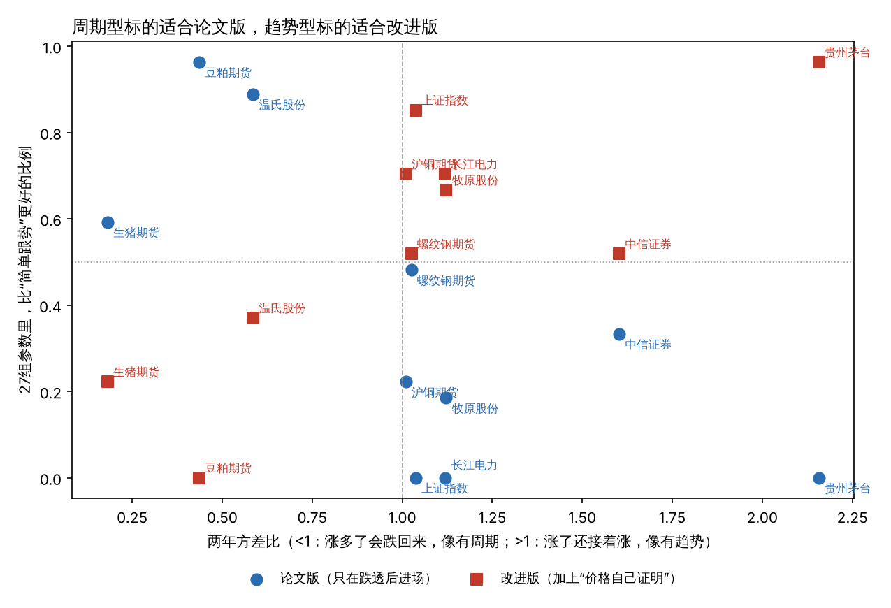
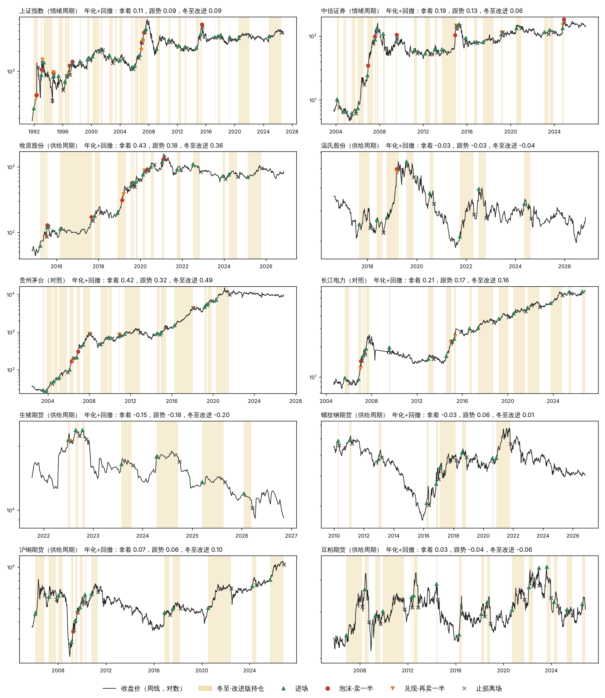

# 研究笔记五：多标的回测——什么有周期，冬至理论管不管用

2026年11月7日

## 一、计划（先写定，再跑）

### 标的（10个）

| 类别 | 标的 | 数据起点 | 为什么选它 |
| --- | --- | --- | --- |
| 供给周期（理论的老本行） | 生猪期货 | 2021-01 | 猪周期本身，但只有一圈多 |
| | 牧原股份、温氏股份 | 2014、2015 | 猪周期在股票上的样子，有成交量，历史更长 |
| | 螺纹钢、沪铜、豆粕期货 | 2009、2005、2005 | 钢铁、有色、农产品，各有供给周期 |
| 情绪周期（理论里“后来的人”） | 上证指数 | 1990-12 | A股最长的历史，经历过七八轮牛熊 |
| | 中信证券 | 2003 | “牛市旗手”，跟着人气走 |
| 对照（理论上不该有明显周期） | 贵州茅台 | 2001 | 长期一路向上 |
| | 长江电力 | 2003 | 稳定收息 |

股票用后复权价格；期货用新浪的主力连续合约（换月有跳空，长期收益会有偏差）。都折成周线，论文说“周线上看大的一轮”。

### 第一部分：什么有周期

每个标的算四样：

1. **大起大落的次数**：涨或跌超过30%算一次摆动，每十年有几次。
2. **摆动有多大**：每次摆动幅度的中位数。
3. **涨多了会不会跌回来**：一年期和两年期的方差比。小于1说明涨多了容易跌回来、跌多了容易涨回来，像有周期；大于1说明涨了还会接着涨，像有趋势。
4. **一圈多长、准不准**：相邻两个大底之间隔多久，长短差得多不多。

### 第二部分：冬至理论在每个标的上管不管用

**规则（周线，所有标的用同一套参数，不按标的调）。** 只用价格和成交量两样，因为声音和消息反应没法对每个标的都量到。

- **绝望（买第一笔，1/3仓）**：过去26周里离两年最高点跌过30%以上（跌了很久）；最近4周没有再创26周新低（坏消息不跌）；本周放量（成交是过去26周平均的1.5倍以上）并且收盘突破前4周最高价（第一次放量上涨）。止损放在26周最低价。
- **怀疑（加第二笔，到2/3仓）**：收盘创出买入以来的新高，而且最近8周的最低价高于原来的止损（低点抬高）。止损上移到最近8周最低价。
- **犹豫（主仓拿满）**：收盘在40周均线上方、40周均线向上，且已经是2/3仓满4周。止损用最近13周最低价，只往上挪。
- **大众共识（不加仓，止损收紧）**：价格高出40周均线30%以上，且13周平均成交在过去三年的前30%。止损改用最近4周最低价。
- **泡沫（卖一半）**：价格高出40周均线60%以上，或13周涨幅超过50%；且13周平均成交在过去三年的前10%（天量）。每一轮上涨只卖一次。止损改用上周最低价。
- **兑现（再卖一半）**：在大众共识或泡沫之后，某一周放量（1.5倍以上）、创26周新高、收盘却低于开盘（冲高回落）。止损放在这一周的最低价。
- **幻想、侥幸（走）**：收盘跌破止损，全部卖掉。
- **瓦解到衰竭（等）**：空仓，等下一次“绝望”。

**两个版本：**

- **论文版**：只有“绝望”能重新进场。
- **改进版**：加一条笔记四里提的“或者等价格自己证明”：收盘创52周新高，也可以进场，直接2/3仓，止损用13周最低价。

**拿来比的：**

- 一直拿着。
- 简单跟势：收盘在40周均线上方就拿着，下方就空仓（这是没有冬至理论的老办法）。

每次买卖算0.1%的成本，空仓现金不计利息。

**另外单独看信号准不准（不管仓位）：** 每次出现“绝望”“泡沫”“兑现”信号、每次“止损离场”，看之后26周、52周涨了多少，和同一个标的随便哪一周之后的涨跌比。

- 理论预测：绝望之后涨得比平常多；泡沫、兑现之后涨得比平常少、回撤更大；止损离场之后，接着跌的比平常多（走对了）。

**什么算“管用”：**

1. 信号方向对：上面四种信号，多数标的上方向和预测一致。
2. 回测上：改进版或论文版的“年化÷最大回撤”，在多数标的上比“简单跟势”好。只比一直拿着好不够，因为跟势本来就能少亏。
3. 周期越明显的标的，理论越管用。

### 已知的局限

- 期货主力连续合约换月有跳空。
- 生猪期货只有不到六年。
- 规则只用了价格和成交量，论文最看重的“消息反应”和“声音”没量到。

---

## 二、结果

一句话：**写成规则的冬至理论，在10个标的上不能稳定地胜过“站上40周均线就拿、跌破就走”这种老办法；但它在真正有周期的标的上有用，在趋势型标的上反而害人。** 所以理论缺了一个“第0步”：先分清这个东西是周期型还是趋势型。

> 实现上的一处更正：第一次跑的时候，“兑现”以后止损不再往上挪，和论文“很紧的止损，跌破就走”不符，导致茅台、长江电力一直留着四分之一仓。已改成兑现段沿用“上一周最低价”做止损。下面都是改正后的数字，改正主要影响了牧原和茅台。

### 1. 什么有周期

| 标的 | 每十年大起大落（≥30%）次数 | 摆动幅度中位数 | 一年方差比 | 两年方差比 | 大底间隔（年） | 判断 |
| --- | --- | --- | --- | --- | --- | --- |
| 生猪期货 | 8.6 | 52% | 0.49 | 0.18 | 2.0 | **最像周期**：涨多了一定跌回来，两年左右一圈（只有不到6年数据） |
| 豆粕期货 | 2.7 | 72% | 0.57 | 0.44 | 7.3 | 周期型，一圈很长 |
| 温氏股份 | 3.6 | 67% | 0.85 | 0.59 | 4.0 | 周期型 |
| 牧原股份 | 7.1 | 52% | 0.96 | 1.12 | 2.3 | 起落多，但2018–2021年那一轮涨了接着涨，介于两者之间 |
| 螺纹钢期货 | 1.7 | 68% | 0.96 | 1.03 | 6.7 | 不明显 |
| 沪铜期货 | 2.7 | 62% | 1.38 | 1.01 | 2.0 | 不明显 |
| 上证指数 | 6.1 | 56% | 1.36 | 1.04 | 1.7 | 起落很多，但一年之内越涨越涨，像**泡沫式的周期** |
| 中信证券 | 6.7 | 55% | 1.60 | 1.60 | 2.1 | 同上，更强 |
| 贵州茅台 | 3.6 | 50% | 1.78 | 2.16 | 5.2 | **趋势型**，不是周期 |
| 长江电力 | 1.7 | 41% | 1.37 | 1.12 | 3.9 | 平稳，没什么周期 |

方差比小于1，说明涨多了容易跌回来、跌多了容易涨回来；大于1，说明涨了还会接着涨。

**真正“涨多了会跌回来”的，是生猪、豆粕、温氏，也就是养猪和饲料。** A股指数和券商大起大落很多，但在一年的尺度上是“越涨越涨、越跌越跌”，周期是靠泡沫吹起来、再破掉形成的，和猪周期不是一种周期。

### 2. 信号准不准（不管仓位，只看信号之后半年）

| 信号 | 事件数 | 方向和理论一致的标的 | 合并后：之后26周比平常 | 理论预测 | 单边p |
| --- | --- | --- | --- | --- | --- |
| 绝望 | 58 | 5 / 10 | 少涨 4.8 个百分点 | 多涨 | 0.85 |
| 泡沫 | 21 | 2 / 7 | 多涨 7.0 个百分点 | 少涨 | 0.81 |
| 兑现 | 26 | **6 / 8** | 少涨 3.9 个百分点 | 少涨 | 0.31 |
| 止损离场 | 154 | 6 / 10 | 多涨 1.4 个百分点 | 少涨 | 0.72 |

- **绝望信号最不可靠。** 上证指数14次、中信证券12次“绝望”之后，半年平均是 −2.3% 和 −3.6%，平常是 +9.7% 和 +13.5%。机器犯的正是论文第七节第六条作者自己犯过的错：把下跌途中的反弹当成了绝望段。
- **泡沫之后还会接着涨。** 合并起来，泡沫信号之后半年比平常多涨。论文自己说过“它可能比你想的长得多”，数据也是这样。不过上证、牧原、中信在泡沫之后的最深跌幅比平常大。
- **兑现是最有希望的信号：** 8个标的里6个方向对，但次数少，合并起来还不显著。
- **止损离场整体没有躲开下跌。** 茅台止损17次，之后半年平均涨了31%，平常是16%；生猪期货止损7次，之后半年平均 −16.6%，平常 −4.2%，走对了。止损在趋势型标的上是成本，在周期型标的上是保护。

### 3. 回测（默认参数）

“年化÷最大回撤”（越大越好）：

| 标的 | 一直拿着 | 简单跟势 | 冬至·论文版 | 冬至·改进版 |
| --- | --- | --- | --- | --- |
| 上证指数 | 0.11 | 0.09 | −0.01 | 0.09 |
| 中信证券 | 0.19 | 0.13 | −0.01 | 0.06 |
| 牧原股份 | 0.43 | 0.18 | 0.19 | 0.36 |
| 温氏股份 | −0.03 | −0.03 | **0.20** | −0.04 |
| 贵州茅台 | 0.42 | 0.32 | 0.20 | **0.49** |
| 长江电力 | 0.21 | 0.17 | −0.05 | 0.16 |
| 生猪期货 | −0.15 | −0.18 | −0.18 | −0.20 |
| 螺纹钢期货 | −0.03 | 0.06 | −0.01 | 0.01 |
| 沪铜期货 | 0.07 | 0.06 | 0.00 | **0.10** |
| 豆粕期货 | 0.03 | −0.04 | −0.01 | −0.06 |

最大回撤，冬至两个版本在每个标的上都比一直拿着小得多。比如上证指数 −49% 对 −78%，中信证券 −47% 对 −74%，牧原 −32% 对 −62%。代价是在场时间只有一到四成，收益也低得多。

**参数换了27组**（跌透的门槛25/30/40%，均线30/40/52周，放量1.5倍改成1.3/2.0倍），比“简单跟势”更好的标的个数：

- 论文版：中位数4个（2–5个）
- 改进版：中位数6个（3–8个）

### 4. 周期性和效果



- **论文版（只在跌透以后进场）在周期型标的上好：** 豆粕27组参数里96%胜过跟势，温氏89%，生猪期货59%；在茅台、长江电力、上证指数上一次都没赢过。
- **改进版（加上“价格自己证明”）在趋势型标的上好：** 茅台96%，上证85%；在豆粕上一次都没赢过。
- 两年方差比和“胜过跟势的比例”：论文版相关 −0.69，改进版 +0.78。

每个标的的价格、持仓和信号：



## 三、对照事先定的标准

| 标准 | 结果 |
| --- | --- |
| 1. 四种信号在多数标的上方向对 | **不满足**。只有“兑现”6/8方向对，也不显著；“绝望”“泡沫”合并起来方向是反的 |
| 2. 回测在多数标的上胜过简单跟势 | **不满足**。默认参数下两个版本都只胜3个；换参数后改进版中位数6个，勉强过半 |
| 3. 周期越明显，理论越管用 | **论文版满足**（相关 −0.69）；改进版相反 |

## 四、这说明什么

1. **冬至理论的核心（等冷了再进、热了就出）只适合真正有周期的东西。** 它本来就是从猪和药材里长出来的，在养猪、饲料这类供给周期明显的标的上，规则版确实比跟势好。
2. **放到A股指数、券商、茅台这种标的上，“等跌透再进”会错过大段行情，“热了就卖”会卖早。** 这些标的的“周期”是泡沫吹大再破掉，一年之内是越涨越涨，用的时候必须加上“价格自己证明就进”。
3. **所以理论该加一个第0步：先看这个东西是哪一种。** 可以用“两年方差比”这类数字来分：小于1按周期型用（论文版），大于1按趋势型用（改进版）。这是看了数据之后才得出的，必须换一批没用过的标的再验证一次。
4. **最弱的一环是“绝望”的认法。** 只靠价格和成交，分不清真底和下跌途中的反弹。论文里认绝望最看重的“坏消息不跌”，这次没量到，补上它可能是提高最多的地方。

## 五、下一步

- **换一批没用过的标的，验证“第0步”**（先写定再跑）：玉米、白糖、棉花、鸡蛋、焦煤期货，新希望、天邦食品等养殖股。事先按方差比分好类，预测哪一版会赢，再看结果。
- **给“绝望”补上消息反应**：对生猪，可以用能繁母猪存栏、猪粮比价的公布日做“坏消息”，看价格跌不跌。
- 继续前面说的：每月记录你的手工判断，攒“没见过的数据”。

## 复现

```bash
cd research/multi
python3 fetch_multi.py   # 拉数据
python3 theory_bt.py     # 周期性、回测、信号
python3 summarize.py     # 合并检验、参数稳健性
python3 plot_multi.py    # 图
```
