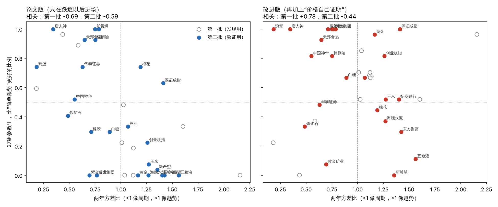

# 研究笔记六：换一批没用过的标的，验证“第0步”

2026年11月7日

## 一、计划（先写定，再跑）

### 要验证的说法

笔记五在10个标的上看到：

- **论文版**（只在跌透以后进场）在周期型标的上好；
- **改进版**（加上“价格创一年新高也进场”）在趋势型标的上好；
- 用“两年方差比”可以分类型：小于1算周期型，大于1算趋势型。

这是看了数据才发现的，可能是碰巧。这次换一批**一个都没用过的标的**，规则、参数一律照搬笔记五，不做任何调整，看这个说法还成不成立。

### 新标的（24个，事先定好）

| 类别 | 标的 |
| --- | --- |
| 农产品期货 | 玉米、白糖、棉花、鸡蛋、豆油、棕榈油 |
| 工业品期货 | 焦煤、铁矿石、沪锌、橡胶、黄金 |
| 养殖、饲料股 | 新希望、天邦食品、唐人神、海大集团 |
| 券商股 | 东方财富、华泰证券 |
| 其他股票 | 招商银行、五粮液、中国神华、紫金矿业、海螺水泥 |
| 指数 | 深证成指、创业板指 |

期货用新浪主力连续合约，股票用后复权，指数不复权。哪个下载失败就照实记下，不换别的补。

### 规则

和笔记五一模一样：周线；跌透门槛30%、40周均线、放量1.5倍；成本单边0.1%；同样的27组参数。

### 检验和标准（全部事先定下）

**检验一：关系还在不在（用全部数据算方差比）**

1. 方差比和“改进版赢过简单跟势的比例”正相关，和“论文版赢过简单跟势的比例”负相关。用打乱标的的办法算p值，**两个都要单边p<0.05**。
2. 两个版本面对面比“年化÷回撤”：方差比<1的标的，论文版应该赢；>1的，改进版应该赢。**按类型挑对版本的标的超过一半，而且二项检验单边p<0.05**，才算这个分法有用。

**检验二：能不能当规矩用（不偷看未来）**

3. 每个标的只用**前一半**数据算方差比，定下类型、选好版本，然后只看**后一半**的回测。“按类型选版本”这个做法：
   - 在多数标的上，“年化÷回撤”比简单跟势好；
   - 平均“年化÷回撤”比“全都用论文版”和“全都用改进版”都高。

**检验一的两条都满足，才算“第0步”这个说法得到验证；检验二满足，才算它能当规矩用。** 只满足一部分，就照实写一部分。

### 已知的局限

- 期货主力连续合约换月有跳空。
- 养殖股之间、券商股之间走势相关，24个标的并不是24份完全独立的证据。
- 前一半数据算出来的方差比，对短历史的标的（鸡蛋、焦煤、铁矿石大约从2013年开始）误差会比较大。

---

## 二、结果

24个标的全部下载成功。规则、参数和笔记五完全一样，没有调。

一句话：**“第0步”只验证了一半。** “等跌透再进只适合周期型标的”这一半，换了一批标的还成立；“趋势型改用改进版”这一半没成立，因为改进版在周期型标的上也不差。所以实用的结论比原来的说法更简单：**直接用改进版，不用先分类型；论文版的“只等跌透”不要单独用在趋势型标的上。**

### 检验一：关系还在不在

| 标准 | 第一批（发现用） | 第二批（验证用） | 是否满足 |
| --- | --- | --- | --- |
| 方差比和“论文版赢过跟势的比例”负相关 | −0.69 | **−0.59，单边p=0.001** | 满足 |
| 方差比和“改进版赢过跟势的比例”正相关 | +0.78 | **−0.44**（方向反了） | 不满足 |
| 按类型挑版本，面对面挑对的比例 | — | 15/24，单边p=0.15 | 不满足 |



左图：两批标的都是同一个样子，越往右（越像趋势），论文版越赢不了跟势。右图：第二批里，改进版在左边（周期型）一样能赢，所以“趋势型才用改进版”这个分法没有必要。

### 检验二：前一半定类型、只看后一半

| 做法（后一半） | “年化÷回撤”平均 | 中位数 | 赢过简单跟势的标的 |
| --- | --- | --- | --- |
| 按类型选版本 | 0.087 | 0.056 | 15/24 |
| 全用改进版 | **0.111** | **0.067** | 14/24 |
| 全用论文版 | 0.032 | 0.001 | — |
| 简单跟势 | 0.072 | 0.036 | — |

按类型选版本赢过跟势的有15个，过半；平均也比全用论文版高。但它不如“全用改进版”。所以这条也**不满足**：分类型这一步没有带来额外的好处。

前一半和全样本分出来的类型，88%是一致的，说明类型本身比较稳定，问题不在分错了类。

### 事后统计（不是事先定的，结论要打折扣）

两批34个标的合在一起，看“在27组参数里过半赢过跟势”的标的数：

| | 周期型（方差比<1，16个） | 趋势型（方差比≥1，18个） |
| --- | --- | --- |
| 论文版 | 11 | **2** |
| 改进版 | 10 | 13 |

- 论文版在趋势型标的上几乎从不赢：18个里只有2个。
- 改进版两种标的上都过半，34个里23个赢过跟势（二项检验单边p=0.03）。
- 回撤：第二批24个标的，改进版的最大回撤全部小于一直拿着。中位数是 −38%，一直拿着 −67%，简单跟势 −53%。

## 三、对冬至理论意味着什么

1. **“等冷了再进”这条核心规矩，有明确的适用范围。** 两批、34个标的、两次独立的检验都一样：在涨多了会跌回来的东西上（养猪股、鸡蛋、焦煤、沪锌、棕榈油、豆粕），它比跟势好；在越涨越涨的东西上（茅台、五粮液、招商银行、东方财富、黄金），它几乎从不赢。论文里应该把这一点写明白。
2. **“价格自己证明就进”应该写进理论，而且对所有标的都加。** 它补上了论文版最大的漏洞：没等到冷就一直不进场。加上它以后，规则版在三分之二的标的上赢过跟势。这是事后看到的，还需要再验证一次。
3. **分类型这一步可以省掉。** 原来想的是“周期型用论文版、趋势型用改进版”，可改进版本身就包含了论文版的“绝望进场”，在周期型标的上并不吃亏。

## 四、能不能就此说冬至理论有效

还不能。

- 能说的：**冬至理论加上“价格自己证明”以后，写成规则，在34个标的里大约三分之二能比简单跟势好一点，回撤普遍小得多。** 这是到目前为止最有利于理论的证据。
- 不能说的：它比一直拿着好（多数标的上不是）；十二段每一段都认得准（“绝望”“泡沫”信号单独看并不准，见笔记五）；论文最看重的“消息反应”有用（还没测）。

## 五、建议下一步

- 把“价格自己证明”写进论文第六节，作为认“绝望”以外的第二个进场办法。
- 第三批验证（先写定再跑）：只检验一句话，“改进版比简单跟势好”，换海外市场或更多A股行业，看三分之二这个比例站不站得住。
- 给“绝望”补上消息反应，这是最弱、也最可能提高的一环。

## 复现

```bash
cd research/multi
python3 fetch_batch2.py
python3 batch2_validate.py
python3 batch2_plot.py
```
