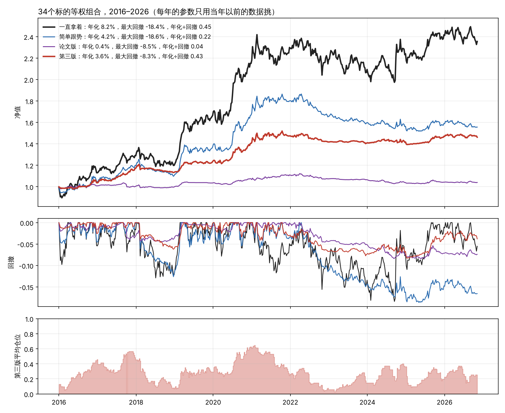

# 研究笔记七：第三版方法，盖住未来的回测

2026年11月7日

## 一、计划（先写定，再跑）

### 为什么要“盖住未来”

前面几轮回测，参数是固定的，但“30%算跌透”“40周均线”“0.8这条线”这些数，都是在看过2008–2026年全部行情以后才定、才挑的。这等于考试前看过答案。

这一次，**每一年要用的规矩，只能用那一年之前的数据来定**。站在2016年初，只用2016年以前的数据挑参数，然后去跑2016年；站在2017年初，只用2017年以前的数据重新挑一次，再跑2017年……一直到2026年。最后只看2016–2026年这十一年“现挑现用”的结果。这叫滚动向前检验。

所有信号也只用当周和以前的数据：周五收盘看信号，下周一开盘执行。

### 第三版规矩（周线）

**第0步，判断类型（只用过去的数据）。** 每年第一周，用这之前的全部周线算两年方差比。小于分界线算周期型，否则按趋势型对待。历史不满6年的，一律按趋势型对待。

**进场，两种：**

- **绝望**（1/3仓）：和以前一样（跌透、不再创新低、放量突破），再加一条顺序要求：**过去52周里出现过“恐慌”周**，也就是这一周的跌幅排在过去三年最差的5%以内，而且放量。止损放在26周最低价。
- **价格自己证明**（2/3仓）：收盘创52周新高。止损放在13周最低价。所有类型都用。

**加仓、拿住：** 和以前一样（怀疑加到2/3，犹豫拿满，大众共识收紧止损）。

**热了以后，按类型分开：**

- 周期型：泡沫卖一半，兑现再卖一半，止损跟紧到上一周最低价（和以前一样）。
- 趋势型：泡沫**不卖**，止损收紧到4周最低价，交给止损；兑现卖一半，止损跟紧到上一周最低价。

**离场：** 收盘跌破止损就全部卖掉。

### 每年要挑的东西（只用当年以前的数据）

| 做法 | 每年从这些里挑 |
| --- | --- |
| 第三版 | 跌透门槛 25/30/40%，均线 30/40/52 周，放量 1.3/1.5/2.0 倍，类型分界线 0.8/1.0/1.2，共81种 |
| 论文版（拿来比） | 前三项，共27种 |
| 简单跟势（拿来比） | 均线 30/40/52 周 |
| 一直拿着（拿来比） | 不用挑 |

挑法：在34个标的上，各算一遍到那一年为止的“年化÷最大回撤”，取所有标的的中位数，中位数最高的那一种就是这一年要用的。所有标的用同一套，不给单个标的开小灶。

### 标的

笔记五、六用过的全部34个。

### 怎么算“有效”（2016–2026年）

1. 第三版的“年化÷最大回撤”，在过半的标的上比简单跟势好。
2. 第三版的最大回撤，在过半的标的上比一直拿着小。
3. 34个标的等权组合起来（每周平均分配），第三版组合的“年化÷最大回撤”比简单跟势组合、一直拿着组合都高。

三条都满足，才算第三版在“盖住未来”的条件下有效。

### 盖不住的东西

- 第三版的**设计思路**（加“价格自己证明”、分类型）是看了全部历史以后才想到的。滚动检验只能盖住参数，盖不住这一层。唯一完全干净的检验，是从今天开始往后记录。
- 34个标的里有不少是同一类，比如养殖股之间、券商股之间，彼此不是完全独立的证据。
- 期货用主力连续合约，换月有跳空。

---

## 二、结果（2016–2026，每年的参数只用当年以前的数据挑）

一句话：**事先定的三条标准满足了两条。** 第三版明显好过论文版和简单跟势，回撤小得多；但在“年化÷回撤”上，和一直拿着只是打平，没有超过。

### 每年挑出来的参数

| 年份 | 简单跟势（均线） | 论文版（跌透、均线、放量） | 第三版（跌透、均线、放量、类型分界线） |
| --- | --- | --- | --- |
| 2016 | 30 | 40%、52、1.3 | 30%、30、2.0、**0.8** |
| 2017 | 52 | 40%、30、1.5 | 40%、30、2.0、**0.8** |
| 2018 | 30 | 40%、52、1.3 | 40%、40、1.3、**0.8** |
| 2019 | 30 | 40%、52、1.3 | 40%、40、1.3、**0.8** |
| 2020 | 30 | 25%、40、1.5 | 25%、40、2.0、**0.8** |
| 2021–2025 | 30或52 | 25%或40%、40或52、1.3或1.5 | 30%、30、2.0、**0.8** |
| 2026 | 30 | 25%、52、1.3 | 30%、40、2.0、1.2 |

类型分界线 0.8，在11年里有10年被选中，而且站在2016年初、只用2016年以前的数据，选出来的就是0.8。这说明0.8不完全是事后凑出来的。不过0.8、1.0、1.2这几个候选，是看过全部数据以后定的，这一层盖不住。

### 三条标准

| 标准 | 结果 | 是否满足 |
| --- | --- | --- |
| 1. 第三版在过半标的上“年化÷回撤”胜过简单跟势 | 20/34（二项检验单边p=0.20） | 满足（过半，但统计上不算强） |
| 2. 第三版在过半标的上最大回撤小于一直拿着 | **30/34** | 满足 |
| 3. 等权组合的“年化÷回撤”高于简单跟势和一直拿着 | 第三版0.43，简单跟势0.22，一直拿着**0.45** | 不满足：比跟势高，比一直拿着略低 |

### 34个标的等权组合

| 做法 | 年化 | 最大回撤 | 年化÷回撤 | 平均仓位 |
| --- | --- | --- | --- | --- |
| 一直拿着 | 8.2% | −18.4% | 0.45 | 100% |
| 简单跟势 | 4.2% | −18.6% | 0.22 | 54% |
| 论文版 | 0.4% | −8.5% | 0.04 | 11% |
| **第三版** | 3.6% | **−8.3%** | 0.43 | 28% |



- **第三版比论文版好得多。** 论文版在“盖住未来”的条件下几乎不赚钱（年化0.4%），因为大部分时间在等“冷”，平均只用了一成的钱。
- **第三版比简单跟势好：** 少赚一点，但回撤小了一半多。
- **和一直拿着比：** 赚得不到一半，回撤也不到一半，“年化÷回撤”基本打平。平均只用了不到三成的钱。

### 单个标的里差别最大的

- 第三版明显更好：天邦食品（0.49，一直拿着 −0.07）、海大集团（0.57 对 0.22）、白糖、玉米、深证成指、创业板指。
- 第三版明显更差：长江电力（0.10 对 0.67）、紫金矿业（0.10 对 0.54）、中信证券、铁矿石。这几个是这十一年里一路上涨、回撤不大的，止损一次就容易下车。

### 事后补充（不是事先定的）：闲钱算利息

回测里空仓的钱不计利息。可第三版平均有七成多的钱闲着，实际上可以放货币基金。按每年2%算：

| 做法 | 年化 | 最大回撤 | 年化÷回撤 |
| --- | --- | --- | --- |
| 一直拿着 | 8.2% | −18.4% | 0.45 |
| 简单跟势 | 5.1% | −15.8% | 0.32 |
| 论文版 | 2.1% | −4.4% | 0.49 |
| **第三版** | 5.0% | **−5.1%** | **1.00** |

算上利息，第三版的“年化÷回撤”是一直拿着的两倍多。这一条是事后加的，不能拿来改写上面的结论，但它说明：**第三版在标准3上输，很大程度上是因为闲钱没算钱。**

## 三、结论

1. **在“盖住未来”的条件下，第三版是一个有效的“少亏钱”办法。** 34个标的里30个回撤比一直拿着小；组合的最大回撤从 −18% 降到 −8%。
2. **它不是一个“多赚钱”的办法。** 组合年化3.6%，一直拿着是8.2%。按事先定的标准，风险调整后只是和一直拿着打平。
3. **论文原版需要改。** 不改的话，在没见过的数据上几乎不赚钱。加上“价格自己证明”和“分类型处理热了以后”这两条，效果差别很大。
4. **在一路上涨、回撤不大的标的上，第三版会吃亏。** 长江电力、紫金矿业这类，止损一次就容易下车，错过后面的上涨。

## 四、还盖不住、还没测的

- 第三版的设计思路是看过全部历史以后才有的。唯一完全干净的检验，是从现在开始往后记录。
- 论文最看重的“消息反应”和“听声音”还没测。
- 34个标的不是34份完全独立的证据。

## 复现

```bash
cd research/multi
python3 v3_walkforward.py   # 约十几分钟
python3 v3_plot.py
```
