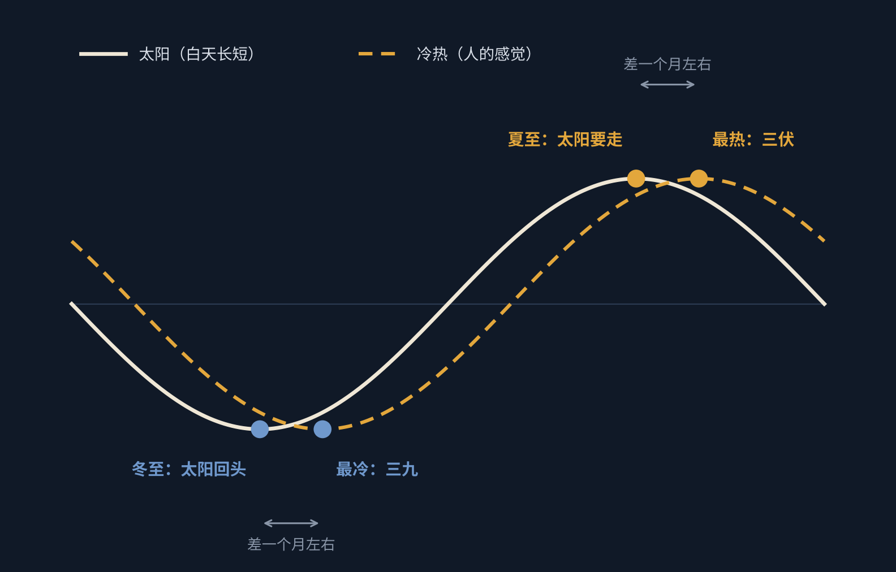
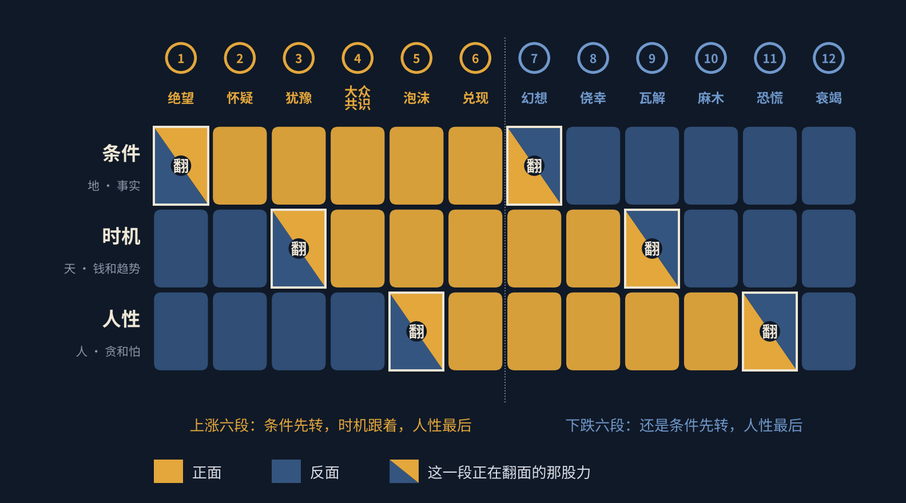
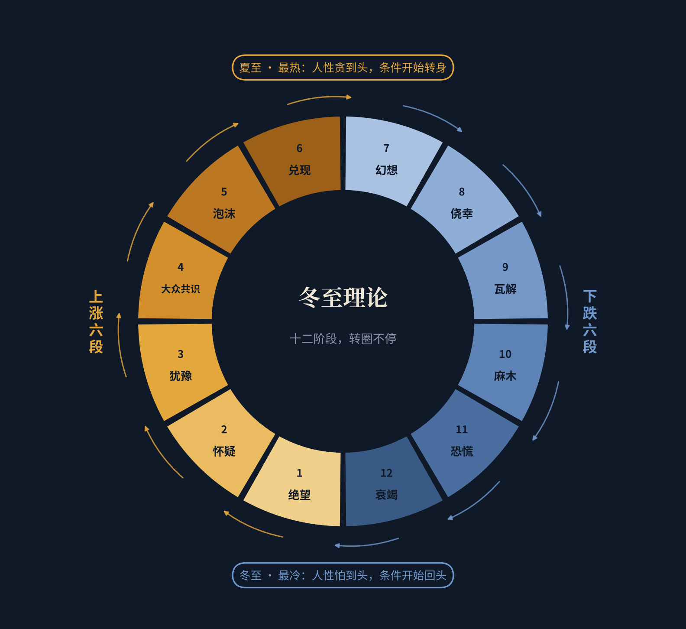
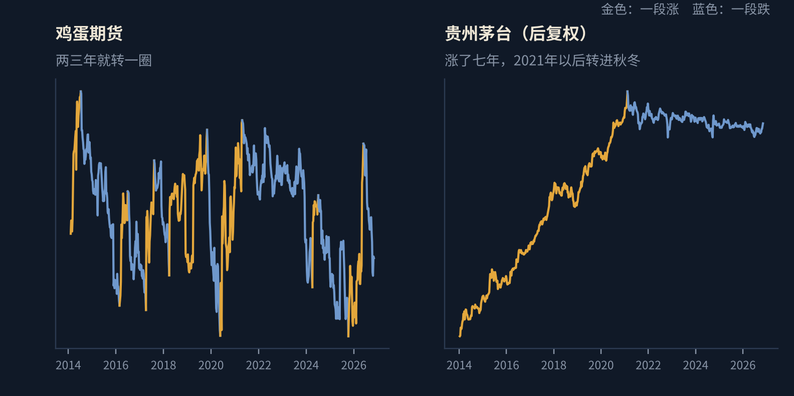
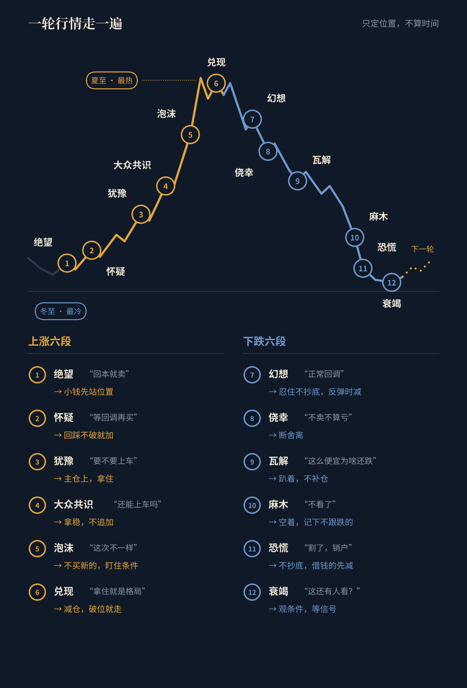
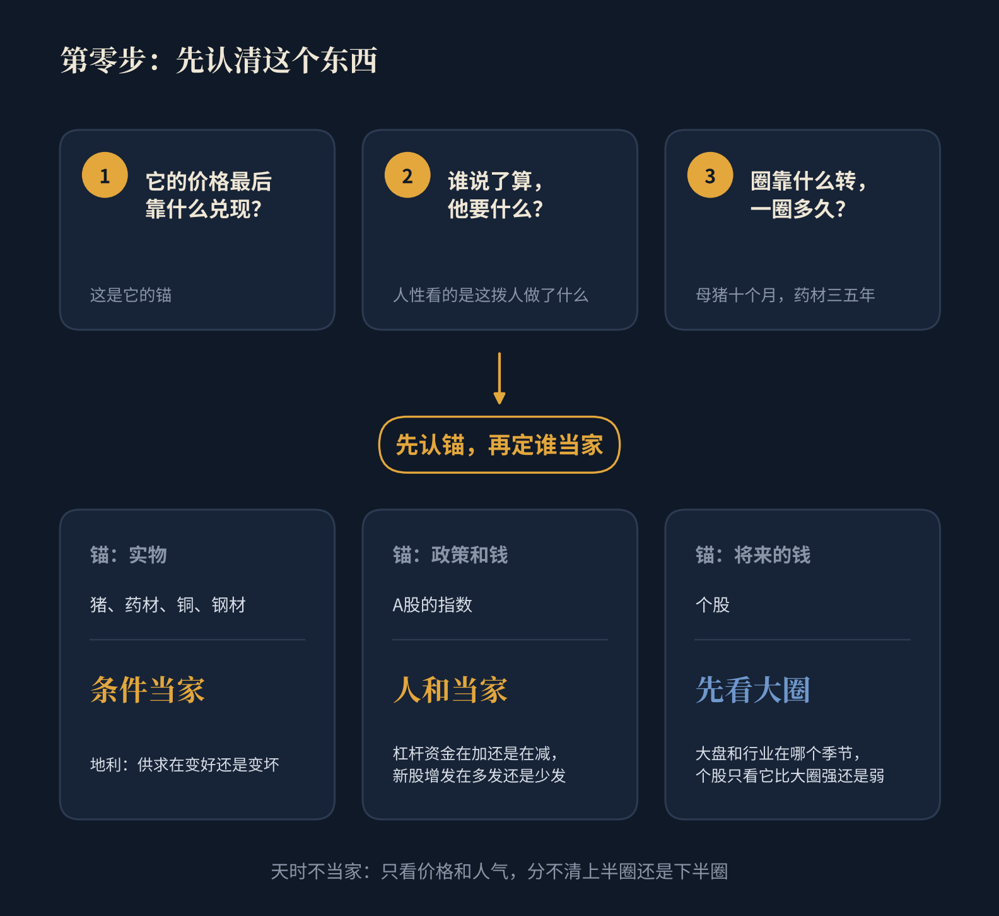
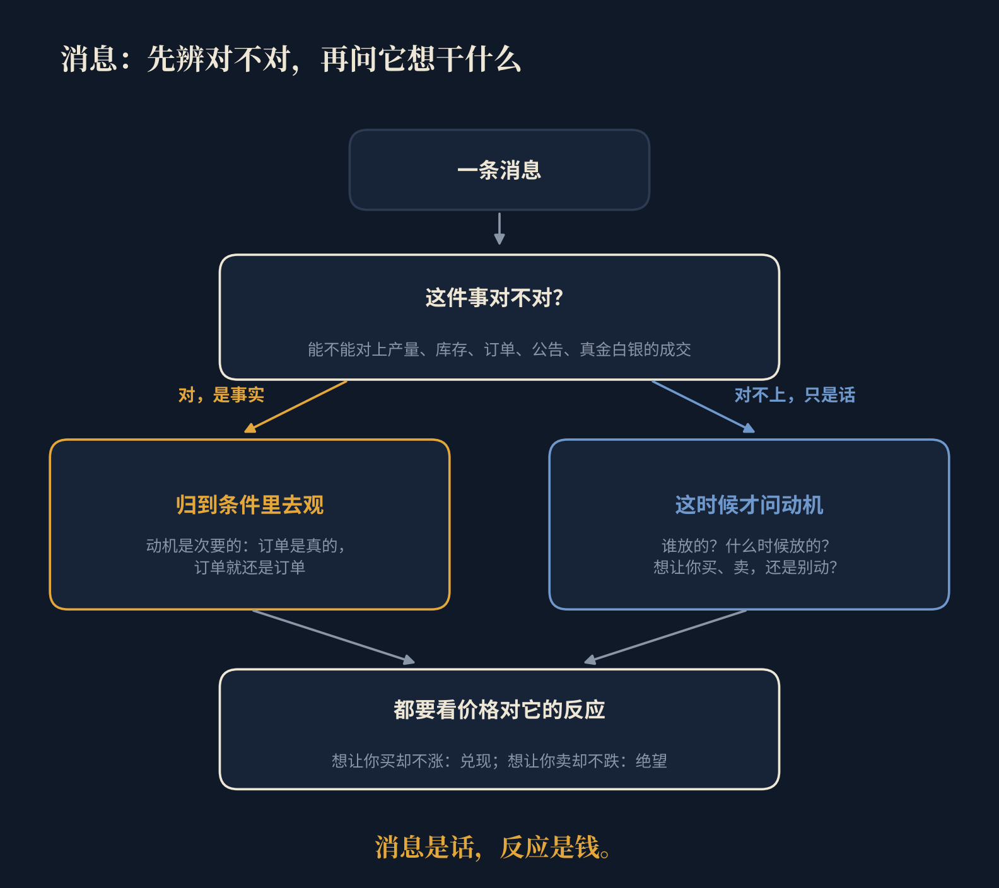
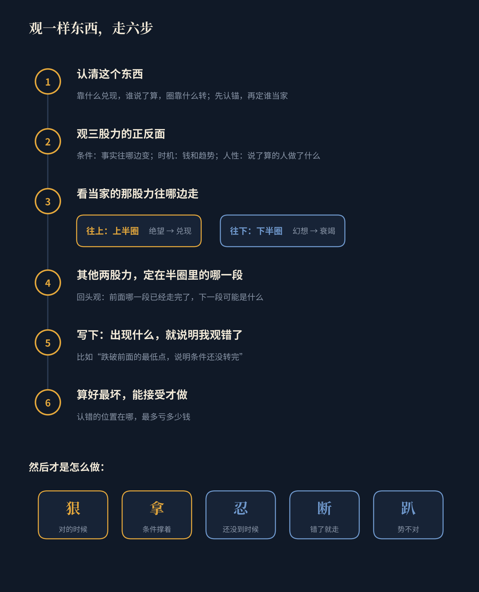
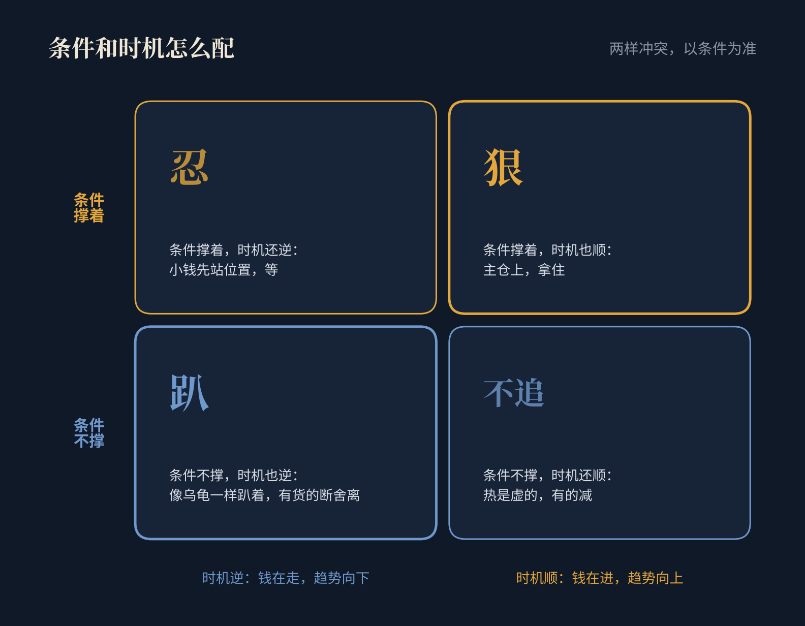
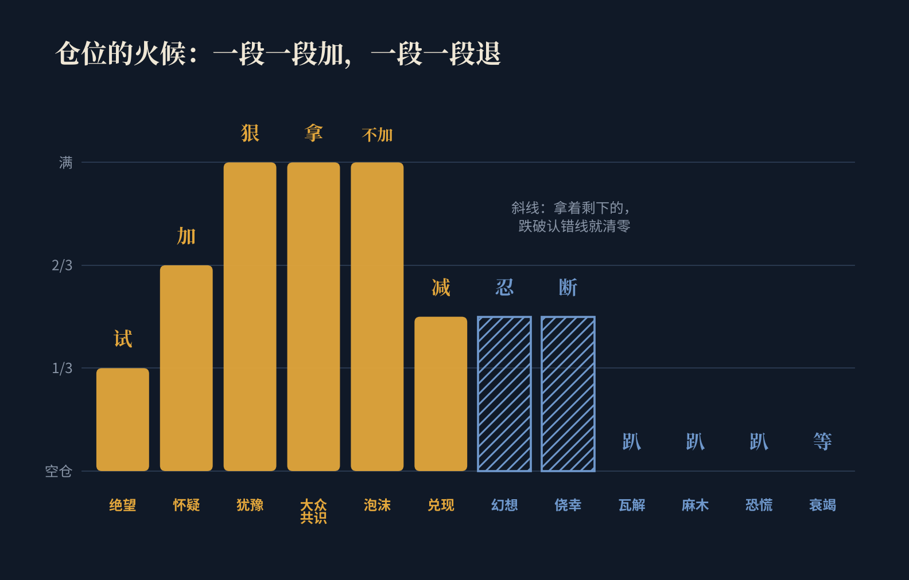

# 冬至理论

一个关于市场冷热循环的十二阶段模型

JustinTang洛辰　二〇二六年十一月

> **摘要**　做买卖的人都见过这样的事：行情最差、人人想跑的时候，价格却不再往下走了；行情最火、人人想买的时候，价格却涨不动了。本文把这件事概括成一句口诀：“最冷的那天，太阳已经回头；最热的那天，太阳已经要走。”冷和热，只是价格给人的感觉，真正决定方向的是条件。本文把推着行情走的力量分成三股：时机，也就是人气、钱和趋势；条件，也就是事实；人性，也就是贪和怕。每一股都有正反两面，合起来就是屋里的六个人。六股力一股一股翻到正面，是上涨的六段：绝望、怀疑、犹豫、大众共识、泡沫、兑现；再按同样的顺序一股一股翻到反面，是下跌的六段：幻想、侥幸、瓦解、麻木、恐慌、衰竭。条件最先转，时机跟着转，人性最后走到头；人性走到头的那一天，条件已经转身了。判断之前先认清这个东西：价格最后靠什么兑现，谁说了算，圈靠什么转；先认锚，再定三股力里谁当家。文章讲怎么用“观”去判断阶段，怎么分辨对和错，怎么看穿消息，怎么做选择。市场只有一个方向，不是做多，也不是做空，而是做对：对的时候狠，错的时候忍，该断就断。

**关键词**　冬至理论；市场周期；条件；时机；人性；观；做对

## 一、引言

### （一）研究缘起：从冬至说起

小时候在老家，每年冬至家里要包饺子。奶奶总念叨一句：“冬至一过，白天就一天比一天长了。”我那时候不信。冬至过后明明更冷，水缸结冰，手上长冻疮。“三九四九冰上走”，最冷的三九天，是在冬至之后半个多月才来的。

长大才弄明白，两件事都是真的。冬至那天白天最短，太阳从那天起就往回走了。可地面攒了一冬的冷还没散完，气温还要往下掉一阵。太阳先回头，冷后到。等你冻得最难受的那天，太阳其实已经回头好些日子了。夏至也一样。白天最长的是夏至，最热的是三伏，三伏在夏至后头。你热得最受不了的时候，太阳已经开始往南走了。

**图1**　太阳与气温的时间差。实线是白天的长短，虚线是人感觉到的冷热。两条线的低点和高点都差着一段日子，这段时间差，就是冬至理论的来历。

后来我做买卖，中药材做过，生猪行情跟过，股票也炒了很多年。做得越久，越觉得市场就是这个脾气。行情最差、身边人都在骂的时候，价格往往已经不怎么跌了。行情最火、菜市场卖菜的大姐都在问代码的时候，价格往往已经涨不动了。我把这件事总结成一句话，就是这套理论的口诀：

> **最冷的那天，太阳已经回头；**  
> **最热的那天，太阳已经要走。**  

这句话我自己用了很多年，也吃过不照它做的亏。这篇东西想把它从一句口诀，整理成一套能拿来用的办法。我叫它《冬至理论》。

### （二）本文要回答的问题

这篇东西想说清楚五件事。一是行情为什么会一圈一圈地转，涨完了跌，跌完了又涨。二是这一圈怎么分段，怎么判断现在走到了哪一段。三是怎么分辨对和错。四是满天飞的消息该怎么看。五是判断出来以后，怎么做选择。

先把话说在前头，这不是一套算命的办法。它不告诉你明天涨多少，也不告诉你哪天见底。它帮你回答的是：现在大概是什么季节，推着它走的那几股力走到哪一步了。

我也不想把它写成一套只教人躲的办法。躲是躲不出钱来的。市场只有一个方向，不是做多，也不是做空，而是做对。看对了，就要敢下手、敢拿住；看错了，就要忍得住、断得了。势对了，像老虎一样扑上去；势不对，像乌龟一样趴着别动。

## 二、核心命题

### （一）口诀的三层意思

“最冷的那天，太阳已经回头”，说的是坏到头的时候。大家最怕、最不想看的时候，人性里的怕已经走到了头；可这时候，事实往往已经不再变坏了：该减的产减了，该出的利空出了，库存不再往上堆。太阳回头，说的就是条件转身了，只是人的感觉还没跟上。

“最热的那天，太阳已经要走”，说的是好到头的时候。大家最兴奋、最舍不得卖的时候，人性里的贪已经走到了头；可这时候，事实往往已经不再变好了：涨价引来的产能开始出货，赚钱的速度开始慢下来。太阳要走，说的也是条件转身了，只是人还泡在热乎劲里。

两句合在一起，是第三层意思：**冷和热，只是价格给人的感觉。热是为了冷，冷是为了热。** 热到头的那一天，就是冷开始的那一天；冷到头的那一天，就是热开始的那一天。所以不管冷热，做决定都要以条件为准：**条件撑着，再冷也是暂时的；条件不撑了，再热也是虚的。**

### （二）屋里的六个人

为了好懂，我常打一个比方。整个市场是一间屋子，屋里坐着六个人。

这六个人不是六种人，是推着行情走的三股力，每一股力都有正反两面。

老话讲天时、地利、人和。放到行情里，我把它改成三样：

- **天，是时机。** 人气、钱和趋势。多少人在谈它，钱在往里进还是往外走，价格的高点低点往哪边走。正面是人气在聚、钱在进、趋势向上；反面是人气在散、钱在走、趋势向下。

- **地，是条件。** 也就是事实。东西够不够，供给在增还是在减，库存在涨还是在降，公司赚钱越来越多还是越来越少，政策在帮还是在压。正面是事实在往好里变，反面是事实在往坏里变。看条件，看的是它往哪边变，不是它眼下好不好。

- **人，是人性。** 就是贪和怕。正面是贪：怕买少了，觉得这次不一样；反面是怕：怕亏，割了不玩了。这里的人性，说的是这个东西里**说了算的那拨人**的贪和怕，看的是他们做了什么，也可以叫取舍：养猪的人在补栏还是在淘汰母猪，大股东在增持还是在减持，借钱炒股的人在加杠杆还是在还钱。不是外面看热闹的人嘴上说什么，也不是你自己心里怎么想。

三股力，每股两面，就是屋里的六个人。

上涨的时候，这六个人一个一个站到涨的那边去；下跌的时候，再按同样的顺序，一个一个站到跌的那边去。谁先站过去？**条件先，时机跟着，人性最后。** 地先动，天跟上，人最后才回过神来。

**图2**　屋里的六个人：三股力的正反面。金色是正面，蓝色是反面。每一段只有一股力在翻面：上涨时条件先翻到正面，时机跟着，人性最后；下跌时还是这个顺序，一股一股翻到反面。

### （三）核心命题：正面走完了，就走反面

这就是冬至理论的核心命题：

> **正面走完了，就走反面；**  
> **反面走完了，就走正面。**  

一轮上涨，不是因为有谁在推，而是条件、时机、人性的正面一层一层地走，走完了，没有可走的了，就转到反面。下跌也一样。很多人总想找一个“见顶的原因”“见底的原因”，其实最大的原因就是：该走的都走完了。

三股力里，条件最先转，人性最后走到头。**人性走到头的那一天，条件已经转身了。** 这就是口诀说的：最热的那天，太阳已经要走；最冷的那天，太阳已经回头。

所以任何时候，都以条件为准。时机会晃人，人性更会骗人，条件是最后的那块地。**以条件为准，没有偏好，才更接近真理。**

不过“地”是哪一块，要先认锚。价格最后靠实物兑现的东西，比如猪、药材、铜、钢材，地就是供求，条件当家；价格靠政策和钱撑着的东西，比如A股的指数，说了算的是杠杆资金和发行节奏，人和当家。不管哪一种，天时都不当家：只看价格和人气去判断方向，和抛硬币差不多。这一点第四节第二条细讲。

### （四）一年四季，转圈不停

一圈分十二段，上涨六段，下跌六段。上涨是绝望、怀疑、犹豫、大众共识、泡沫、兑现；下跌是幻想、侥幸、瓦解、麻木、恐慌、衰竭。衰竭之后又回到绝望，开始下一圈。

**图3**　冬至理论十二阶段循环图。左半圈暖色是上涨六阶段，右半圈冷色是下跌六阶段，顺着箭头转。最下面是冬至，人性怕到了头，条件开始回头；最上面是夏至，人性贪到了头，条件开始转身。

就像一年四季，冬天过了是春天，夏天过了是秋天，谁也没法让它一直停在夏天。每一圈长短不一样，有的几个月，有的好几年；每一段的长短也不一样。但顺序很少乱。这一点是整套理论最看重的：**不知道要多久，但大致知道下一步是什么。**

### （五）每样东西都有冬天，只是圈的大小不一样

任何东西都有它的冬天。没有冬天，就不成规律。区别只在于，有的冬天来得早，有的来得晚；有的圈小，有的圈大。

圈有多大，看推着它转的是什么。生猪大概四年左右一轮，推着它的是供求：猪价好了大家多养，一年多以后猪多了，价钱就下来；亏到养不下去，大家少养，过一阵猪少了，价钱又上去。药材也差不多，推着它的是种植和库存，有的品种种下去好几年才能收，圈就更长。一家公司，推着它的是盈利，只要它赚的钱还一年比一年多，它的条件就一直站在正面，冬天就还没到。整个经济的圈更大，有人算过大概五十年左右一个大轮回，推着它的是一轮一轮的新技术。

所以像茅台这样的股票，这些年看着像没有冬天，其实是它的条件、时机、人性还没走完一圈，盈利是它最大的条件。它的冬天会来，只是来得晚。特别有周期性的东西，比如猪、鸡蛋，冬天来得勤，看得也清楚；圈大的东西，冬天来得慢。

还有一句要说死：**冬天之后一定有春天。没有春天的，不是冬天，是死了。** 胶卷死了，拍照这件事的春天给了数码；一个被淘汰的品种、一家退市的公司，它的冬天就是终点。所以在等春天之前，先问一句：它还会有新的东西吗？需要它的人还在不在？条件永远不回头的，不是在过冬，是在死，别等它的春天。

这里有个很实在的坑：**在一个大圈的夏天里死等冬天，可能一等就是好多年。** 所以判断阶段之前，先要认清这个东西的圈：它靠什么转，一圈大概多长，现在走到了大圈的哪里。

**图4**　圈的大小不一样。左边是鸡蛋期货，两三年就转一圈；右边是贵州茅台，涨了七年，2021年以后才转进它的秋冬。金色是一段涨，蓝色是一段跌；鸡蛋按涨跌两成半算一段，茅台按四成算。纵轴是对数刻度。

## 三、市场周期的十二阶段模型

下面一段一段讲。每段讲四件事：这一段是哪一股力在翻面，这时候大家心里怎么想、价格是什么样子，怎么认出来，该怎么做。每段后面配一个交易场景，品种是大家熟悉的中药材、生猪和股票。场景都是照着常见的情形写的，不对应哪一个真实的品种或者公司，也不讲具体价格。

**图5**　一轮行情走一遍（示意）。一轮完整的涨跌，大致是这个样子。引号里是每一段大家最常说的话，箭头后面是这一段该怎么做。图里各段画得差不多宽，只是为了好看，真实行情里每一段的长短差得很远。

### （一）上涨六阶段

#### 阶段一　绝望　涨了没人信

◆ 条件的反面走完了。时机、人性还全在反面。

这是最冷的那几天。外面几乎听不到好话，有也没人信。新闻还在报坏消息，标题是“底到底在哪里”。之前喊过底的人被打过好几回脸，现在谁也不敢喊了。群里冷冷清清，偶尔涨一天，马上有人说“又来骗人了”。套着的人心里只有一句话：回本就卖。

可条件这边，事情已经在变了。该减的产减了，该砍的砍了，坏消息照样出来，价格却不再创新低。第一次放量涨了一下，回落的时候没有跌破前面的最低点。这就是太阳回头了，只是还没人觉得暖和。

**怎么认？**坏消息砸不动了，涨了没人信。最要紧的是观条件：事实是不是已经不再变坏。

这一段最容易认错。下跌途中的每一次反弹，都长得像绝望段，光看价格去认，错的比对的多。分辨的办法只有一个：观条件。条件还在往坏里变，那只是反弹；条件不再变坏了，才是绝望。

**该怎么做？**条件刚转，时机和人性还在反面，这时候用小钱先站个位置，或者干脆只观不动。认错的地方就是前面那个最低点：跌破了，说明条件还没转完，认了就走。

> **交易场景**
>
> 某个根茎类药材，价格跌了很久。前一阵有几个借钱囤货的大户撑不住，低价甩了一批货，那几天报价跌得最狠。后来药农说明年不种了，药商仓库里压着货，没人问价。有一阵市场上又传“库存还多得很”，往年这种话一出，报价马上往下掉，这回只是松了一下，没有跌破前面的最低价。过了些日子，有药厂来问货，报价小涨了一截，同行都说“炒作，别信”。按冬至理论看，库存多的坏消息砸不动了，药农也在减种，条件的反面走完了，像是绝望段。做法是先收一小批货，记下前面那个最低价。要是后来报价跌破了它，说明判断错了，这批货认赔出掉，亏的也只是一点小钱。

#### 阶段二　怀疑　想等回调的人等不到

◆ 条件的正面出来了。时机、人性还在反面。

事实开始往好里变了：需求起来一点，库存往下走一点。低点一个比一个高，可主流的声音还是不信：“反弹而已”“涨到前面套人的位置就要下来”。很多人说等回调再买，可回调很浅，根本等不到。新闻里开始出现“回暖”“止跌”这种词，说话的人小心翼翼地把看法往上调一点，后面跟一串“但是”。群里有人晒赚钱的单子，底下回的是“小心被埋”。

这一段有个特点，好多人在这里下车。套了很久的人，很多就是在这一段回了本，赶紧卖掉，长出一口气。手里有点利润的人，想的是“赚了一点，先跑吧”。钱还在往外走，所以时机还在反面。

**怎么认？**低点一个比一个高，好消息出来会涨，坏消息出来跌不动。想等便宜价的人一直等不到。

**该怎么做？**条件站到了正面，这时候就该有点胆子了。试的那一笔赚了钱，回踩又没破，就加第二笔。认错的地方挪到最近一个抬高的低点下面。错过了绝望段的人，也不用硬猜底，等价格自己创出一年来的新高，再跟上。这一段最常见的错，就是赚一点就跑，把后面最好的一段让给了别人。

> **交易场景**
>
> 猪价从低处回来了一些，村里养猪的都说“季节性反弹，过了节还得跌”，谁也不敢补栏，都说等猪价再回落一下。结果猪价回落了几天，没跌到前面的低点，又往上走了。等回调的人一直没等到。我当时的判断是，这是怀疑段：低点在抬高，大家还不信。前面在绝望段补的那批仔猪已经有赚头，回落又没破，就再补第二批。止损的规矩也定好：要是猪价跌破最近那个抬高的低点，第二批就不再加，出栏时该卖就卖，不硬扛。

#### 阶段三　犹豫　最顺的一段

◆ 时机的反面走完了。条件在正面，人性还在反面。

这时候故事讲通了。新闻从报“涨了”，变成讲“为什么涨”。行业转好了，政策来了，业绩上去了，一整套道理都出来了。看好的研究报告多起来，目标价往上调。群里聊的是道理和业绩，看多的看空的都有，吵得有来有回。

叫它犹豫，是因为屋里一半人信，一半人不信，场外还有很多人在犹豫要不要上车。偏偏这种时候，价格走得最稳。想卖的钱走得差不多了，有人卖就有人接。涨得不急，但是扎实。你自己拿着也不慌，甚至觉得有点无聊。

**怎么认？**涨的时候放量，回调的时候缩量，回调有人接。有道理，而且还有人不同意。

**该怎么做？**这是最该狠的一段。条件撑着，时机也站过来了，人性还没热，后面的路最长。主要的仓位就在这一段上，拿住，少动，别被一两天的回调吓跑。认错的地方放在上一次回调的低点，到这时候它多半已经在你的成本上面了。这一段最常见的错，是嫌它涨得慢，换去追别的热闹东西。

> **交易场景**
>
> 某只股票所在的行业开始转好，季报不错，看好的报告一篇接一篇。群里每天都在吵，有人说业绩拐点到了，有人说估值已经不便宜。股价涨的时候成交大，回调的时候成交小，一回调就有人接。我手里的仓位就是在这一段拿得最安稳的。那阵子有朋友劝我换去追一个天天上热搜的品种，我没动。止损放在上一次回调的低点，那时候它已经在我成本上面了。真跌破了，就按保本卖掉，最多是白忙一场。

#### 阶段四　大众共识　反对的人不说话了

◆ 时机的正面出来了。钱涌进来，人气聚起来，人性还没走到头。

出圈了。这东西上了热搜，平时不炒股的人也开始打听。新闻标题从“为什么涨”变成“还能涨多少”“下一个是谁”。说话的人比着上调目标价，开始说老的算法已经不管用了。群里全是晒收益的，看空的人被怼了几回，就不吭声了。新进群的人问的都是同一句：“现在还能上车吗？”

你自己心里的话变成了“买少了”，开始掰着手指头算，照这个速度一年能赚多少。

**怎么认？**涨得越来越陡，离上一个平台越来越远，成交越来越大。反对的人不说话了。

**该怎么做？**条件还撑着，时机也顺，手里的继续拿，拿得稳稳的。但从这一段开始，不再追着加，认错的地方收紧到最近几周的低点。冲得最猛的时候，也是最容易卡住的时候。

> **交易场景**
>
> 还是那个根茎类药材，涨了一大段以后上了新闻。以前只有药商在抢货，现在开小卖部的、跑运输的都来打听能不能囤一点。有个远房亲戚打电话问我，说想把存款拿出来囤货。市场上已经没人说贵了，偶尔有人提一句，马上被人怼回去。我判断到了大众共识段，手里的货一斤不卖，但也一斤不再收。止损改成最近几天的最低报价，报价跌破就开始出货。那个亲戚，我劝他别进，至少别拿存款进。

#### 阶段五　泡沫　没有人说卖

◆ 人性的反面走完了。怕的人没了，没有人说卖。

到这一段，只剩一种声音。最后一个唱反调的人也认错改口了。平时不报财经的地方也在报，标题里全是“新高”“全民”。说话的人目标价一翻再翻，讲的是五年十年以后的故事，口头禅是“这次不一样”。亲戚同事来问代码，有人借钱进场，有人上杠杆，新出的基金一天就卖完。群里谁提风险，谁就被笑。

你自己会觉得赚钱太容易了，觉得自己看得特别准，想加大仓位，觉得止损都是多余的。这种感觉，就是三伏天那种热，热得人发昏。

**怎么认？**价格几乎直着往上走，一天之内上下晃得厉害，没有人说卖。成交很大，但这一轮最大的成交，常常在最高点之前就出现了。

**该怎么做？**不买新的。这时候要盯的不是价格，是条件：条件还撑着，就拿着剩下的，认错的地方跟着每周的低点往上提；条件开始松动，比如扩产的消息越来越多、赚钱的速度慢下来，就先走一部分。别凭“我觉得太高了”去卖，也别凭“这次不一样”去加。泡沫可能比你想的长得多，让条件和价格替你决定。

> **交易场景**
>
> 某只股票连着好几天大涨，单位里平时不碰股票的同事午饭时都在聊它，有人说已经把房贷的钱挪进去了。以前看空它的几个人，这会儿都改口了。我先卖掉一部分，剩下的每天用前一天的最低价当止损。卖掉的那部分后来又涨了一截，说不难受是假的，可我没有追回去。几天后的一个早上，股价高开，盘中一下子掉下来，跌破了前一天的最低价，剩下的也按规矩卖了。没卖在最高，但大头落了袋。

#### 阶段六　兑现　好消息不涨了

◆ 人性的正面走到头了。六个人都站到了涨的一边，没有第七个人来接。

声音还是最热乎的，可价格不听话了。业绩大涨，政策支持，好消息一个接一个，价格却高开低走。大家给的解释是“洗盘”“换手”“良性调整”，群里说“拿住就是格局”。你自己跌一天也不慌，心里想“会涨回来的”。

为什么叫兑现？因为六股力都站到了涨的一边，正面全走完了，后面没有可走的了。这时候真正在动的，是那些早早进场的人，他们在悄悄把纸面上的钱换成真金白银。热闹还在，钱已经在往外走了。这就是最热的那天，太阳已经要走。

**怎么认？**好消息不涨。成交很大但涨不动，冲高了收不住，创了新高当天又跌回去。

**该怎么做？**减仓。正面走完了，下一步只能是反面。剩下的用很紧的认错线看着，放在那周放量冲高又回落的最低价，跌破就走，不要等它“涨回来”。

> **交易场景**
>
> 猪价到了这一轮的高处，村里人人扩栏，有人把猪圈盖到了自家后院，还有外行老板拿钱来投养猪场。到处都在说“猪肉还得涨”。可这阵子收猪的报价，冲上去一下又回来，连着几回都没能站住。市场上好消息不少，价格就是不往上走了。我判断是兑现段：该进来的人都进来了。做法是不再补栏，能出栏的猪尽早出，手里还有的，以那回冲高又回落的最低报价为线，跌破就不再等，有一头卖一头。

### （二）下跌六阶段

#### 阶段七　幻想　第一道裂缝

◆ 条件的正面走完了。事实不再变好，可时机、人性还在正面。

第一次像样的下跌来了，没人当回事。“正常回调”“上车的机会”“千金难买牛回头”。新闻里说“技术性调整”“获利回吐”，后面跟一句“长期逻辑不变”。群里很多人晒加仓的单子，卖掉的人被笑话“没格局”。

你自己后悔没在高点卖，心里想“等反弹到前面的高点就卖”，同时又想再加一点，把成本摊低。这就是幻想：大家还活在夏天里，以为天凉只是下了一场雨。可条件这边已经不再变好了：涨价引来的货开始出来，赚钱的速度开始慢下来。借钱买的人在这一段往往还在加。

**怎么认？**下跌那天放量，后面的反弹缩量，而且反弹过不了前高。卖的人被笑话。

**该怎么做？**这是忍的开始。忍住不抄底，忍住不加仓，反弹的时候减。认错的规矩是：反弹过不了前高，又跌破了这次下跌的低点，就走。早上出门脚下踩到霜，就该知道结冰不远了。

> **交易场景**
>
> 那只股票见顶以后第一次大跌，那天成交特别大。群里一片“倒车接人”，有人晒补仓的单子，说“跌下来正好上车”。有个朋友问我要不要也补一点，把成本摊低。我看的是后面几天的反弹：成交越来越小，涨到前面高点下面就上不去了。这就是幻想段。我的做法是趁反弹把剩下的仓位再减一些。要是还有人拿着，规矩很简单：等这次下跌的低点被跌破，就全部卖掉，别等回到前高。

#### 阶段八　侥幸　短线变成了长线

◆ 条件的反面出来了。事实开始变坏，时机、人性还在正面。

事实开始变坏了：库存往上堆，产能过剩的苗头出来了，赚的钱越来越少。反弹没成，前面的低点也破了。声音开始变味。喊“加仓”的少了，说“拿着吧，又不是不涨回来”的多了。新闻开始写“为什么跌”“谁在卖”，结论还是“长期向好不变”。群里没人晒单子了，冒出来的话是“不卖就不算亏”“我是做长线的”。

你心里的话，从“我为什么买”，悄悄变成了“我为什么不用卖”。你开始专挑看好的文章看，不太想打开账户。这就是侥幸：心里知道不对劲，嘴上还在给自己找理由。

**怎么认？**高点在降低，低点也在降低。短线变成了长线。

**该怎么做？**就是这里，断舍离。条件已经站到了反面，你拿着的理由没了，剩下的只是不甘心。跌破前一个低点就走，不找理由。已经错过的，等它反弹到跌破的那个位置附近再走。这一段的顺势，就是离场。整套理论里，这一段的断最值钱。

> **交易场景**
>
> 药材的报价跌破了前面那个低点。囤货的人嘴上都硬：“药材放得住，大不了放两年。”可药材放久了会走油、生虫，压着的钱也在吃利息，这些大家心里都清楚，就是不想提。原本说“涨一涨就出”的人，现在改口说“我是长期看好”。按冬至理论，这就是侥幸段，条件已经翻到了反面，是最该断的地方。手里的货，报价一跌破前低就出，不讲价钱，不等好消息。要是当时犹豫了没出，就等报价反弹回跌破的那个位置附近，把货出掉，别再给自己第二次找理由。

#### 阶段九　瓦解　怎么都不涨

◆ 时机的正面走完了。进来的钱没了，只剩人性还在撑。

这是抱怨最多的一段。“业绩这么好为什么不涨”“这么便宜了为啥还跌”“被错杀了”。还有骂人的，骂庄家，骂机器炒股，骂管理层。新闻开始讲坏的故事：产能过剩，竞争太狠，管得严了。群里互相安慰，有人开始补仓。你自己每次反弹都觉得“终于回来了”，第二天又是失望。

叫它瓦解，是因为当初撑着价格的那一整套道理，正在一块一块地塌。它和“犹豫”那一段正好对着：那时候好消息能传到价格上，现在传不上去了。因为屋里还拿着的，是等着回本就卖的人，每一次反弹都有人往外卖。

**怎么认？**好消息不涨，坏消息大跌，反弹一两天就没了。“便宜”这个词出现得特别多。

**该怎么做？**像乌龟一样趴着。手里没有的，别动；还拿着的，每次反弹过不了前高，都是走的机会，千万别补仓。便宜在这一段不是买的理由，抢反弹是这一段亏钱最主要的方式。

> **交易场景**
>
> 猪价一路往下。到了往年吃肉最多的节前，大家都说“这回总该涨了”，结果只涨了两天就掉头，节后跌得更多。有养殖户觉得仔猪便宜得很，趁便宜多补了一批，说等猪价回来能赚一大笔。按冬至理论，好消息不涨，坏消息大跌，这是瓦解段，便宜不是补栏的理由。我的做法是不补栏，存栏的猪赶上反弹就出一批，反弹过不了前面的高点，就再出一批，不跟价格赌气。

#### 阶段十　麻木　只看不动

◆ 时机的反面出来了。钱在往外走，人性还在硬撑着等解套。

声音小下去了，抱怨变成了麻木：“不看了”“装死”“软件卸了”。群里改聊别的。新闻报得少了，偶尔有一句“估值到了低位”“有资金在抄底”，没人接话。有人开始写“当初为什么会涨那么高”。

你自己很少打开账户，偶尔反弹一下，心里那句话还是“回本就卖”。这句话很要紧。它说明还有很多人手里攥着货，在等解套。等解套的人还没卖，底就还没到。

**怎么认？**反弹一次比一次弱，成交越来越小，但还没有恐慌。冷淡，但还在等解套。

**该怎么做？**手里没货最好，接着趴着。这一段可以顺手做一件事：大盘跌的时候，留意哪些东西已经不跟着跌了，再去观观它们的条件是不是已经不再变坏。下一轮先起来的，常常就在这里头。

> **交易场景**
>
> 那只股票已经很久没人提了，群里聊的都是别的。偶尔它涨一天，有人冒一句“回本我就走”，也没人接话。我手里早就没有它了，这一段我做的事情只有一样：每次大盘跌得厉害的那几天，翻一翻同行业的几只股票，看哪只已经不跟着跌了，把它记在本子上。这时候什么都不买，所以也谈不上止损。记名单的意思，是等太阳回头的时候，知道先去看谁。

#### 阶段十一　恐慌　没有人说买

◆ 人性的正面走完了。最后那点希望也没了，没有人说买。

声音突然又大了，全是坏的。新闻上了头条，“暴跌”“崩盘”“史上最惨”，讲的是最坏的故事：“这个行业完了”“再也回不去了”。最后几个看好的人也翻了脸。不炒股的朋友打电话来问“你没事吧”。群里全是“割了”“不玩了”“销户”，还有爆仓、被强行平仓的消息。你自己只想让它停下来，什么价都愿意卖。

这一段和“泡沫”正好对着。泡沫的时候没有人说卖，恐慌的时候没有人说买。

**怎么认？**加速往下跌，成交放大，坏消息一出来跌得更快。没有人说买。

**该怎么做？**说实话，拖到这里已经没有好办法了。该断的地方是“侥幸”那一段。到这里只剩两种难受：卖了，可能卖在最低；不卖，可能还有一截。带着杠杆的，先把仓位减到不会被强行平仓的程度，保住本钱再说。也别急着抄底。“别人恐惧我贪婪”听着有道理，可恐慌能持续的时间，常常比你想的长。

> **交易场景**
>
> 药材市场传出一连串坏消息，产地丰收、库存积压、需求不好，一条接一条。有几个借钱囤货的大户撑不住了，开始低价甩货，药商趁机压价，报价一天比一天低。有人打电话问我“这么便宜，要不要接一点”。我没接。按冬至理论，这是恐慌段，没人说买的时候，往往还没跌完。要是谁手里还有借钱囤的货，先卖掉一部分，卖到就算再跌一截也不会被逼到绝路，剩下的再慢慢想。

#### 阶段十二　衰竭　连声音都没了

◆ 人性的反面走到头了。怕到了顶，想卖的都卖完了。

没有声音了。新闻不报了，说话的人不写了，群也死了。你跟人提起来，别人的反应是：“这还有人看？”坏消息出来，跌一点就跌不动了。你自己也不关心，快忘了。

道理和“兑现”那一段反过来：六股力都站到了跌的一边，反面全走完了，没人再砸。卖的力气用光了，所以叫衰竭。这就是最冷的那天，太阳已经回头。

**怎么认？**坏消息不跌，没人谈论，想卖的都卖完了。

成交会很少，可最少的那几周，常常要等到价格见底以后才来。所以别非等到地量才认衰竭，也别把地量当成买的信号。要观的还是条件：事实是不是已经不再变坏。

**该怎么做？**手里没仓位，就做功课：哪个东西的条件已经不再变坏，记下来，但不提前买。磨底可以磨很久，也可能再跌一段。等条件真的转身，价格第一次放量往上走，回落又不破低点，就回到第一段“绝望”了，新的一圈开始。

> **交易场景**
>
> 猪价低了很久以后，村里的猪圈空了一大半。小户早就不养了，有的把母猪都卖了，大一点的场子也在减。说起养猪，大家直摇头。这时候又传出需求不好的消息，猪价却只是晃了晃，没再往下掉。按冬至理论，这是衰竭段：该退的都退了，卖的力气用完了。我的做法是先不进场，把哪里还能找到好仔猪、圈舍要怎么收拾这些事打听好。等猪价第一次放量往上走，回落又不破低点，再按绝望段的办法，小批量先补一点。

### （三）十二阶段总表

**表1　冬至理论十二阶段总表**

| 阶段 | 哪股力在翻面 | 大众心态 | 价格信号 | 该做什么 |
| --- | --- | --- | --- | --- |
| 绝望 | 条件的反面走完 | “回本就卖”“又来骗人了” | 坏消息不跌，低点不破 | 小钱先站位置 |
| 怀疑 | 条件的正面出来 | “反弹而已”“等回调再买” | 低点抬高，回调很浅 | 回踩不破就加 |
| 犹豫 | 时机的反面走完 | 一半人信一半人不信 | 涨时放量，跌时缩量 | 主仓上，拿住 |
| 大众共识 | 时机的正面出来 | “买少了”“还能上车吗” | 越涨越陡，成交很大 | 拿稳，不追加 |
| 泡沫 | 人性的反面走完 | “这次不一样”，没人说卖 | 近乎直线，上下晃得厉害 | 不买新的，盯住条件 |
| 兑现 | 人性的正面到头 | “洗盘”“拿住就是格局” | 好消息不涨，新高又跌回 | 减仓，破位就走 |
| 幻想 | 条件的正面走完 | “正常回调”“上车机会” | 跌时放量，反弹过不了前高 | 忍住不抄底，反弹时减 |
| 侥幸 | 条件的反面出来 | “不卖不算亏”“我做长线” | 高点低点一起往下 | 断舍离 |
| 瓦解 | 时机的正面走完 | “这么便宜为啥还跌” | 好消息不涨，坏消息大跌 | 趴着，不补仓 |
| 麻木 | 时机的反面出来 | “不看了”“装死” | 反弹越来越弱，成交越来越少 | 空着，记下不跟跌的 |
| 恐慌 | 人性的正面走完 | “割了”“销户” | 加速下跌，成交放大 | 不抄底，借钱的先减 |
| 衰竭 | 人性的反面到头 | “这还有人看？” | 坏消息不跌，没人谈论 | 观条件，等信号 |

注：前六行为上涨六阶段，后六行为下跌六阶段；衰竭之后回到绝望。三股力的顺序是：条件先转，时机跟着，人性最后。

## 四、怎么判断阶段：观

### （一）看和观

判断阶段，最难的地方是身在其中的时候常常分不清。事后回头，哪段是哪段清清楚楚；人在里面，涨的时候怕它跌，跌的时候盼它涨，越看越乱。

问题就出在“看”上。

> **看，是向外追逐；观，是清醒觉知。**  
> **看有好恶，观只有照见。**  

看的时候，眼睛跟着价格跑：涨了心里一热，跌了心里一紧，喜欢自己手里的，讨厌别人推荐的。看着看着，自己就成了屋里的第七个人，被人性牵着鼻子走。

观的时候，人是站在屋外的。它是什么样，就照见什么样，不添一分喜欢，也不添一分讨厌。条件在哪一面，时机在哪一面，人性在哪一面，一样一样照清楚。观自在，说的就是这个：你不被它带着跑，它在你心里清清楚楚。

所以判断阶段的核心，不是看，是观。不管是上涨还是下跌，任何一段，都要如实观照。

### （二）第零步：认清这个东西

观之前，先认清你观的是个什么东西。问三句：

**第一，它的价格最后靠什么兑现？** 这是它的锚。猪要被吃掉，铜要被用掉，期货到期要交割，这些是实物，锚最硬，价格跑不远。股票靠的是将来能赚的钱，价格常常跑在已经公告的业绩前面。A股的指数，靠的是政策和钱。

**第二，谁说了算，他要什么？** 养猪的人看今年的价钱决定明年养多少；大股东上市是为了融资，上市以后要减持、要质押换钱，跌狠了也会增持、回购；监管要稳，要能融资；期货里，套保的产业方和投机的人互为对手。人性那一股力，看的就是说了算的这拨人做了什么。

**第三，圈靠什么转，转一圈要多久？** 母猪到出栏大约十个月，果树三四年挂果，药材三五年，信贷三四年一小圈，解禁一年到三年。圈认错了，后面怎么观都是白观。

问完这三句，再定一件事：**先认锚，再定谁当家。**

**图6**　第零步：先认清这个东西。先问三句，再看锚：实物的东西条件当家，A股的指数人和当家，个股先看大圈。天时不当家。

当家的那股力往哪边走，就基本定了是上半圈还是下半圈。其他两股力，决定在半圈里的哪一段。天时不当家：只看价格和人气，分不清上下半圈。

还要记住一句：**冬天之后一定有春天；没有春天的，不是冬天，是死了。** 观之前先问一句，它还会有新的东西吗，需要它的人还在不在。

### （三）观三股力的正反面

认清了圈，就一样一样地观。

**观条件。** 事实在往哪边变？供给在增还是在减，库存在涨还是在降，赚的钱越来越多还是越来越少。要观的是方向，不是眼下的好坏。最冷的那天，事实往往最坏，可只要它不再往坏里变，条件就已经在转身了。还有一点：条件观的是事实，不是消息。产量多少、库存多少、赚了多少，这是事实；“前景广阔”“风险加大”，这是话。

**观时机。** 钱在进还是在出，人气在聚还是在散，高点低点往哪边走。好消息出来推不推得动，坏消息出来砸不砸得下去。

**观人性。** 观说了算的那拨人做了什么：养猪的人在补栏还是在淘汰母猪，大股东在增持还是在减持，借钱炒股的人在加杠杆还是在还钱。嘴上说的是贪还是怕，只能参考，要看他们拿钱做了什么。也观观自己：你心里冒出来的那句话，正是哪一段的口头禅。

观完三样，就知道六个人里有几个站在涨的一边、是哪几个，阶段也就出来了。

### （四）先分上涨六段，还是下跌六段

判断的时候，先分清楚是在上涨的六段里，还是在下跌的六段里。分的办法：**看当家的那股力往哪边走。** 实物的东西看条件，条件在变好，就是上半圈；条件在变坏，就是下半圈。A股的指数看杠杆资金和发行节奏。个股先看大圈的季节。分清上下半圈，已经能管住大部分的对错。

同样是三股力在正面，犹豫和瓦解完全是两回事。犹豫的时候，站在正面的是条件和时机，后面还有人性没走，路还长；瓦解的时候，站在正面的只剩人性和一点时机，条件早就翻到了反面，那是在硬撑。**数一样，是哪几股力不一样，结果就完全不一样。** 所以别只数人头，要观是哪几股力。

### （五）回头观，不是回头看

判断阶段要回头。但回头不是去看前面的价格，而是观前面的阶段：条件走到了哪一层，时机走到了哪一层，人性走到了哪一层。

前面已经走完了的，是观得清的。比如前一阵人人喊割、借钱的被强平，那是人性的正面已经走完了，恐慌过去了。接下来只可能是衰竭，或者条件开始转身的绝望。一段一段地走，很少往回跳，也很少一下子跳好几段。上回观到的是瓦解，这回一涨就说是绝望，中间的麻木、恐慌、衰竭都没观到，那多半是看错了。我自己就不止一次把下跌途中的反弹当成了绝望，犯的就是这个错。

回头观，观的是条件走到了哪一层；往前，只是把可能的下一段列出来，等条件去验证。

### （六）消息：先辨对不对，再问它想干什么

市场上的消息，多半带着目的。语言本来就是用来给东西贴标签的，同一件事，可以贴“利好”，也可以贴“利空”，贴标签的人想让你怎么想，就怎么贴。

可动机不是第一位的。拿到一条消息，**先判断这件事对不对**：它说的是不是事实，站不站得住？能不能对上看得见的东西，比如产量、库存、订单、公告、真金白银的成交？

- **对的，是事实。** 那它就是条件的一部分，按条件去观。这时候动机就是次要的了。大股东为了减持放出来的好消息，如果订单是真的，订单还是订单。动机会影响他挑什么时候放，改不了这件事本身。

- **对不上，或者只是话。** “前景广阔”“风险加大”“这次不一样”，这些不进条件。这时候才去问动机：谁放出来的，他手里有货还是没货？什么时候放的？在高处放好消息，多半是想让你接货；在低处放坏消息，多半是想让你交货。它想让你买、想让你卖，还是想让你别动？

不管是哪一种，最后都要回到价格对它的反应上。消息想让你买，价格却不涨，说明想买的人已经没了，那是兑现；消息想让你卖，价格却不跌，说明想卖的人已经卖完了，那是绝望。**消息是话，反应是钱。** 话可以随便说，钱是真金白银掏出来的。

**图7**　消息怎么看。先辨对不对，对的归到条件里；对不上的才问动机。不管哪一种，最后都看价格的反应。

### （七）观不清的时候

观不清，就以条件为准。条件也观不清，就不动。不动不是认怂，是不在看不清的地方乱下注。能分清是上半圈还是下半圈，是偏冷还是偏热，已经很够用了，别硬掐到准确的某一段。

每次判断，写下一句话：出现什么，就说明我观错了。比如观的是绝望，就写“要是跌破前面的最低点，说明条件还没转完”。这句话写在前面，错了才认得快。附录一有一张阶段观照表，可以照着填。

把这一节串起来，就是下面这张图。

**图8**　观一样东西，走六步。先认清这个东西，再观三股力；当家的那股力定上下半圈，其他两股力定在哪一段；写下观错的信号，算好最坏，然后才是怎么做。

## 五、怎么分辨对与错

### （一）市场只有一个方向：做对

市场只有一个方向，不是做多，也不是做空，而是做对。

很多人把交易当成猜涨跌，猜涨就做多，猜跌就做空，猜对了是本事，猜错了是运气不好。这是扯淡。涨跌不是猜出来的，是条件、时机、人性一层一层走出来的。你站的位置，跟它们走的方向一致，就是对；不一致，就是错。

> **对的时候要狠，错的时候要忍，**  
> **该断的时候要舍得。**  

势对了，像老虎一样扑上去，胆子放大，拿得住，别被一两天的回调吓跑；势不对，像乌龟一样趴着，稳稳地趴着，别乱动，等它走完。

### （二）什么是对，什么是错

分辨对错，问自己三句话：

- **条件还撑不撑？** 你站的方向，事实是不是还在往这边变。这一句最要紧。

- **时机还顺不顺？** 钱和趋势是不是还跟你一个方向。

- **我是不是被人性牵着走？** 你现在拿着它，是因为条件撑着，还是因为舍不得、不甘心、想翻本。

条件撑着、时机顺着，就是对，对了就拿住，甚至加。条件不撑了，再热也是虚的，那就是错了，错了就走。时机跟你反着，可条件还撑着，那是还没到时候，忍着，别急。

还有一面镜子，是价格。你判断的时候依据的那个位置，比如前面的最低点、上一次回调的低点，被价格打穿了，就是市场在告诉你：你观错了。这时候别跟它吵。

### （三）纪律是底线，情绪才是敌人

很多书都讲止损、讲纪律。纪律当然要有，可纪律只是底线，底线这东西，他妈的就是用来被打破的。谁没给自己定过“跌破就走”？可真跌破的那天，脑子里冒出来的是“再等等”“明天会弹回来”。打破纪律的，不是你不懂，是情绪。

所以光背纪律没用，得真正分得清对错。真看明白了条件已经不撑了，割肉就不是在咬着牙守纪律，而是在做一件对的事，情绪也就没那么大的地方。真看明白了条件还撑着，跌两天你也拿得住，不会被吓下车。

分得清对错，纪律才守得住。分不清，纪律写得再好，也是一张纸。

### （四）忍，和断舍离

做对难，认错更难。

忍，是忍住不做。不对的趋势里，忍住不抄底、不补仓、不去赌反弹；对的趋势里，忍住不因为赚了一点就跑。

断舍离，是发现错了，就断。断掉手里错的东西，舍掉“回本再走”的念头，离开那个让你越陷越深的位置。不回头，不找理由。亏了的钱已经亏了，别让它带着你亏更多。

## 六、怎么做选择

### （一）最坏的结果，你能接受

判断出阶段、分清了对错，最后要做选择。冬至理论做选择，以一句话为主：

> **最坏的结果，你能接受，**  
> **就可以去做。**  

很多人做选择只想好的一面：能赚多少，能翻几倍。冬至理论反过来，先想最坏的：要是我观错了，最多亏多少？这个数我接不接受得了？

算法很简单。买之前先定好认错的位置：绝望段放在前面的最低点，怀疑段放在最近一个抬高的低点，犹豫段放在上一次回调的低点。买入价到这个位置差多少，乘上买的数量，就是这一笔最多亏多少。能接受，就做；接受不了，就少买，直到接受得了为止。别为了多买，把认错的位置往远处挪。

### （二）没有预期，就是最好的预期

还有一件事，比算最坏更难：别给自己定预期。

很多人进场就想好了，“这把要赚三成”“翻倍再走”。听着挺有计划，其实最危险。赚到了，舍不得走，想着再多一点；没赚到，不甘心走，想着等到了再说。市场可不管你的预期，它一掉头，赚的就变成亏的。交易市场上，太多人不是亏在看错了，而是亏在看对了却等不到心里那个数，最后把盈利拿成了亏损。

**没有预期，就是最好的预期。** 不定赚多少，只观条件：条件撑着，就拿着，让它自己走；条件不撑了，就走，赚多少算多少。能赚多少，是条件和时机给的，不是你想出来的。

### （三）条件和时机怎么配

把条件和时机放在一起，选择就清楚了：

**图9**　条件和时机怎么配。条件撑着、时机也顺，就狠；条件撑着、时机还逆，就忍；条件不撑、时机还顺，不追；两样都不对，就趴着。两样冲突，以条件为准。

人性放在最后：贪的时候，问一句条件还撑不撑；怕的时候，问一句条件是不是已经转身了。**条件定方向，时机定节奏，人性要管住。**

### （四）每一段的最坏

**表2　每一段的最坏结果和选择**

| 阶段 | 最坏的结果 | 选择 |
| --- | --- | --- |
| 绝望 | 跌破前低，认错亏一小截 | 小钱先站位置 |
| 怀疑 | 跌破抬高的低点，亏得更少 | 加 |
| 犹豫 | 跌破回调低点，大约保本 | 狠，主仓上，拿住 |
| 大众共识 | 跌回最近几周的低点 | 拿稳，不追加 |
| 泡沫 | 一跌就是一大截 | 不买新的，条件松了就减 |
| 兑现 | 在高处接最后一棒 | 减 |
| 幻想 | 越补越深 | 忍住，反弹时减 |
| 侥幸 | 越拖越深，伤筋动骨 | 断 |
| 瓦解 | 便宜了还会更便宜 | 趴着 |
| 麻木 | 恐慌还没来，还要再跌一段 | 趴着，记名单 |
| 恐慌 | 接在半山腰 | 不抄底，借钱的先减 |
| 衰竭 | 磨很久，钱被占着 | 观条件，等信号 |

你会发现，越是让人心动的地方，最坏的那一栏越吓人。会做选择的人，盯的是最坏那一栏。

## 七、案例推演：一轮行情走一遍

前面是一段一段拆开讲的。这一节把它们串起来，用一个虚构的人物，跟着一个虚构的中药材品种，从最冷走到最热，再从最热走回最冷。人和品种都是编的，讲的是常见的情形，不对应真实的事。读的时候可以对照前面的图4，看看每一步走在曲线的什么位置。

老周是做药材生意的，跟我认识很多年。那年冬天，他常做的一个品种已经跌了很久，前一阵还有大户借钱囤货撑不住、低价甩货，报价跌得最狠。后来产地的人说不种了，他自己仓库里也压着货。有一回市场上又传库存多，他以为还要跌，结果报价只松了一下，没破前低。我跟他说，产地在减种，库存多的坏消息也砸不动了，条件的反面走完了，这像是绝望段。他半信半疑。收货之前，我们算了一笔账：最坏是报价跌破前低，这批货认赔，亏的只是一点小钱，他接受得了。他就收了一小批，也没定要赚多少，认错的位置定在前面那个最低价。

开春以后，报价一点一点往上走，回落几次都没跌到前低。同行都说是反弹，等着回落再进，可一直没等到。这是怀疑段。老周第一批货已经有赚头，又收了第二批，止损跟着挪到最近那个抬高的低点下面。那阵子不少压了很久货的人，回本就卖了，老周差点也跟着卖，最后忍住了。

再往后，药厂那边用量起来了，市场上开始有人讲这个品种为什么该涨，也有人说已经不便宜。报价涨的时候成交多，回落的时候成交少。这是犹豫段，最顺的一段，也是最该狠的一段。老周把该收的货都收齐了，然后就拿着，不折腾。认错的位置已经提到成本上面，最坏也就是不赚不亏。

到了夏天，这个品种上了新闻，外行都来打听，连老周的邻居都问能不能跟着囤一点。市场上说贵的人越来越少，后来干脆没人说了。这是大众共识段。我提醒老周，从现在起不再收货，止损改用最近几天的最低报价。

又过了一阵，报价几乎是直着往上冲，一天里上下晃得厉害，到处都在说这回不一样。有人借钱囤货，还有人把别的生意停了专门做这个。这是泡沫段。老周盯的是条件：产地扩种的消息一条接一条，明年的货肯定多，条件开始松了。他先出了一半，剩下的看前一周的最低价，跌破就再出。他后来跟我抱怨，说出早了，少赚了不少。我说，你本来就没定要赚多少，出早了是少赚，出晚了是要命。

没多久，市场上好消息还是一个接一个，报价却冲高就回来，连着几回站不住。这是兑现段，太阳要走了。老周把剩下的货大部分出掉，只留一点，用那回冲高回落的最低报价盯着。没几天报价跌破了，他把最后一点也出了。

秋天来了。报价第一次大跌，市场上都说是正常回调，好些人趁机补货。老周问我要不要回去接一点，我说先看反弹。反弹的时候成交很小，上不到前面的高点，这是幻想段。他忍住了，没接。

后来报价跌破了前低，囤货的人开始说“药材放得住”“我做长期”。这是侥幸段。老周一个朋友当时还压着不少货，老周劝他按前低止损，他没听，说再等等。

再往后，好消息也不管用了，旺季报价也起不来，人人都在说便宜，有人越跌越补。这是瓦解段。接着是麻木段，没人再聊这个品种，那个朋友说“不看了，就当没买”。老周这时候手里没货，只是留意着哪些产区的报价已经不跟着跌了。

冬天又来了。坏消息一连串，借钱囤货的人开始甩货，报价跌得最快。这是恐慌段。老周那个朋友在这时候扛不住，低价全卖了。再往后，市场冷到没人提，产地又有人说不种了，坏消息出来报价也不怎么跌了。这是衰竭段。

一圈走完，老周在最冷的地方买了一小批，在最顺的地方拿住，在最热的地方分批出，在开始变冷的时候守住没接。他没有一次买在最低，也没有一次卖在最高，可这一圈下来，钱是实实在在赚到手里的。他那个朋友，在怀疑段因为回本就卖了一回，后来在泡沫段又追了回去，最后在恐慌段割在了低处。两个人看的是同一个行情，差的就是分不分得清对和错。

还要补一句。药材的圈小，冬天来得勤，所以这套办法在老周手里观得清清楚楚。要是拿同样的眼光去观一只圈很大的好股票，就得先认清它的圈：它的条件还站在正面，冬天还远，死等冬天，可能一等好几年。

## 八、冬至理论还能用来做什么

判断阶段、分辨对错、做选择，是冬至理论最主要的用处。除此之外，它还有几种用法。有的我自己一直在用，有的是顺着这套道理推出来的。

### （一）当一张季节表：一个词说清楚现在在哪

很多人聊行情，说了半天也说不清楚到底是什么状况。冬至理论给了一套共同的说法：绝望、怀疑、犹豫……说一个词，对方就知道你观到的是什么样子、打算怎么做。

可以把自己关心的东西列成一张季节表，比如十几个药材品种、几个板块、大盘，每个月填一次。

**表3　季节表（格式示例，内容是虚构的）**

| 品种 | 它的圈 | 上一段 | 现在 | 条件在哪一面 | 出现什么说明观错了 |
| --- | --- | --- | --- | --- | --- |
| 某根茎类药材 | 种植和库存，几年一轮 | 恐慌 | 衰竭，正在转绝望 | 不再变坏：药农减种，库存不涨了 | 跌破前面的最低价 |
| 某果实类药材 | 种植和库存，几年一轮 | 大众共识 | 泡沫 | 开始松动：扩种的消息变多 | 涨势放缓、说贵的人又多起来（那还没到泡沫） |
| 某只白马股 | 盈利，圈很大 | 怀疑 | 犹豫 | 正面：盈利还在增长 | 跌破上一次回调的低点 |

时间长了，这张表本身就是一份记录：你观得准不准，一翻就知道。

### （二）挑东西：哪个正当季

同一个时候，不同的东西在不同的季节。大盘在麻木，某个板块可能已经在怀疑；这个药材在泡沫，那个药材可能还在衰竭。冬至理论可以拿来挑：把钱放在条件刚转到正面、时机刚跟上的东西上，也就是在怀疑、犹豫的；躲开条件的正面已经走完的东西，也就是在兑现、幻想、侥幸的。

### （三）掌握火候：仓位跟着季节加减

做菜讲火候，仓位也一样。上涨的时候一段一段加火，下跌的时候一段一段退火，不一下子烧到最大，也不一下子全关掉。

**图10**　仓位的火候。柱子是这一段最多用你计划仓位的几成。上涨时一段一段加火，下跌时一段一段退火；幻想、侥幸两段拿着剩下的，跌破认错线就清零。

### （四）大圈套小圈：大圈定方向，小圈找时机

一年里有四季，一天里也有早晚。行情也是这样：周线上走一大圈，日线上走好几小圈。两个圈可以配合着用：大圈决定这件事做不做、最多做多大，小圈决定哪一天进、哪一天出。

个股尤其要这样用。个股自己的条件、时机、人性，常常判断不准它是在上半圈还是下半圈；先看大盘和行业在哪个季节，会清楚得多。所以观个股，先观大圈。

大圈在春天，小圈刚从衰竭转到绝望，是两个圈对上了，可以出手。大圈在秋天，小圈哪怕走出一个漂亮的绝望，也只能当作下跌途中的反弹，最多小钱试，或者干脆不做。

### （五）反常预警：该热不热，该冷不冷

每一段都有它该有的样子。犹豫段，好消息该涨；瓦解段，好消息该涨不动。行情不照这个样子走，就是反常。老辈人看节气也是这样：该冷的时候不冷，该下雨的时候不下，就知道要变天了。

用法是：判断了阶段以后，把这一段该有的样子写下来，每周对一对。连着两次对不上，就要重新观：要么是自己观错了，要么是阶段正在转。这比等价格打穿认错线，要早一步。

### （六）做生意的人怎么用：春生、夏长、秋收、冬藏

冬至理论不只是给买卖股票、期货的人用的。养猪的、种药的、做药材生意的、开厂的，天天都在跟周期打交道，而且他们的决定本身就在推着周期转。

- 冬天（恐慌、衰竭、绝望）：别人都在砍产能、甩货，正好筹备。留好现金，找好货源和人手，小批量补栏、收货。

- 春天（怀疑、犹豫）：条件转过来了，该扩就扩，胆子放大一点，但别借太多钱。

- 夏天（大众共识、泡沫、兑现）：别人一窝蜂扩产的时候，不跟着扩；能卖的卖，能锁的价格先锁住，把账收回来。

- 秋天（幻想、侥幸、瓦解、麻木）：收缩，回笼资金，不囤货，不赌反弹。

猪周期、药材周期这么多年一直转，原因就是大多数人反着做：价高的时候扩产，价低的时候砍产。做生意的人只要把这个顺序倒过来，就能少吃很多亏。

公司也是一样。股价热的时候适合融资、增发，冷的时候适合回购、收购。反过来看，一家公司的老板在干什么，也是观季节的一个办法：老板在减持、增发，多半是夏末；老板在回购、增持，多半是冬天。

### （七）照镜子：用阶段观自己

观行情的人也在屋里。冬至理论还可以反过来用：不观行情，观自己。

心里冒出“这次不一样”“买少了”，你多半正处在泡沫段的心情里；冒出“不卖就不算亏”“我是做长线的”，你多半在侥幸段；想着“不看了，等解套”，你在麻木段。每一段那句大家常说的话，就是一面镜子。哪天发现自己说出了这句话，就该停下来，问问自己：条件还撑不撑？

### （八）复盘：给做过的每一笔标上季节

把过去做过的每一笔买卖拿出来，标上买的时候在哪一段、卖的时候在哪一段。标多了，你会看到自己的毛病在哪：是总在泡沫段追进去，还是总在侥幸段不肯走，还是总把下跌途中的反弹当成绝望。知道自己最常在哪一段犯错，比知道市场在哪一段还有用。

## 九、阶段转换的机制

### （一）情绪推价格，价格又推情绪

菜市场里有个现象，哪个摊子前面排的人多，路过的人就越想去排，哪怕不知道卖的是什么。市场也是这样。价格涨了，赚钱的人更有底气，旁边看的人眼红，就有更多人进来买，价格再涨，又有更多人眼红。跌的时候反过来，亏钱的人慌，旁边的人怕，卖的人更多，价格再跌，慌的人更多。

所以人性和价格是互相推着走的。上涨六段，就是一把火从一点火星烧成大火，再烧到没有柴；下跌六段，是火灭了以后，屋子一点一点凉透。

### （二）正面走完了，火就灭了

这个互相推的过程，靠的是三股力的正面。条件撑着，时机跟着，人性热起来，价格就一路往上。可正面是会走完的：条件不再变好了，钱进完了，最后一个怕的人也变成了贪的人。正面走完了，火自己就灭了，用不着什么大消息。

下跌也一样。条件不再变坏了，钱走完了，最后一个盼着的人也割了，反面走完了，跌就停了。

### （三）为什么转折总在感觉最强的时候

人对行情的感觉，是靠过去一段时间的涨跌攒起来的。涨了一阵子，人才敢信；跌了一阵子，人才会怕。就像冬至以后的冷，是地面一天一天攒下来的。所以人性总是三股力里最后一个走到头的。

等到感觉最强、最一致的时候，条件和时机早就走完了，人性是最后一个。人性一走到头，正面或者反面就全走完了，转折就到了。不是市场故意跟人作对，是人的感觉天生慢半拍。

### （四）看消息，不如看价格对消息的反应

消息说的如果是事实，就归到条件里去观；剩下的，多半带着目的，本身没什么用。有用的是：同样一个坏消息，以前一出来就大跌，现在出来跌不动了，说明想卖的人不多了，这是冷到头的样子。同样一个好消息，以前一出来就大涨，现在出来涨不动了，说明想买的人不多了，这是热到头的样子。

前面十二个交易场景里，绝望段药材“库存多”的消息不跌，兑现段猪价好消息不涨，瓦解段节前猪价涨不起来，衰竭段需求不好也不跌，讲的都是这一条。消息是话，反应是钱。

### （五）东西本身也在转

除了人心，东西本身也在转。猪价好的时候养的人多了，过一阵子出栏的猪就多了，价格往下走；猪价差的时候有人不养了，过一阵子猪少了，价格又回来。药材也一样，价高了一窝蜂地种，价低了没人种。供给跟着价格走，又落在价格后头，这就是条件自己的圈。再加上人会忘，疼过的人慢慢不疼了，没疼过的新人又进来了。所以每一圈的故事都不一样，圈的样子却总差不多。

圈有多大，就看条件靠什么转。猪靠供求，几年一圈；公司靠盈利，盈利一直在长，它的圈就大，冬天就来得晚。

## 十、局限与边界

这套理论有用，但不是万能的。下面几条，用之前一定要想清楚。

第一，它不是算命。它说不出哪天见顶，哪天见底，也说不出涨到多少、跌到多少。它只能告诉你大概在什么季节。冬天里也会有几天暖和，夏天里也会下几场冷雨。

第二，段与段的边界是模糊的。事后回头观，哪段是哪段清清楚楚；身在其中的时候，常常分不清。行情也可能跳过某一段，或者在两段之间来来回回地磨。下跌途中的反弹，看着就很像绝望段。

第三，大环境会打断它。政策突然变了，天灾来了，整个行业的根本变了，条件一下子翻了面，原来的圈可能被打乱，甚至重新开始。遇到这种时候，别死守着原来的判断，以新的条件为准。

第四，圈有大有小，冬天来得有早有晚。生猪、药材、股票，各有各的圈。大盘有大盘的圈，个股有个股的圈，大圈里套着小圈。用的时候先想清楚，自己观的是哪一个圈，这个圈走到了哪里。在一个大圈的夏天里死等冬天，会等很久。

第五，你自己也在屋里。观阶段的那个人，也会被热冲昏头，被冷吓破胆。最热的时候，你很可能也觉得“这次不一样”。所以要学会分辨对错，要观自己。

第六，用的人越多，季节越会提前。要是很多人都知道“条件一转就是绝望段”，一看到条件转了就去买，没人信的日子就撑不了多久，冬天的底会变浅、变早，甚至条件还没转就有人抢着买。好在条件这一层不会被人心改变：母猪存栏不会因为大家相信冬至理论就变多。所以用的人越多，越要以条件为准。

第七，钱推起来的行情，条件会暂时失灵。2015年A股那一波，经济的条件一直在往下走，价格却翻了一倍，那是借来的钱推上去的，时机一时压过了条件。以条件为准的人会错过那一段上涨，但也躲开了后面的大跌。

第八，观错了要认。我自己就不止一次把下跌途中的反弹当成了绝望段，进去以后才发现底还没到。好在每次都认得快，亏的是小钱，人还在场上。

还要说一句，本文只是我个人做买卖的方法和体会，文中的场景和案例都是为了讲清道理而写的，不构成任何投资建议。

## 十一、结论

本文从冬至说起，提出了一套看市场冷热的办法，叫《冬至理论》。它的核心是一句口诀：“最冷的那天，太阳已经回头；最热的那天，太阳已经要走。”

冷和热，只是价格给人的感觉。热是为了冷，冷是为了热。真正决定方向的，是屋里的六个人：时机、条件、人性，各有正反两面。上涨的时候，它们一个一个站到正面；下跌的时候，再一个一个站到反面。条件最先转，人性最后走到头；人性走到头的那一天，条件已经转身了。正面走完了就走反面，反面走完了就走正面。任何东西都有它的冬天，只是圈有大有小，来得有早有晚。

判断阶段，靠的是观，不是看。看是向外追逐，观是清醒觉知；看有好恶，观只有照见。

消息是话，反应是钱。拿到消息，先辨对不对，再问它想让你干什么。

判断之前，先认清这个东西：靠什么兑现，谁说了算，圈靠什么转。先认锚，再定谁当家。冬天之后一定有春天，没有春天的，不是冬天，是死了。

分辨对错，以条件为准。市场只有一个方向，不是做多，也不是做空，而是做对。对的时候要狠，错的时候要忍，该断的时候要舍得。势对了，像老虎一样扑上去；势不对，像乌龟一样趴着。

做选择，先看最坏的结果你能不能接受。没有预期，就是最好的预期。

说到底就一句话：

> **以条件为准，没有偏好，**  
> **才更接近真理。**  

冬至那天，太阳已经回头了，可你还得穿着棉袄，等春天慢慢来。市场也是一样。知道季节，不着急，不慌张，该狠的时候狠，该趴的时候趴。

◇　◇　◇

## 附录一　阶段观照表（可以照着填）

每次判断填一张。填完不改，过一段时间再拿出来对照。

| 项目 | 怎么填 |
| --- | --- |
| 日期、品种 | 哪一天，观的是什么东西，观的是哪一个圈（比如周线，半年到一年） |
| 它的锚 | 价格最后靠什么兑现，谁说了算，谁当家 |
| 它的圈 | 靠什么转，一圈大概多长，现在在大圈的哪里 |
| 上一段 | 已经走完、观得清的那一段，凭什么这么说 |
| 观条件 | 事实在往哪边变：不再变坏、开始变好、不再变好、开始变坏 |
| 观时机 | 钱在进还是在出，人气在聚还是在散，趋势往哪边走 |
| 观人性 | 说了算的那拨人做了什么，是贪还是怕，到头没有；我自己心里在想什么 |
| 消息 | 最近的消息对不对，想让人干什么，价格的反应是什么 |
| 几股力在正面 | 是哪几股；当家的那股力往哪边走 |
| 现在在哪一段 | 上涨六段还是下跌六段，第几段 |
| 出现什么说明观错了 | 写一个看得见的价格或者事情 |
| 最坏的结果 | 认错的位置在哪，最多亏多少钱，能不能接受 |
| 怎么做 | 狠、拿、忍、断，还是趴着；做多大 |
| 事后对照 | 过三个月、半年以后，实际走成了哪一段，观对了没有 |

## 附录二　一轮真实的行情：2014–2016年A股

正文的案例是编的，这里放一轮真实的。这是事后的划分，身在其中的时候没有这么清楚。

| 阶段 | 时间 | 当时的样子 |
| --- | --- | --- |
| 衰竭→绝望 | 2014年7月 | 7月24日，上证指数三个月来第一次站上2100点，放量上涨。 |
| 怀疑、犹豫 | 2014年8月到11月 | 一步一步往上走，低点越垫越高，信的人不多。 |
| 大众共识 | 2014年12月 | 12月5日，沪深两市成交10740亿元，创全球股市单日成交纪录；19只券商股里15只涨停。 |
| 泡沫 | 2015年3月到5月 | 4月13日到17日这一周，新开A股账户325.71万户，刷新历史纪录。4月21日，有媒体发表文章，题目叫《4000点才是A股牛市的开端》。 |
| 兑现 | 2015年5月到6月12日 | 6月12日，上证指数摸到5178点，两融余额2.23万亿元。这一年到6月17日，重要股东和高管减持4771亿元，光5月就有1507.5亿元。 |
| 幻想 | 2015年6月中下旬 | 6月12日见顶之后价格开始往下走，6月18日两融余额却冲到2.27万亿元的历史最高。 |
| 侥幸、瓦解 | 2015年7月到8月 | 7月7日，一千七百多只股票跌停；到7月8日，1429家公司停牌，超过一半。 |
| 恐慌（第一次） | 2015年8月下旬 | 8月24日起连续暴跌，8月26日盘中跌到2850点附近。 |
| 小圈的衰竭和反弹 | 2015年9月到12月 | 9月28日，沪市只成交1664亿元，是10个月来最少。之后反弹，12月18日收在3578.96点，全市场比9月涨了二十几个百分点。 |
| 恐慌（第二次） | 2016年1月 | 1月4日和1月7日两次触发熔断，1月7日晚上熔断机制暂停。 |
| 衰竭 | 2016年1月底 | 1月27日，上证指数盘中最低2638.30点，这是那一年的最低点。 |

这里要特别说一处：2015年9月到12月，很容易被当成麻木，可那几个月价格并没有慢慢创新低，而是反弹了二十几个百分点。更说得通的看法是大圈里套着小圈：8月下旬是第一次恐慌，9月的地量是小圈的衰竭，四季度是一次下跌途中的反弹，2016年1月是第二次恐慌。这也正好是“下跌途中的反弹长得像绝望段”的一个真实例子：要是在10月就认定绝望，三个月后会碰上熔断。

这一轮里有三个地方最值得看。第一，顶部的信号都摆在那里：开户创纪录、“4000点才是开端”、大股东成批减持，都出现在最高点之前。第二，最热的那天在最高点之后：价格6月12日见顶，两融余额到6月18日才冲到最高。第三，跌得最狠的那几天，不一定是最后的恐慌：7月初千股跌停，很多人以为这就是底，真正的最低点要等到半年以后。

这一轮还有一点最值得记住：2015年全国规模以上工业企业的利润其实是下降的，条件根本没撑着，涨全靠钱和人气。所以热得快，塌得也狠。条件不撑，再热也是虚的。

本文为JustinTang洛辰《冬至理论》原创方法，转载请注明出处。
