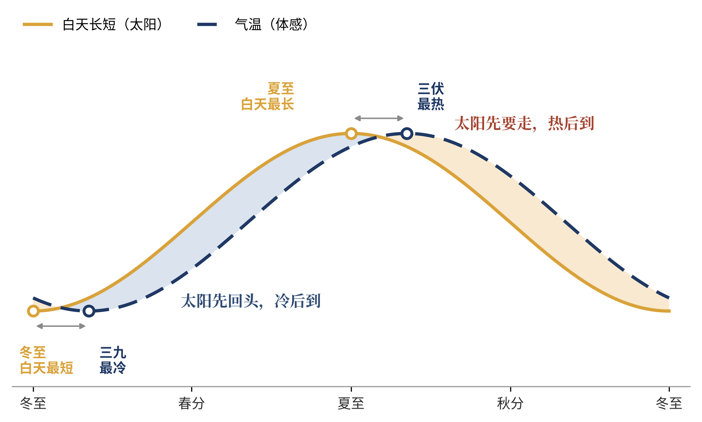
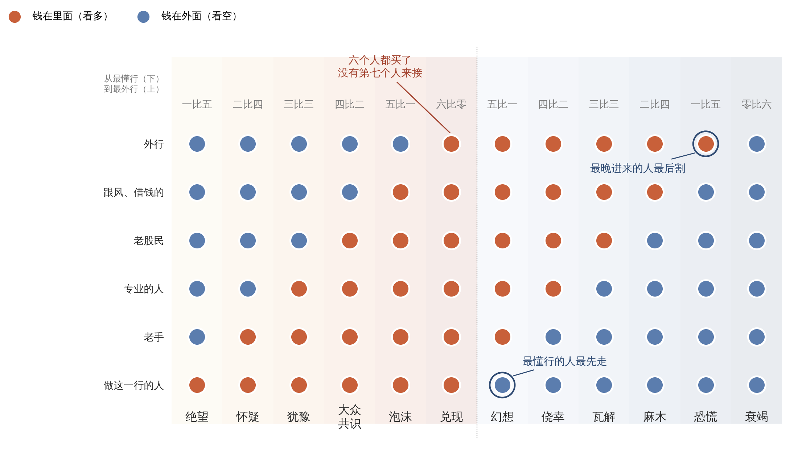
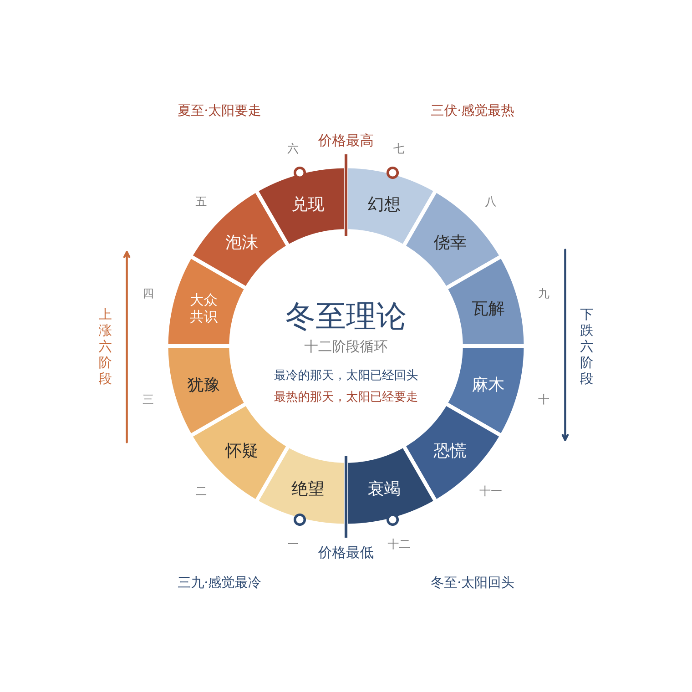
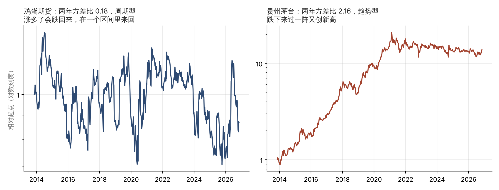
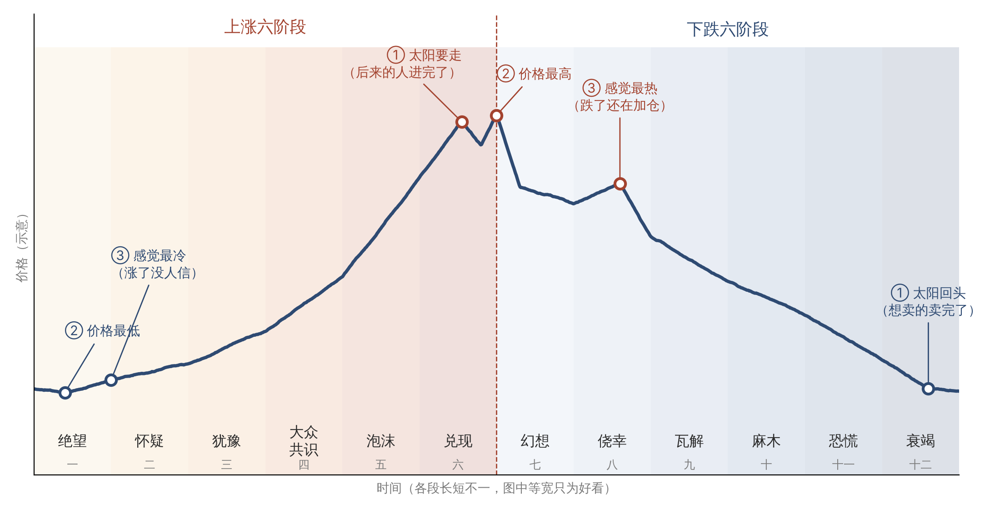
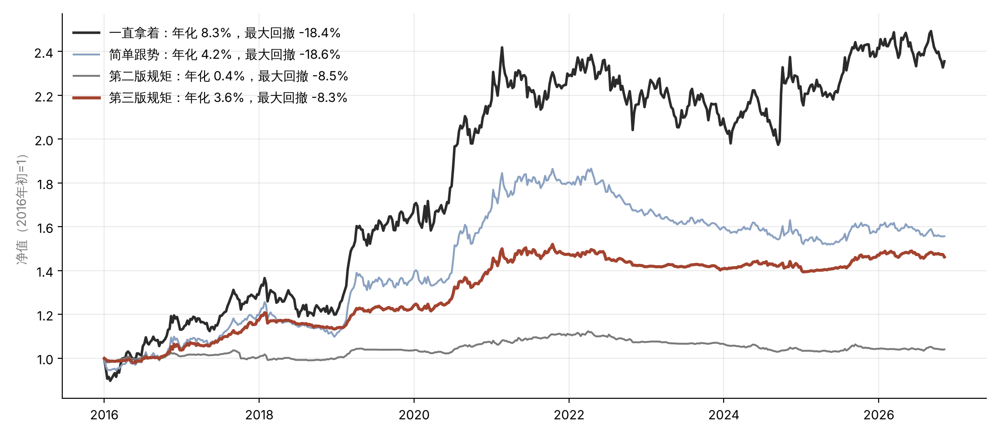

# 冬至理论（第三版）

一个关于市场冷热循环的十二阶段模型

洛辰justin　二〇二六年十一月

> **摘要**　做买卖的人都见过这样的事：行情最差、人人想跑的时候，价格却不再往下走了；行情最火、人人想买的时候，价格却涨不动了。本文把这件事概括成一句口诀：“最冷的那天，太阳已经回头；最热的那天，太阳已经要走。”在这句话的基础上，本文提出一个十二阶段的市场周期模型。上涨分六段：绝望、怀疑、犹豫、大众共识、泡沫、兑现。下跌分六段：幻想、侥幸、瓦解、麻木、恐慌、衰竭。第三版做了三处大的修改：一是加了“第0步”，先看一样东西有没有冬天，也就是它是周期型还是趋势型；二是进场除了“绝望”，再加一种“价格自己证明”；三是把口诀拆成一次转折里的三个时刻，并把屋里的六个人改成“先进先出”。文章最后报告了用A股和34个品种做的检验：照这套规矩做，能明显少亏，但不能多赚；“等冷了再进”只在有冬天的东西上管用。

**关键词**　冬至理论；市场周期；周期型与趋势型；十二阶段；止损；纪律

## 写在第三版前面

第二版写完以后，我把这套办法拿到真实的数据上，前前后后检验了好几轮：先是A股全市场十几年的数据，然后是十个品种，再换二十四个没用过的品种，最后用“盖住未来”的办法，每一年只用那一年以前的数据来定规矩，从2016年一直滚到2026年。每一轮都是先把要检验什么、什么结果算数写下来，再去跑数据，免得看了结果再凑结论。过程和数字放在第八节和附录里。

这里先说结论，也就是这一版改动的原因：

- 照规矩做，回撤明显变小。这一条站得住。

- “等冷了再进”只在有冬天的东西上管用。在猪、鸡蛋、豆粕、煤这类有供给周期的东西上，它比简单的跟势办法好；在茅台、招商银行这类一路向上的东西上，它几乎从来没赢过。

- 只靠“绝望”一种进场，在没见过的数据上几乎不赚钱，因为大部分时间都在等冷。加上“价格自己证明”以后，结果好了很多。

- 它是一套少亏钱的办法，不是多赚钱的办法。

所以这一版改了下面这些地方：

- 第二节：屋里的六个人改成按懂行程度排、先进先出；口诀拆成一次转折里的三个时刻；新加“不是每样东西都有冬天”。

- 第三节：绝望、泡沫、衰竭三段的认法和做法按检验结果改了；总表跟着改。

- 第四节（新）：第0步，先看这东西有没有冬天，怎么看。

- 第六节：“人数一样，方向不一样”改成“人数一样，人不一样”。

- 第七节：判断现在在哪一段，改成三样信号分工、按顺序问四句话；进场改成两种；热了以后按类型分开做。

- 第八节（新）：它管用到什么程度。

- 附录：照着做的规矩、一轮真实的行情、检验数据。

## 一、引言

### （一）研究缘起：从冬至说起

小时候在老家，每年冬至家里要包饺子。奶奶总念叨一句：“冬至一过，白天就一天比一天长了。”我那时候不信。冬至过后明明更冷，水缸结冰，手上长冻疮。“三九四九冰上走”，最冷的三九天，是在冬至之后半个多月才来的。

长大才弄明白，两件事都是真的。冬至那天白天最短，太阳从那天起就往回走了。可地面攒了一冬的冷还没散完，气温还要往下掉一阵。太阳先回头，冷后到。等你冻得最难受的那天，太阳其实已经回头好些日子了。夏至也一样。白天最长的是夏至，最热的是三伏，三伏在夏至后头。你热得最受不了的时候，太阳已经开始往南走了。

**图1**　太阳与气温的时间差。实线是白天的长短，虚线是人感觉到的冷热。两条线的低点和高点都差着一段日子，这段时间差，就是冬至理论的来历。

后来我做买卖，中药材做过，生猪行情跟过，股票也炒了很多年。做得越久，越觉得市场就是这个脾气。行情最差、身边人都在骂的时候，价格往往已经不怎么跌了。行情最火、菜市场卖菜的大姐都在问代码的时候，价格往往已经涨不动了。我把这件事总结成一句话，就是这套理论的口诀：

> **最冷的那天，太阳已经回头；**  
> **最热的那天，太阳已经要走。**  

这句话我自己用了很多年，也吃过不照它做的亏。这篇东西想把它从一句口诀，整理成一套能拿来用的办法。我叫它《冬至理论》。

### （二）本文要回答的问题

这篇东西想说清楚四件事。一是市场为什么会一圈一圈地转，涨完了跌，跌完了又涨。二是这一圈能不能分成几段，每一段都有认得出来的样子。三是认出来以后，一个普通人该怎么做：什么时候买，什么时候卖，错了怎么办。四是这套办法在什么东西上管用，管用到什么程度。

先把话说在前头，这不是一套预测价格的办法。它不告诉你明天涨多少，也不告诉你哪天见底。它只帮你回答一个问题：现在大概是一年里的什么季节。知道了季节，该穿棉袄还是短袖，心里就有数了。

还要加一句，这是第三版才想明白的：**不是每样东西都有冬天。** 有的东西一年四季分明，有的东西差不多一直是春夏。先看清楚你看的这样东西有没有冬天，再去问它现在是什么季节。

## 二、理论来源与核心命题

### （一）口诀的三层意思

“最冷的那天，太阳已经回头”，说的是坏到头的时候。大家最绝望、最不想看的时候，往往是该卖的人都已经卖完了。没人再往下砸，价格自然就跌不动了。转折其实已经开始，只是人的感觉还没跟上。

“最热的那天，太阳已经要走”，说的是好到头的时候。大家最兴奋、最舍不得卖的时候，往往是想买的人都已经买进去了。后面没有新钱来接，价格就涨不动了。见顶其实已经发生，只是人还泡在热乎劲里。

两句合在一起，是第三层意思：人的感觉总比市场慢半拍。你觉得最冷的时候，不是最该害怕的时候；你觉得最热的时候，也不是最该放心的时候。所以做决定不能跟着感觉走，要跟着价格自己露出来的信号走。

### （二）一间屋子里的六个人

为了好懂，我常打一个比方。假设整个市场就是一间屋子，屋里坐着六个人。

这六个人不一样。坐在最里面的，是最懂行的人：做这一行的、药厂、养殖大场、公司的大股东。往外一点是老手，再往外是专业的人、老股民、跟风借钱的人。坐在门口的，是外行，比如菜市场卖菜的大姐、想拿存款囤货的远房亲戚。

越懂行的人，动得越早。行情从最低处起来的时候，第一个出手的是最里面那个人，外面五个人还都看空。后来第二个、第三个，一个一个跟进来，最后门口的外行也进来了，六个人全都买了。这时候麻烦来了：谁来接着买？没有第七个人了。价格只能停下来。

下跌也是这个顺序：**谁先进来，谁先走。** 最懂行的那个人最早往外卖，那时候屋里还热闹得很。然后是第二个、第三个。最后一个扛不住的，是最晚进来的外行，他往往卖在最低处。所有人都卖完了，没人再砸，价格同样只能停下来。

还有一点要分清：手上的动作和嘴上的话不是一回事。**手上先变，嘴上后变。** 最懂行的人卖的时候，嘴上不一定说；屋里说话最响的，常常是最晚进来的那几个。所以你听到的声音，总比钱的动作慢一步。下图里每个圆点画的是一个人手上的钱在不在里面。

**图2**　屋里六个人手上的钱怎么变。暖色是钱在里面，冷色是钱在外面。从下往上，是从最懂行的人到最外行的人。最早进来的，最先走；最晚进来的，最后割。

这就是冬至理论的核心命题：**价格靠的是“后来的人”。最懂行的人先进先出，外行后进后出。大家的看法越一致，后来的人就越少，转折就越近。**

当然，真实的市场不止六个人，也不会这么整齐地一个一个变。六个人只是个比方，帮你记住两件事：看法越来越一边倒，就离头越来越近；最先动的，往往是最懂行、说话最少的人。

### （三）一次转折里的三个时刻

口诀里说的“太阳回头”和“最冷的那天”，不是同一天。就像冬至和三九，差着半个多月。一次转折里有三个时刻，按先后是：

**太阳回头。** 钱的方向变了。在顶上，是后来的人进完了，最懂行的人开始往外卖，这是兑现段。在底下，是想卖的人卖完了，最懂行的人开始悄悄收，这是衰竭段。

**价格到头。** 最高点在兑现段的末尾，最低点在衰竭段的末尾。

**感觉到头。** 嘴上最热，是在幻想段，大家还活在夏天里，跌了还在加仓。嘴上最冷，是在绝望段，坏消息不跌了，涨了也没人信。

所以“最热的那天，太阳已经要走”，说的是幻想段的热，太阳在兑现段就已经走了；“最冷的那天，太阳已经回头”，说的是绝望段的冷，太阳在衰竭段就已经回头了。

这一条在数据上有支持。借钱炒股的融资余额，可以看成屋里的人最后、最用力的那一下。我查了A股2015年以来的七次大顶大底，融资余额次次都比价格晚转：价格见顶以后，借钱买的人还在加；价格见底以后，借钱的人还在撤。

### （四）一年四季，转圈不停

一圈分十二段，上涨六段，下跌六段。上涨是绝望、怀疑、犹豫、大众共识、泡沫、兑现；下跌是幻想、侥幸、瓦解、麻木、恐慌、衰竭。衰竭之后又回到绝望，开始下一圈。

**图3**　冬至理论十二阶段循环图。左半圈暖色是上涨六阶段，右半圈冷色是下跌六阶段。正上方那条线是价格最高点，夏至（太阳要走）在它前面的兑现段，三伏（感觉最热）在它后面的幻想段。正下方那条线是价格最低点，冬至（太阳回头）在它前面的衰竭段，三九（感觉最冷）在它后面的绝望段。

就像一年四季，冬天过了是春天，夏天过了是秋天，谁也没法让它一直停在夏天。每一圈长短不一样，有的几个月，有的好几年；每一段的长短也不一样。但顺序很少乱。这一点是整套理论最看重的：**不知道要多久，但大致知道下一步是什么。**

### （五）不是每样东西都有冬天

第二版默认，猪、药材、股票都是这样一圈一圈转的。检验下来，这句话只对了一半。

有的东西确实有冬天。猪价好了，大家多养；一年左右以后猪多了，猪价就跌；跌到养猪亏钱，大家又不养了，过一阵猪少了，猪价又回来。鸡蛋、豆粕、煤、有色金属，还有靠这些东西吃饭的公司，大多是这个样子。供给跟着价格走，又落在价格后头，所以涨多了一定跌回来，跌多了一定涨回来。我把这种叫**周期型**。

有的东西冬天很短，或者差不多没有。比如有品牌、有护城河、需求一年比一年大的好公司，像茅台、招商银行。它们也会跌，有时候跌得很凶，可跌完过一阵又创新高。用屋里六个人的比方说，它们的屋门口一直有新人在排队，柴烧掉一批，又添进来一批。我把这种叫**趋势型**。

**图5**　周期型和趋势型。左边是鸡蛋期货，十几年在一个区间里上上下下；右边是贵州茅台，同一段时间里一路往上。纵轴是对数刻度。

两种东西用同一套办法，结果差得很远。在周期型的东西上，“等冷了再进、热了就卖”很管用；在趋势型的东西上，等冷可能一等好几年，热了就卖常常卖在半山腰。所以第三版在判断季节之前，加了第0步：先看这东西有没有冬天。怎么看，放在第四节讲。

还有一种介于两者之间，A股的大盘和券商股就是这样：一年之内越涨越涨，像趋势；可长期看很少创新高，靠泡沫吹大再破掉，转出一圈来。对这一类，我按趋势型对待，不能只靠等冷。

## 三、市场周期的十二阶段模型

下面一段一段讲。每段讲四件事：这时候大家心里怎么想，价格是什么样子，怎么认出来，该怎么做。每段后面配一个交易场景，品种是大家熟悉的中药材、生猪和股票。场景都是照着常见的情形写的，不对应哪一个真实的品种或者公司，也不讲具体价格。

**图4**　价格走势与十二阶段（示意）。一轮完整的涨跌，大致是这个样子。图里各段画成一样宽，只是为了好看，真实行情里每一段的长短差得很远。圆圈标的是一次转折里的三个时刻。

### （一）上涨六阶段

#### 阶段一　绝望　涨了没人信

◆ 屋里六个人，一个人的钱在里面，五个人的钱在外面。进来的那一个，是最懂行的人。

这是最冷的那几天。外面几乎听不到好话，有也没人信。新闻还在报坏消息，标题是“底到底在哪里”。之前喊过底的人被打过好几回脸，现在谁也不敢喊了。群里冷冷清清，偶尔涨一天，马上有人说“又来骗人了”。套着的人心里只有一句话：回本就卖。

可价格这边，事情已经在变了。坏消息照样出来，价格却不再创新低。第一次放量涨了一下，回落的时候没有跌破前面的最低点。这就是太阳回头以后的样子，只是还没人觉得暖和。

**怎么认？**记住一句话：坏消息不跌，涨了没人信，而且前面见过恐慌。

这一段最容易认错。下跌途中的每一次反弹，都长得像绝望段。我检验的时候，单靠价格和成交去认绝望，认出来的有一大半是下跌途中的反弹：在上证指数和中信证券上，“绝望”信号出来以后半年，平均反而是跌的。所以认绝望要加两道关。一是顺序：前面得见过恐慌，没见过恐慌，先别认绝望。二是看反应：坏消息出来，价格是不是真的跌不动了。放到34个品种上看，只加第一道关还不够：“绝望”信号出来以后半年，上涨的次数只占43%，比平常的51%还低。第二道关，消息反应，最要紧；就算两道关都过了，这一段也只能用小钱试。

**该怎么做？**只用小钱试，或者干脆只看不买。止损放在前面那个最低点，跌破了，说明底还没到，认了就走。这一段宁可少赚，不要多下。

> **交易场景**
>
> 某个根茎类药材，价格跌了很久。前一阵有几个借钱囤货的大户撑不住，低价甩了一批货，那几天报价跌得最狠。后来药农说明年不种了，药商仓库里压着货，没人问价。有一阵市场上又传“库存还多得很”，往年这种话一出，报价马上往下掉，这回只是松了一下，没有跌破前面的最低价。过了些日子，有药厂来问货，报价小涨了一截，同行都说“炒作，别信”。按冬至理论看，恐慌来过了，坏消息不跌，涨了没人信，像是绝望段。做法是先收一小批货，记下前面那个最低价。要是后来报价跌破了它，说明判断错了，这批货认赔出掉，亏的也只是一点小钱。

#### 阶段二　怀疑　想等回调的人等不到

◆ 屋里两个人的钱在里面，四个人的钱在外面。

低点一个比一个高了，可主流的声音还是不信：“反弹而已”“涨到前面套人的位置就要下来”。很多人说等回调再买，可回调很浅，根本等不到。新闻里开始出现“回暖”“止跌”这种词，说话的人小心翼翼地把看法往上调一点，后面跟一串“但是”。群里有人晒赚钱的单子，底下回的是“小心被埋”。

这一段有个特点，好多人在这里下车。套了很久的人，很多就是在这一段回了本，赶紧卖掉，长出一口气。手里有点利润的人，想的是“赚了一点，先跑吧”。

**怎么认？**好消息出来会涨，坏消息出来跌不动。想等便宜价的人一直等不到。

**该怎么做？**试的那一笔赚了钱，价格回踩又没破，再加第二笔。止损挪到最近一个抬高的低点下面。错过了绝望段的人，不用硬去猜底，等价格自己证明：收盘创出一年来的新高，就可以进。这一段最常见的错，就是赚一点就跑，把后面最好的一段让给了别人。

> **交易场景**
>
> 猪价从低处回来了一些，村里养猪的都说“季节性反弹，过了节还得跌”，谁也不敢补栏，都说等猪价再回落一下。结果猪价回落了几天，没跌到前面的低点，又往上走了。等回调的人一直没等到。我当时的判断是，这是怀疑段：低点在抬高，大家还不信。前面在绝望段补的那批仔猪已经有赚头，回落又没破，就再补第二批。止损的规矩也定好：要是猪价跌破最近那个抬高的低点，第二批就不再加，出栏时该卖就卖，不硬扛。

#### 阶段三　犹豫　最顺的一段

◆ 屋里三个人的钱在里面，三个人的钱在外面。外面那三个，是还没进来的人。

这时候故事讲通了。新闻从报“涨了”，变成讲“为什么涨”。行业转好了，政策来了，业绩上去了，一整套道理都出来了。看好的研究报告多起来，目标价往上调。群里聊的是道理和业绩，看多的看空的都有，吵得有来有回。

叫它犹豫，是因为屋里一半人信，一半人不信，场外还有很多人在犹豫要不要上车。偏偏这种时候，价格走得最稳。有人不同意，就还有后来的人可以被说服；有人卖，就有人接。涨得不急，但是扎实。你自己拿着也不慌，甚至觉得有点无聊。

**怎么认？**涨的时候放量，回调的时候缩量。有道理，而且还有人不同意。

**该怎么做？**主要的仓位就在这一段拿着，少动。止损放在上一次回调的低点，到这时候它应该已经在你的成本上面了，也就是说，最坏也不亏本。这一段最常见的错，是嫌它涨得慢，换去追别的热闹东西。

> **交易场景**
>
> 某只股票所在的行业开始转好，季报不错，看好的报告一篇接一篇。群里每天都在吵，有人说业绩拐点到了，有人说估值已经不便宜。股价涨的时候成交大，回调的时候成交小，一回调就有人接。我手里的仓位就是在这一段拿得最安稳的。那阵子有朋友劝我换去追一个天天上热搜的品种，我没动。止损放在上一次回调的低点，那时候它已经在我成本上面了。真跌破了，就按保本卖掉，最多是白忙一场。

#### 阶段四　大众共识　反对的人不说话了

◆ 屋里四个人的钱在里面，两个人的钱在外面。

出圈了。这东西上了热搜，平时不炒股的人也开始打听。新闻标题从“为什么涨”变成“还能涨多少”“下一个是谁”。说话的人比着上调目标价，开始说老的算法已经不管用了。群里全是晒收益的，看空的人被怼了几回，就不吭声了。新进群的人问的都是同一句：“现在还能上车吗？”

你自己心里的话变成了“买少了”，开始掰着手指头算，照这个速度一年能赚多少。

**怎么认？**涨得越来越陡，离上一个平台越来越远，成交越来越大。反对的人不说话了。

**该怎么做？**手里有的继续拿，但不再加仓，新钱不进。止损要收紧，不再用很远的那个回调低点，改用最近几周的低点。冲得最猛的时候，也是最容易卡住的时候。

> **交易场景**
>
> 还是那个根茎类药材，涨了一大段以后上了新闻。以前只有药商在抢货，现在开小卖部的、跑运输的都来打听能不能囤一点。有个远房亲戚打电话问我，说想把存款拿出来囤货。市场上已经没人说贵了，偶尔有人提一句，马上被人怼回去。我判断到了大众共识段，手里的货一斤不卖，但也一斤不再收。止损改成最近几天的最低报价，报价跌破就开始出货。那个亲戚，我劝他别进，至少别拿存款进。

#### 阶段五　泡沫　没有人说卖

◆ 屋里五个人的钱在里面，门口还剩一个外行，而且他也快忍不住了。

到这一段，只剩一种声音。最后一个唱反调的人也认错改口了。平时不报财经的地方也在报，标题里全是“新高”“全民”。说话的人目标价一翻再翻，讲的是五年十年以后的故事，口头禅是“这次不一样”。亲戚同事来问代码，有人借钱进场，有人上杠杆，新出的基金一天就卖完。群里谁提风险，谁就被笑。

你自己会觉得赚钱太容易了，觉得自己看得特别准，想加大仓位，觉得止损都是多余的。这种感觉，就是三伏天那种热，热得人发昏。

**怎么认？**价格几乎直着往上走，一天之内上下晃得厉害，没有人说卖。成交很大，但这一轮最大的成交，常常在最高点之前就出现了。

**该怎么做？**不再买。接下来要分东西：周期型的东西，先卖掉一半，剩下的用上一周的最低价做止损；趋势型的东西，不要凭“我觉得太高了”去卖，把止损收紧到最近几周的最低价，让止损替你决定。这一段最难的地方是，它可能比你想的长得多。我检验的时候，“泡沫”出来以后半年，价格平均还在涨。所以卖早了不要后悔，卖晚了也晚不了太多，关键是别加仓、别加杠杆。

> **交易场景**
>
> 某只股票连着好几天大涨，单位里平时不碰股票的同事午饭时都在聊它，有人说已经把房贷的钱挪进去了。以前看空它的几个人，这会儿都改口了。我先卖掉一部分，剩下的每天用前一天的最低价当止损。卖掉的那部分后来又涨了一截，说不难受是假的，可我没有追回去。几天后的一个早上，股价高开，盘中一下子掉下来，跌破了前一天的最低价，剩下的也按规矩卖了。没卖在最高，但大头落了袋。

#### 阶段六　兑现　好消息不涨了

◆ 屋里六个人的钱都在里面。最早进来的那个人，已经在悄悄往外卖了。

声音还是最热乎的，可价格不听话了。业绩大涨，政策支持，好消息一个接一个，价格却高开低走。大家给的解释是“洗盘”“换手”“良性调整”，群里说“拿住就是格局”。你自己跌一天也不慌，心里想“会涨回来的”。

为什么叫兑现？因为屋里六个人都买了，没有第七个人来接。这时候真正在动的，是那些早早进场的人，他们在悄悄把纸面上的钱换成真金白银。热闹还在，钱已经在往外走了。这就是“太阳要走”的那一刻。

**怎么认？**好消息不涨。成交很大但涨不动，冲高了收不住，创了新高当天又跌回去。

这一种信号，在有冬天的东西上是靠得住的：在周期型的品种上，出现这种“放量冲高回落”以后半年，价格上涨的次数只占35%，平常是49%。可在一路向上的东西上，它不灵，之后反而多半还在涨。所以兑现段的减仓，在周期型的东西上最该坚决。周期型的样本只有二十几次，还不能算定论。

**该怎么做？**减仓，不管周期型还是趋势型。剩下的用很紧的止损看着，止损放在那周放量冲高又回落的最低价，以后每周跟着上一周的最低价往上提，跌破就走。不要等它“涨回来”。

> **交易场景**
>
> 猪价到了这一轮的高处，村里人人扩栏，有人把猪圈盖到了自家后院，还有外行老板拿钱来投养猪场。到处都在说“猪肉还得涨”。可这阵子收猪的报价，冲上去一下又回来，连着几回都没能站住。市场上好消息不少，价格就是不往上走了。我判断是兑现段：该进来的人都进来了。做法是不再补栏，能出栏的猪尽早出，手里还有的，以那回冲高又回落的最低报价为线，跌破就不再等，有一头卖一头。

### （二）下跌六阶段

#### 阶段七　幻想　第一道裂缝

◆ 屋里五个人的钱在里面，一个人的钱在外面。出去的那一个，正是最懂行、最早进来的人。

第一次像样的下跌来了，没人当回事。“正常回调”“上车的机会”“千金难买牛回头”。新闻里说“技术性调整”“获利回吐”，后面跟一句“长期逻辑不变”。群里很多人晒加仓的单子，卖掉的人被笑话“没格局”。

你自己后悔没在高点卖，心里想“等反弹到前面的高点就卖”，同时又想再加一点，把成本摊低。这就是幻想：大家还活在夏天里，以为天凉只是下了一场雨。这也是嘴上最热的时候，三伏天在这里。借钱买的人在这一段往往还在加，融资余额常常要比价格晚一阵才见顶。

**怎么认？**下跌那天放量，后面的反弹缩量，而且反弹过不了前高。卖的人被笑话。

**该怎么做？**不抄底，不加仓，反弹的时候减。止损的规矩是：反弹过不了前高，又跌破了这次下跌的低点，就走。早上出门脚下踩到霜，就该知道结冰不远了。

> **交易场景**
>
> 那只股票见顶以后第一次大跌，那天成交特别大。群里一片“倒车接人”，有人晒补仓的单子，说“跌下来正好上车”。有个朋友问我要不要也补一点，把成本摊低。我看的是后面几天的反弹：成交越来越小，涨到前面高点下面就上不去了。这就是幻想段。我的做法是趁反弹把剩下的仓位再减一些。要是还有人拿着，规矩很简单：等这次下跌的低点被跌破，就全部卖掉，别等回到前高。

#### 阶段八　侥幸　短线变成了长线

◆ 屋里四个人的钱在里面，两个人的钱在外面。

反弹没成，前面的低点也破了。声音开始变味。喊“加仓”的少了，说“拿着吧，又不是不涨回来”的多了。新闻开始写“为什么跌”“谁在卖”，结论还是“长期向好不变”。群里没人晒单子了，冒出来的话是“不卖就不算亏”“我是做长线的”。

你心里的话，从“我为什么买”，悄悄变成了“我为什么不用卖”。你开始专挑看好的文章看，不太想打开账户。这就是侥幸：心里知道不对劲，嘴上还在给自己找理由。

**怎么认？**高点在降低，低点也在降低。短线变成了长线。

**该怎么做？**就是这里，必须止损。跌破前一个低点就走，不找理由。已经错过的，等它反弹到跌破的那个位置附近再走。这一段的顺势，就是离场。退得早，亏得少。整套理论里，这一段的止损最值钱。

> **交易场景**
>
> 药材的报价跌破了前面那个低点。囤货的人嘴上都硬：“药材放得住，大不了放两年。”可药材放久了会走油、生虫，压着的钱也在吃利息，这些大家心里都清楚，就是不想提。原本说“涨一涨就出”的人，现在改口说“我是长期看好”。按冬至理论，这就是侥幸段，是最该止损的地方。手里的货，报价一跌破前低就出，不讲价钱，不等好消息。要是当时犹豫了没出，就等报价反弹回跌破的那个位置附近，把货出掉，别再给自己第二次找理由。

#### 阶段九　瓦解　怎么都不涨

◆ 屋里三个人的钱在里面，三个人的钱在外面。外面那三个，是早就走了的内行；里面那三个，是后来进来、被套住的人。

这是抱怨最多的一段。“业绩这么好为什么不涨”“这么便宜了为啥还跌”“被错杀了”。还有骂人的，骂庄家，骂机器炒股，骂管理层。新闻开始讲坏的故事：产能过剩，竞争太狠，管得严了。群里互相安慰，有人开始补仓。你自己每次反弹都觉得“终于回来了”，第二天又是失望。

叫它瓦解，是因为当初撑着价格的那一整套道理，正在一块一块地塌。它和“犹豫”那一段正好对着：那时候好消息能传到价格上，现在传不上去了。因为屋里还拿着的，是等着回本就卖的人，每一次反弹都有人往外卖。

**怎么认？**好消息不涨，坏消息大跌，反弹一两天就没了。“便宜”这个词出现得特别多。

**该怎么做？**不买。手里没有的，不存在止损的问题；还拿着的，每次反弹过不了前高，都是减仓的机会，千万别补仓。便宜在这一段不是买的理由，抢反弹是这一段亏钱最主要的方式。

> **交易场景**
>
> 猪价一路往下。到了往年吃肉最多的节前，大家都说“这回总该涨了”，结果只涨了两天就掉头，节后跌得更多。有养殖户觉得仔猪便宜得很，趁便宜多补了一批，说等猪价回来能赚一大笔。按冬至理论，好消息不涨，坏消息大跌，这是瓦解段，便宜不是补栏的理由。我的做法是不补栏，存栏的猪赶上反弹就出一批，反弹过不了前面的高点，就再出一批，不跟价格赌气。

#### 阶段十　麻木　只看不动

◆ 屋里两个人的钱在里面，四个人的钱在外面。

声音小下去了，抱怨变成了麻木：“不看了”“装死”“软件卸了”。群里改聊别的。新闻报得少了，偶尔有一句“估值到了低位”“有资金在抄底”，没人接话。有人开始写“当初为什么会涨那么高”。

你自己很少打开账户，偶尔反弹一下，心里那句话还是“回本就卖”。这句话很要紧。它说明还有很多人手里攥着货，在等解套。等解套的人还没卖，底就还没到。

**怎么认？**反弹一次比一次弱，成交越来越小，但还没有恐慌。冷淡，但还在等解套。

**该怎么做？**手里没货最好。这一段可以顺手做一件事：大盘跌的时候，留意哪些东西已经不跟着跌了。下一轮先起来的，常常就在这里头。

> **交易场景**
>
> 那只股票已经很久没人提了，群里聊的都是别的。偶尔它涨一天，有人冒一句“回本我就走”，也没人接话。我手里早就没有它了，这一段我做的事情只有一样：每次大盘跌得厉害的那几天，翻一翻同行业的几只股票，看哪只已经不跟着跌了，把它记在本子上。这时候什么都不买，所以也谈不上止损。记名单的意思，是等太阳回头的时候，知道先去看谁。

#### 阶段十一　恐慌　没有人说买

◆ 屋里只剩一个人的钱在里面，就是最晚进来的那个外行。

声音突然又大了，全是坏的。新闻上了头条，“暴跌”“崩盘”“史上最惨”，讲的是最坏的故事：“这个行业完了”“再也回不去了”。最后几个看好的人也翻了脸。不炒股的朋友打电话来问“你没事吧”。群里全是“割了”“不玩了”“销户”，还有爆仓、被强行平仓的消息。你自己只想让它停下来，什么价都愿意卖。

这一段和“泡沫”正好对着。泡沫的时候没有人说卖，恐慌的时候没有人说买。恐慌还是一个记号：它来过了，后面的绝望才可信。

**怎么认？**加速往下跌，成交放大，坏消息一出来跌得更快。没有人说买。

**该怎么做？**说实话，拖到这里已经没有好办法了。该走的地方是“侥幸”那一段。到这里只剩两种难受：卖了，可能卖在最低；不卖，可能还有一截。带着杠杆的，先把仓位减到不会被强行平仓的程度，保住本钱再说。也别急着抄底。“别人恐惧我贪婪”听着有道理，可恐慌能持续的时间，常常比你想的长。把这一段记下来，它是后面认绝望的依据。

> **交易场景**
>
> 药材市场传出一连串坏消息，产地丰收、库存积压、需求不好，一条接一条。有几个借钱囤货的大户撑不住了，开始低价甩货，药商趁机压价，报价一天比一天低。有人打电话问我“这么便宜，要不要接一点”。我没接。按冬至理论，这是恐慌段，没人说买的时候，往往还没跌完。要是谁手里还有借钱囤的货，先卖掉一部分，卖到就算再跌一截也不会被逼到绝路，剩下的再慢慢想。

#### 阶段十二　衰竭　连声音都没了

◆ 屋里六个人的钱都在外面。最懂行的那个人，已经开始悄悄看货了。

没有声音了。新闻不报了，说话的人不写了，群也死了。你跟人提起来，别人的反应是：“这还有人看？”坏消息出来，跌一点就跌不动了。你自己也不关心，快忘了。

道理和“兑现”那一段反过来：六个人都卖了，想卖的都卖完了，没人再砸。卖的力气用光了，所以叫衰竭。这就是“太阳回头”的那一刻。

**怎么认？**坏消息不跌，没人谈论，想卖的都卖完了。

成交会很少，可最少的那几周，常常要等到价格见底以后，在绝望和怀疑段才来。我查过的几次大底里，地量比最低价晚好几个月的不在少数。所以别非等到地量才认衰竭，也别把地量当成买的信号。

**该怎么做？**手里没仓位，就没有止损的问题。这一段做功课，列名单，但不提前买。磨底可以磨很久，也可能再跌一段。等哪天第一次放量上涨，回落又不破低点，就回到第一段“绝望”了，新的一圈开始。

> **交易场景**
>
> 猪价低了很久以后，村里的猪圈空了一大半。小户早就不养了，有的把母猪都卖了，大一点的场子也在减。说起养猪，大家直摇头。这时候又传出需求不好的消息，猪价却只是晃了晃，没再往下掉。按冬至理论，这是衰竭段：该退的都退了，卖的力气用完了。我的做法是先不进场，把哪里还能找到好仔猪、圈舍要怎么收拾这些事打听好。等猪价第一次放量往上走，回落又不破低点，再按绝望段的办法，小批量先补一点。

### （三）十二阶段总表

**表1　冬至理论十二阶段总表**

| 阶段 | 钱在里面的人 | 大众心态 | 价格信号 | 该做什么 |
| --- | --- | --- | --- | --- |
| 绝望 | 一比五 | “回本就卖”“又来骗人了” | 坏消息不跌，低点不破，前面见过恐慌 | 小钱试，止损放在最低点 |
| 怀疑 | 二比四 | “反弹而已”“等回调再买” | 低点抬高，回调很浅 | 回踩不破加第二笔；错过的等价格创一年新高再进 |
| 犹豫 | 三比三 | 一半人信一半人不信 | 涨时放量，跌时缩量 | 主仓拿住，少动 |
| 大众共识 | 四比二 | “买少了”“还能上车吗” | 越涨越陡，成交很大 | 不加仓，止损收紧 |
| 泡沫 | 五比一 | “这次不一样”，谁提风险笑谁 | 近乎直线，上下晃得厉害 | 不买；周期型卖一半，趋势型收紧止损 |
| 兑现 | 六比零 | “洗盘”“拿住就是格局” | 好消息不涨，新高又跌回 | 减仓，止损跟紧，破位就走 |
| 幻想 | 五比一 | “正常回调”“上车机会” | 跌时放量，反弹缩量过不了前高 | 不抄底，反弹时减 |
| 侥幸 | 四比二 | “不卖不算亏”“我做长线” | 高点低点一起往下 | 止损离场，不找理由 |
| 瓦解 | 三比三 | “这么便宜为啥还跌” | 好消息不涨，坏消息大跌 | 不买，不补仓 |
| 麻木 | 二比四 | “不看了”“装死” | 反弹越来越弱，成交越来越少 | 空仓，记下不跟跌的 |
| 恐慌 | 一比五 | “割了”“销户” | 加速下跌，成交放大 | 不抄底，杠杆先减，记下来 |
| 衰竭 | 零比六 | “这还有人看？” | 坏消息不跌，没人谈论 | 做功课，等信号 |

注：前六行为上涨六阶段，后六行为下跌六阶段；衰竭之后回到绝望。“钱在里面的人”是屋里六个人的比方。

## 四、第0步：先看这东西有没有冬天

### （一）为什么要先看

冬至理论的核心规矩是“等冷了再进、热了就卖”。这条规矩在有冬天的东西上很好用，在没有冬天的东西上会害人。检验下来，差别非常清楚：在34个品种里，周期型的16个，有11个用这条规矩比简单的跟势办法好；趋势型的18个，只有2个。

所以判断季节之前，先要知道这个地方有没有冬天。在海南等下雪，是等不到的。

### （二）怎么看

有三个办法，从粗到细。

**一是看东西本身。** 价格由供需决定、供给跟着价格走又慢半拍的，多半是周期型：猪、鸡蛋、豆粕、煤、有色金属，和靠这些东西吃饭的公司。需求一年比一年大、有品牌有护城河的，多半是趋势型：茅台、五粮液、招商银行这一类。

**二是看图。** 把十年以上的周线图拉出来。低点一个比一个高，跌下来一两年又创新高的，是趋势型。在一个大区间里上上下下，好几年回不到前高的，是周期型。

**三是算一个数。** 我用的是“两年方差比”。它量的是一件事：涨多了会不会跌回来。小于1，说明涨多了容易跌回来，跌多了容易涨回来；大于1，说明涨了还会接着涨。具体怎么用：

| 两年方差比 | 类型 | 论文版规矩管不管用 | 例子 |
| --- | --- | --- | --- |
| 小于0.8 | 周期型 | 多数管用（15个里11个） | 生猪、鸡蛋、豆粕、焦煤、中国神华、温氏股份 |
| 0.8到1.2 | 说不准 | 几乎不管用（9个里1个） | 上证指数、牧原股份、沪铜、螺纹钢、黄金 |
| 大于1.2 | 趋势型 | 几乎不管用（10个里1个） | 贵州茅台、五粮液、招商银行、东方财富、创业板指 |

注：“论文版规矩”指只靠绝望进场、热了就卖的第二版做法；括号里是在27组参数中过半赢过简单跟势的品种数。0.8这条线是看了数据以后定的；在“盖住未来”的检验里，站在2016年初、只用以前的数据去挑，挑出来的也是0.8。

### （三）判断完了怎么用

| 类型 | 进场 | 热了以后 | 主要靠什么 |
| --- | --- | --- | --- |
| 周期型 | 绝望段小钱试；也可以等价格自己证明 | 泡沫卖一半，兑现再卖一半 | 低买高卖 |
| 说不准、趋势型 | 不要只等冷，价格创一年新高就可以进 | 泡沫不急着卖，收紧止损；兑现减仓 | 止损控制回撤 |

如果嫌麻烦，也可以不分类型，一律用“两种进场都用”的做法。检验里这样做也不吃亏，因为它本来就包含了绝望进场。第0步最大的用处，是在趋势型和说不准的东西上提醒你：**不能只靠等冷。**

### （四）要注意的

- 同一个行业也可能不一样。华泰证券算出来是0.63，中信证券是1.60。不能只按行业猜，要算。

- 数据要够长。少于八年算出来的数不可靠。

- 类型会变。一家公司这几年在成长，过几年可能变成周期股。最好每年复查一次。

## 五、案例推演：一轮行情走一遍

前面是一段一段拆开讲的。这一节把它们串起来，用一个虚构的人物，跟着一个虚构的中药材品种，从最冷走到最热，再从最热走回最冷。人和品种都是编的，讲的是常见的情形，不对应真实的事。读的时候可以对照前面的图4，看看每一步走在曲线的什么位置。

老周是做药材生意的，跟我认识很多年。那年冬天，他常做的一个品种已经跌了很久，前一阵还有大户借钱囤货撑不住、低价甩货，报价跌得最狠。后来产地的人说不种了，他自己仓库里也压着货。有一回市场上又传库存多，他以为还要跌，结果报价只松了一下，没破前低。我跟他说，恐慌来过了，坏消息也不跌了，这像是绝望段。他半信半疑，听我的只收了一小批，止损定在前面那个最低价。

开春以后，报价一点一点往上走，回落几次都没跌到前低。同行都说是反弹，等着回落再进，可一直没等到。这是怀疑段。老周第一批货已经有赚头，又收了第二批，止损跟着挪到最近那个抬高的低点下面。那阵子不少压了很久货的人，回本就卖了，老周差点也跟着卖，最后忍住了。

再往后，药厂那边用量起来了，市场上开始有人讲这个品种为什么该涨，也有人说已经不便宜。报价涨的时候成交多，回落的时候成交少。这是犹豫段，最顺的一段。老周这时候主要做一件事：拿着，不折腾。止损已经提到成本上面，最坏也就是不赚不亏。

到了夏天，这个品种上了新闻，外行都来打听，连老周的邻居都问能不能跟着囤一点。市场上说贵的人越来越少，后来干脆没人说了。这是大众共识段。我提醒老周，从现在起不再收货，止损改用最近几天的最低报价。

又过了一阵，报价几乎是直着往上冲，一天里上下晃得厉害，到处都在说这回不一样。有人借钱囤货，还有人把别的生意停了专门做这个。这是泡沫段。药材是有冬天的东西，所以老周按周期型的办法，先出了一半，剩下的看前一周的最低价，跌破就再出。他后来跟我抱怨，说出早了，少赚了不少。我说，出早了是少赚，出晚了是要命。

没多久，市场上好消息还是一个接一个，报价却冲高就回来，连着几回站不住。这是兑现段，太阳要走了。老周把剩下的货大部分出掉，只留一点，用那回冲高回落的最低报价盯着。没几天报价跌破了，他把最后一点也出了。

秋天来了。报价第一次大跌，市场上都说是正常回调，好些人趁机补货。老周问我要不要回去接一点，我说先看反弹。反弹的时候成交很小，上不到前面的高点，这是幻想段。他忍住了，没接。

后来报价跌破了前低，囤货的人开始说“药材放得住”“我做长期”。这是侥幸段。老周一个朋友当时还压着不少货，老周劝他按前低止损，他没听，说再等等。

再往后，好消息也不管用了，旺季报价也起不来，人人都在说便宜，有人越跌越补。这是瓦解段。接着是麻木段，没人再聊这个品种，那个朋友说“不看了，就当没买”。老周这时候手里没货，只是留意着哪些产区的报价已经不跟着跌了。

冬天又来了。坏消息一连串，借钱囤货的人开始甩货，报价跌得最快。这是恐慌段。老周那个朋友在这时候扛不住，低价全卖了。再往后，市场冷到没人提，产地又有人说不种了，坏消息出来报价也不怎么跌了。这是衰竭段。

一圈走完，老周在最冷的地方买了一小批，在最顺的地方拿住，在最热的地方分批出，在开始变冷的时候守住没接。他没有一次买在最低，也没有一次卖在最高，可这一圈下来，钱是实实在在赚到手里的。他那个朋友，在怀疑段因为回本就卖了一回，后来在泡沫段又追了回去，最后在恐慌段割在了低处。两个人看的是同一个行情，差的就是有没有一套规矩。

还要补一句。老周做的是药材，药材有冬天，所以这套办法在他手里好用。要是他拿同样的办法，去做一只一路向上的好股票，结局就不一样了：等冷，可能一等好几年；热了就卖，可能卖在半山腰。这就是第四节说的，先看这东西有没有冬天。

## 六、阶段转换的机制

### （一）情绪推价格，价格又推情绪

菜市场里有个现象，哪个摊子前面排的人多，路过的人就越想去排，哪怕不知道卖的是什么。市场也是这样。价格涨了，赚钱的人更有底气，旁边看的人眼红，就有更多人进来买，价格再涨，又有更多人眼红。跌的时候反过来，亏钱的人慌，旁边的人怕，卖的人更多，价格再跌，慌的人更多。

所以情绪和价格是互相推着走的。上涨六段，就是一把火从一点火星烧成大火，再烧到没有柴；下跌六段，是火灭了以后，屋子一点一点凉透。

### （二）柴烧完了，火就灭了

这个互相推的过程，要靠一样东西撑着，就是前面说的“后来的人”。只要场外还有人没买，涨就能接着涨；只要场里还有人没卖，跌就能接着跌。

麻烦在于，后来的人是会用完的。看法越一致，用得越快。到了兑现段，该进来的都进来了；到了衰竭段，该走的都走了。柴烧完了，火自己就灭了，用不着什么大消息。很多人总想找一个“见顶的原因”或者“见底的原因”，其实最大的原因往往就是：没人了。

不过也有另一种情形。有的东西，门口一直有新人在排队，柴烧掉一批，又添进来一批，火就能烧很久。趋势型的东西就是这样。所以“柴快烧完了”这个判断，在周期型的东西上比在趋势型的东西上可靠得多。

### （三）为什么转折总在感觉最强的时候

人对行情的感觉，是靠过去一段时间的涨跌攒起来的。涨了一阵子，人才敢信；跌了一阵子，人才会怕。就像冬至以后的冷，是地面一天一天攒下来的。所以感觉总是落在后面。

还有一层：最先动的是最懂行的人，他们不说话；说话最响的，是最后进来的人。你听到的声音，大多来自慢半拍的那部分人。等到声音最强、最一致的时候，柴恰好也快烧完了。不是市场故意跟人作对，是人的感觉天生慢半拍。

### （四）人数一样，人不一样

上涨和下跌两边，屋里的人数是对着的。绝望和恐慌，都是一比五；怀疑和麻木，都是二比四；犹豫和瓦解，都是三比三；大众共识和侥幸，都是四比二；泡沫和幻想，都是五比一。

人数一样，屋里的人却不一样。

同样是三比三。犹豫段里钱在外面的三个，是**还没进来**的人：老股民、跟风的、外行。他们是后面的柴，好消息一来，就会被一个一个说服。瓦解段里钱在外面的三个，是**早就走了**的人：做这一行的、老手、专业的人。钱还在里面的三个，是后来进来、被套住的人，每次反弹都想着“回本就卖”，他们是压在上面的砖。

所以犹豫段好消息能把价格推上去，瓦解段推不动。

这也给了一个很好用的办法：**看谁在看空，看谁在卖。** 看空的是外行，多半在上半圈；先卖的是内行，多半在下半圈。大股东在减持、做这一行的人在出货，这时候嘴上再热闹，也要当成下半圈的开头看。

### （五）看消息，不如看价格对消息的反应

在所有信号里，我最看重的一条，是价格对消息怎么反应。消息本身谁都能看到，没什么用。有用的是：同样一个坏消息，以前一出来就大跌，现在出来跌不动了，说明想卖的人不多了，这是冷到头的样子。同样一个好消息，以前一出来就大涨，现在出来涨不动了，说明想买的人不多了，这是热到头的样子。

前面十二个交易场景里，绝望段药材“库存多”的消息不跌，兑现段猪价好消息不涨，瓦解段节前猪价涨不起来，衰竭段需求不好也不跌，讲的都是这一条。

要说明的是，这一条我还没能用数据好好检验过。我只拿降准这一种好消息试了一下，次数太少，看不出结论。它是下一步最该检验的地方。

### （六）东西本身也在转

除了人心，东西本身也在转。猪价好的时候养的人多了，过一阵子出栏的猪就多了，价格往下走；猪价差的时候有人不养了，过一阵子猪少了，价格又回来。药材也一样，价高了一窝蜂地种，价低了没人种。供给跟着价格走，又落在价格后头，这就是一个圈。再加上人会忘，疼过的人慢慢不疼了，没疼过的新人又进来了。所以每一圈的故事都不一样，圈的样子却总差不多。

反过来，东西本身不怎么转的，比如需求一年比一年大的好公司，圈就转得不明显。这就是第四节为什么要先看这东西有没有冬天。

## 七、应用方法

### （一）先看这东西有没有冬天

用第四节的办法，先定下它是周期型、趋势型，还是说不准。这一步一年做一次就够了。

### （二）怎么判断现在在哪一段

我自己用三样东西来判断。这三样各管一件事。

**看价格，管方向。** 高点、低点在往上走还是往下走；好消息管用，还是坏消息管用。这一样告诉你在上半圈还是下半圈。

**听声音，管冷热。** 身边的人在说什么，新闻在写什么，群里在聊什么。这一样告诉你屋里大概几个人看多。

**看反应，管还剩多少柴。** 上半圈，看好消息还推不推得动，门口还有没有新人在打听；下半圈，看坏消息还砸不砸得下去，套住的人走完了没有。这一样告诉你离转折还有多远。

三样不一定对得上。声音和反应对不上的时候，不是看不清，恰恰是要转了：声音还热、好消息却不涨，是兑现；声音还冷、坏消息却不跌，是绝望。整套理论里最值钱的就是这两段，也最容易错过。要是非等三样都对上才动手，往往要等到下一段，那时候最好的地方已经过去了。

判断的时候，按顺序问自己四句话：

- 在上半圈，还是下半圈？

- 屋里大概几个人看多？

- 柴还剩多少？

- 上一回我判断在哪一段？

最后一句最容易忘。行情一段一段地走，很少往回跳，也很少一下子跳好几段。上回判断在瓦解，这回一涨就说是绝望，中间的麻木、恐慌、衰竭都没见着，那多半是看错了。我自己就不止一次把下跌途中的反弹当成了绝望段，犯的就是这个错。**没见过恐慌，先别认绝望；没见过泡沫和兑现，也先别认幻想。**

也别想一下子就判断到准确的某一段。能分清是上半圈还是下半圈，是偏冷还是偏热，已经很够用了。段与段之间本来就有过渡，硬要掐准，反而容易出错。判断错了也不要紧，止损会替你认错。

### （三）怎么做决定

把十二段连起来看，一圈里该做的事其实只有五种：

- 绝望到怀疑，是买的时候，先小钱试，对了再加。

- 犹豫到大众共识，是拿的时候，主仓位拿住，少折腾。

- 泡沫到兑现，是卖的时候，不加仓，分批卖，让止损替你决定最后一笔。

- 幻想到侥幸，是走的时候，没走的，侥幸段是最后的机会。

- 瓦解、麻木、恐慌、衰竭，是等的时候，手里没货，做功课，列名单，等新一圈的信号。

**进场有两种。** 一种是在绝望段认出来，小钱先试，这要求前面见过恐慌、坏消息不跌。另一种是等价格自己证明：收盘创出一年来的新高，就可以进，用最近一个季度的最低价做止损。第二种不用猜底，代价是买得贵一些。在没有冬天的东西上，主要靠第二种；在有冬天的东西上，两种都可以用。

**热了以后，按类型分开。** 周期型的东西，泡沫卖一半，兑现再卖一半；趋势型的东西，泡沫段不急着卖，把止损收紧到最近几周的最低价，等兑现的信号出来再减。

归成四句话：**不追最热，不怕最冷，守住纪律，学会止损。**

不追最热，是说别人都在抢的时候，你不进新钱。最热闹的时候买进去的人，常常就是那个“第七个人”，进去以后才发现后面没人了。不怕最冷，是说大家都不敢看的时候，你要敢看。不是让你闭着眼睛抄底，而是在最冷的时候盯着信号，把钱和名单准备好。等太阳真的回头了，你是第一批知道的。

### （四）止损与纪律

这套理论能用，靠的不是判断准，而是错了能出来。所以止损是整套办法里最硬的一条。检验下来，这一条也是最站得住的：照规矩做，几乎在每个品种上，最大回撤都比一直拿着小得多。我有几条规矩。

买之前，先想好在哪里认错。没想好止损，就不买。

止损放在价格自己画出来的位置上，比如前面的低点，而不是放在“亏多少钱我受不了”上。前者是市场告诉你错了，后者只是你心里疼了。

跌破就走，不商量。最怕的是跌破以后跟自己说“再等等”，侥幸段就是这么来的。

止损只往有利的方向挪。赚了钱，止损跟着往上提；绝不往下挪，给自己留后路。

仓位也是纪律。分批进，不一次全押。大众共识以后不加仓，泡沫的时候不加杠杆。

最后一条，把规矩写下来。人在热的时候和冷的时候，会变成两个人。热的时候觉得规矩多余，冷的时候觉得规矩没用。写在纸上的规矩，不跟着情绪变。

### （五）几个常见的错

按着十二段走一遍，最常见的错几乎每一段都有一个：怀疑段赚一点就跑；犹豫段嫌慢换车；大众共识和泡沫段加仓、借钱、上杠杆；幻想段越跌越买，想摊低成本；侥幸段短线拖成长线；瓦解段因为便宜去补仓；恐慌段急着冲进去抄底。案例里老周的那个朋友，差不多把这些错走了一遍。

第三版还要加两个：一是在没有冬天的东西上死等冬天，一等好几年，错过整段行情；二是凭“我觉得太热了”把好东西卖光，卖在半山腰。这两个错，我检验的时候都看得清清楚楚。

这些错我自己也犯过。认得出自己在犯错，比认得出市场在哪一段还要紧。

## 八、它管用到什么程度

### （一）怎么检验的

第二版写完以后，我把这套办法写成谁照着做都一样的规矩，前后检验了四轮。

- 第一轮，A股全市场2010年到2026年的数据，看热度、消息反应、规矩回测。

- 第二轮，十个品种：生猪期货、牧原、温氏、螺纹钢、沪铜、豆粕、上证指数、中信证券、茅台、长江电力。

- 第三轮，换二十四个之前一个都没用过的品种，规矩、参数一点不改，看前一轮的发现还成不成立。

- 第四轮，“盖住未来”：每一年要用的参数，只能用那一年以前的数据来挑，从2016年滚到2026年，最后只看这十一年的结果。

每一轮都先把“检验什么、什么结果算数”写下来，再去跑。拿来比的有两种做法：一直拿着，和简单跟势（价格在40周均线上面就拿，下面就不拿）。

### （二）结果

**图6**　盖住未来的检验：34个品种平均分钱，2016–2026年。每一年的参数都只用那一年以前的数据挑选。第三版规矩平均只用了不到三成的钱，闲着的钱没有算利息。

| 做法 | 年化 | 最大回撤 | 年化÷最大回撤 |
| --- | --- | --- | --- |
| 一直拿着 | 8.2% | −18.4% | 0.45 |
| 简单跟势 | 4.2% | −18.6% | 0.22 |
| 第二版规矩 | 0.4% | −8.5% | 0.04 |
| 第三版规矩 | 3.6% | −8.3% | 0.43 |

说成大白话，是这几条：

- **能少亏。** 34个品种里，30个品种的最大回撤比一直拿着小。组合起来，最大回撤从−18%降到−8%。

- **不能多赚。** 组合的年化收益是3.6%，一直拿着是8.2%。按“收益除以最大回撤”算，和一直拿着打平。如果把闲着的钱按每年2%算利息，第三版是5.0%、最大回撤−5.1%，比一直拿着好；不过这是后加的算法，不算数。

- **比简单跟势好。** 34个品种里20个更好，组合的“收益除以回撤”是0.43对0.22。

- **第二版的规矩必须改。** 只靠绝望进场，在没见过的数据上几乎不赚钱，年化0.4%，因为大部分时间都在等冷。

- **等冷只在有冬天的东西上管用。** 两批品种都是这样，第二批是专门用来验证第一批的发现的。

- **一笔一笔看：** 2016到2026年，第三版一共做了214笔，赚钱的占47%，不到一半。可赚钱的那些平均赚24%，亏钱的那些平均亏8%，赚的总和是亏的总和的2.6倍。它靠的是“对的时候多赚、错的时候少亏”，不是靠猜得准。

- **单个信号准不准：** 最准的是“价格自己证明”，之后半年上涨的次数占61%，平常是54%。在周期型的东西上，兑现以后半年上涨的只占35%，平常是49%，这个卖的信号是准的；在其他东西上，兑现、泡沫以后反而多半还在涨。最不准的是绝望：之后半年上涨的只有43%，比平常的51%还低。

- **口诀有支持：** 七次大顶大底，融资余额次次比价格晚转，感觉到头确实在价格到头之后。

### （三）还不知道的

- 我最看重的“看反应”和“听声音”，还没有用数据好好检验过。

- 第三版的几处修改，是看了检验结果以后才想到的。“盖住未来”只能盖住参数，盖不住这一层。真正干净的检验，只能是从现在开始，每个月写下判断，写完不改，过一两年再对答案。

- 34个品种里有不少是同一类，比如养殖股之间、券商股之间，不是34份完全独立的证据。

## 九、局限与边界

这套理论有用，但不是万能的。下面几条，用之前一定要想清楚。

第一，它不是算命。它说不出哪天见顶，哪天见底，也说不出涨到多少、跌到多少。它只能告诉你大概在什么季节。冬天里也会有几天暖和，夏天里也会下几场冷雨。

第二，段与段的边界是模糊的。事后回头看，哪段是哪段清清楚楚；身在其中的时候，常常分不清。行情也可能跳过某一段，或者在两段之间来来回回地磨。下跌途中的反弹，看着就很像绝望段。

第三，大环境会打断它。政策突然变了，天灾来了，整个行业的根本变了，原来的圈可能被打乱，甚至重新开始。遇到这种时候，别死守着理论，先保住本钱。

第四，不同的东西节奏不一样，有的甚至没有冬天。生猪、药材、股票，各有各的圈。大盘有大盘的圈，个股有个股的圈，大圈里套着小圈。用的时候先想清楚，自己看的是哪一个圈，这个圈有没有冬天。

第五，你自己也在屋里。判断阶段的那个人，也会被热冲昏头，被冷吓破胆。最热的时候，你很可能也觉得“这次不一样”。所以光靠判断不够，要靠写下来的规矩和止损来管住自己。

第六，判断错了要认。我自己就不止一次把下跌途中的反弹当成了绝望段，进去以后才发现底还没到。好在每次都有止损，亏的是小钱，人还在场上。

第七，它是少亏钱的办法，不是多赚钱的办法。照着它的规矩做，错的时候亏得少；可在一路向上的好东西上，它会让你少赚，有时候少赚很多。

还要说一句，本文只是我个人做买卖的方法和体会，文中的场景和案例都是为了讲清道理而写的，检验结果也只是过去的数据，不构成任何投资建议。

## 十、结论

本文从冬至说起，提出了一套看市场冷热的办法，叫《冬至理论》。它的核心是一句口诀：“最冷的那天，太阳已经回头；最热的那天，太阳已经要走。”背后的道理很朴素：价格靠后来的人推着走，最懂行的人先进先出，大家看法越一致，后来的人越少，转折就越近。人的感觉又天生慢半拍，所以一次转折里，总是太阳先回头，价格再到头，感觉最后到头。

按照这个道理，本文把一轮行情分成十二段。上涨是绝望、怀疑、犹豫、大众共识、泡沫、兑现；下跌是幻想、侥幸、瓦解、麻木、恐慌、衰竭。衰竭之后回到绝望，一圈一圈地转，像一年四季。

第三版加了一句最要紧的话：先看这个地方有没有冬天。有冬天的东西，等冷了再进、热了就卖；没有冬天的东西，不能死等冬天，要让价格自己证明。判断在哪一段，三样信号各管一件事：价格管方向，声音管冷热，反应管还剩多少柴。

检验下来，这套办法最站得住的，是止损和纪律带来的少亏钱。它不能让你每次都看对，也不能让你比一直拿着赚得多，但能让你看错的时候少亏一点，在有冬天的地方，冷的时候敢看，热的时候敢走。

用这套理论，说到底还是四句话：不追最热，不怕最冷，守住纪律，学会止损。

冬至那天，太阳已经回头了，可你还得穿着棉袄，等春天慢慢来。市场也是一样。知道季节，不着急，不慌张，该做什么做什么。

◇　◇　◇

## 附录一　照着做的规矩（周线版）

这是检验时用的规矩，写成了谁照着做都一样的样子。只用价格和成交量两样，没有用到声音和消息反应。每周五收盘看信号，下周一开盘执行。

**第0步，定类型。** 每年第一周，用这之前的全部周线算两年方差比。小于0.8算周期型，否则按趋势型对待。历史不满六年的，一律按趋势型对待。

**进场一：绝望（三分之一仓）。** 下面四条同时满足：过去半年里，离两年最高点跌过30%以上；最近四周没有再创半年新低；这一周放量（成交是过去半年周平均的1.5倍以上），收盘突破前四周最高价；过去一年里出现过恐慌周（这一周的跌幅排在过去三年最差的5%以内，而且放量）。止损放在半年最低价。

**进场二：价格自己证明（三分之二仓）。** 收盘创52周新高。止损放在最近13周最低价。

**加仓、拿住。** 绝望进场以后，收盘创出进场以来新高、最近8周的低点高于原止损，加到三分之二，止损上移到8周最低价。之后收盘在40周均线上方、均线向上，满4周，拿满。拿满以后止损用13周最低价，只往上挪。

**大众共识。** 价格高出40周均线30%以上，而且13周平均成交在过去三年的前30%：不再加仓，止损改用4周最低价。

**泡沫。** 价格高出40周均线60%以上，或者13周涨了50%以上，而且13周平均成交在过去三年的前10%。周期型：卖一半，止损改用上一周最低价，每周跟着提。趋势型：不卖，止损改用4周最低价。

**兑现。** 大众共识或泡沫出现过以后，某一周放量、创半年新高、收盘却低于开盘：再卖一半，止损改用这一周的最低价，以后每周跟着上一周的最低价提。

**离场。** 收盘跌破止损，全部卖掉，回到“等”。

在“盖住未来”的检验里，跌透的门槛、均线长短、放量倍数、类型分界线，每年都按以前的数据重新挑。2016年和2021到2025年挑出来的都是同一组：跌透30%、均线30周、放量2倍、分界线0.8。分界线0.8，在11年里有10年被选中。

## 附录二　一轮真实的行情：2014–2016年A股

正文的案例是编的，这里放一轮真实的。这是事后的划分，身在其中的时候没有这么清楚。

| 阶段 | 时间 | 当时的样子 |
| --- | --- | --- |
| 衰竭→绝望 | 2014年7月 | 7月24日，上证指数三个月来第一次站上2100点，放量上涨。 |
| 怀疑、犹豫 | 2014年8月到11月 | 一步一步往上走，低点越垫越高，信的人不多。 |
| 大众共识 | 2014年12月 | 12月5日，沪深两市成交10740亿元，创全球股市单日成交纪录；19只券商股里15只涨停。 |
| 泡沫 | 2015年3月到5月 | 4月13日到17日这一周，新开A股账户325.71万户，刷新历史纪录。4月21日，有媒体发表文章，题目叫《4000点才是A股牛市的开端》。 |
| 兑现 | 2015年5月到6月12日 | 6月12日，上证指数摸到5178点，两融余额2.23万亿元。这一年到6月17日，重要股东和高管减持4771亿元，光5月就有1507.5亿元。 |
| 幻想 | 2015年6月中下旬 | 6月12日见顶之后价格开始往下走，6月18日两融余额却冲到2.27万亿元的历史最高。 |
| 侥幸、瓦解 | 2015年7月到8月 | 7月7日，一千七百多只股票跌停；到7月8日，1429家公司停牌，超过一半。 |
| 恐慌（第一次） | 2015年8月下旬 | 8月24日起连续暴跌，8月26日盘中跌到2850点附近。 |
| 小圈的衰竭和反弹 | 2015年9月到12月 | 9月28日，沪市只成交1664亿元，是10个月来最少。之后反弹，12月18日收在3578.96点，全市场比9月涨了二十几个百分点。 |
| 恐慌（第二次） | 2016年1月 | 1月4日和1月7日两次触发熔断，1月7日晚上熔断机制暂停。 |
| 衰竭 | 2016年1月底 | 1月27日，上证指数盘中最低2638.30点，这是那一年的最低点。 |

和第二版相比，这里改了一处：2015年9月到12月，原来写的是麻木，可那几个月价格并没有慢慢创新低，而是反弹了二十几个百分点。更说得通的看法是大圈里套着小圈：8月下旬是第一次恐慌，9月的地量是小圈的衰竭，四季度是一次下跌途中的反弹，2016年1月是第二次恐慌。这也正好是“下跌途中的反弹长得像绝望段”的一个真实例子：要是在10月就认定绝望，三个月后会碰上熔断。

这一轮里有三个地方最值得看。第一，顶部的信号都摆在那里：开户创纪录、“4000点才是开端”、大股东成批减持，都出现在最高点之前。第二，最热的那天在最高点之后：价格6月12日见顶，两融余额到6月18日才冲到最高。第三，跌得最狠的那几天，不一定是最后的恐慌：7月初千股跌停，很多人以为这就是底，真正的最低点要等到半年以后。

## 附录三　检验数据摘要

**表A　“等冷了再进”在不同类型上的表现（34个品种）**

| 类型 | 品种数 | 第二版规矩过半赢过简单跟势 | 第三版规矩过半赢过简单跟势 |
| --- | --- | --- | --- |
| 周期型（两年方差比小于1） | 16 | 11 | 10 |
| 趋势型（两年方差比不小于1） | 18 | 2 | 13 |

**表B　信号之后半年，价格上涨的比例（34个品种，和平常比）**

| 信号 | 周期型：信号之后 | 周期型：平常 | 其他：信号之后 | 其他：平常 |
| --- | --- | --- | --- | --- |
| 价格自己证明（买） | 57% | 50% | 63% | 55% |
| 绝望（买） | 34% | 47% | 48% | 54% |
| 泡沫（卖） | 44% | 47% | 58% | 54% |
| 兑现（卖） | 35% | 49% | 68% | 55% |

注：周期型指两年方差比小于0.8的品种，其他指不小于0.8的。买的信号，之后上涨的比例比平常高才算准；卖的信号，比平常低才算准。

**表C　盖住未来的检验，三条事先定的标准（2016–2026年）**

| 标准 | 结果 | 是否满足 |
| --- | --- | --- |
| 第三版在过半品种上胜过简单跟势 | 34个里20个 | 满足 |
| 第三版在过半品种上最大回撤小于一直拿着 | 34个里30个 | 满足 |
| 组合的“收益除以回撤”高于简单跟势和一直拿着 | 0.43，简单跟势0.22，一直拿着0.45 | 不满足 |

数据来自东方财富、腾讯、新浪的公开行情；期货用主力连续合约，股票用后复权价格。检验的代码和逐轮记录，另存在研究笔记里。

本文为洛辰《冬至理论》原创方法，转载请注明出处。
